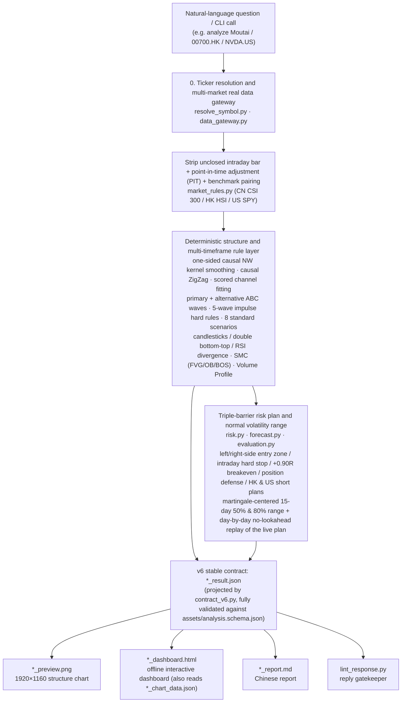

# kline-structure-chart

**Deterministic K-line (candlestick) structure and risk-plan research skill for AI agents such as Claude Code and Codex, covering A-shares, Hong Kong and US stocks**

[中文](README.md) | **English**

[](https://github.com/xiongcp/stock-skill/actions/workflows/ci.yml)  

`kline-structure-chart` is a quantitative K-line structure analysis skill that follows the [Agent Skills open specification](https://agentskills.io/specification). Install it into Claude Code, Codex, Hermes Agent, Cursor, Gemini CLI, OpenCode or a similar AI agent, then just ask in plain language (for example: "Look at Kweichow Moutai's K-line structure, support and resistance; my account is 500,000 CNY; include a backtest"). The agent runs the full research loop on its own: **fetch real market data → deterministic structure detection → triple-barrier risk plan and normal volatility range → offline interactive dashboard and high-resolution chart → reply-contract check**.

> Generated reports, chart labels and the reply contract are in Chinese. Ticker formats, CLI flags and JSON field names are the same in both languages.


<sub>Kweichow Moutai `600519.SH` structure chart (A-share colors: red up, green down; broadening formation, three rule-based scenario paths and the 15-day normal volatility range), generated by the scripts from real market data as of 2026-10-15. The red box at the top right is a risk veto: when the market regime score is below 35, the stock gets no long rating.</sub>

---

## At a glance

### What it does

- **Three markets**: A-shares (Shanghai, Shenzhen and Beijing stocks, ETFs and indices), Hong Kong and US. Each analysis is paired with its market benchmark (CSI 300 / Hang Seng Index / SPY): market first, then the stock.
- **K-line structure detection**: causal swing points, channel fitting, primary + alternative ABC wave counts and 5-wave impulses, 8 standard scenarios, candlestick / double-bottom-and-top / RSI divergence, SMC (FVG / order blocks / BOS) and a volume profile.
- **Triple-barrier risk plan**: entry zone, stop, TP1/TP2, move-to-breakeven and position defense; with an account size it computes the share count from the per-trade risk fraction. A very weak market vetoes any long setup.
- **15-day normal volatility range**: 50% / 80% bands centered on the latest close. They describe the size of moves, not their direction, and come with out-of-sample coverage and the number of independent samples.
- **No-lookahead backtest**: on every historical decision day the live pipeline is rerun with only the data available up to that day. The fill win rate comes with a Wilson 95% interval and the sample size.
- **One computation, several outputs**: `*_result.json` (stable contract), a 1920×1160 PNG structure chart, an offline interactive HTML dashboard and a Chinese Markdown report all come from the same computation. `lint_response.py` blocks invented prices and probability claims in the agent's reply.

### Why it helps

- **No guessing prices from screenshots**: every level is computed in Python from real OHLCV data; the agent only relays numbers from the JSON.
- **Reproducible and auditable**: the same data and cut-off date give the same result; `--days` only changes how many bars are displayed, never any conclusion; offline tests replay recorded real market data.
- **No overclaiming**: no "probability of going up", and the rule score is never called a win rate. If real data cannot be fetched, the scripts exit with `[DATA_UNAVAILABLE]` instead of estimating or filling gaps.
- **Driven by one sentence**: ask in plain language and the agent resolves the ticker, runs the scripts and structures the answer according to the reply contract.

### 30-second start

One-line install on macOS / Linux (registers the skill with the Claude Code, Codex and other agents it finds):

```bash
curl -fsSL https://raw.githubusercontent.com/xiongcp/stock-skill/main/install.sh | bash
```

Then **start a new session** and ask "Analyze 600519.SH" or "Show me the K-line structure of Tencent 00700.HK, with a backtest". Windows, the Claude Code plugin marketplace, `npx skills`, letting your AI agent install it and installing without uv are covered in [section 3](#3-installation); command-line usage is in [section 5](#5-command-line-usage).

> For research and learning only. Not investment advice, and the skill never places orders for you.

---

## 0. What problem does it solve? (Why not let an LLM read the chart directly)

Asking a multimodal model to read a chart, or chatting with an LLM about a stock, runs into four serious problems:

1. **Visual hallucination and invented prices**: a vision-language model (VLM) reading a K-line screenshot easily misreads the axes, invents prices that do not exist or draws the wrong trend lines.
2. **Lookahead bias and hindsight**: classic ZigZag swing points, double bottoms/tops and ABC waves are often redrawn after the fact using future bars. The backtest looks perfect and cannot be reproduced live.
3. **Subjective scores dressed up as "probability of going up"**: many tools present a simple weighted sum of a few indicators as "75% chance of rising", with no historical samples behind it and no out-of-sample calibration.
4. **Ignoring the market regime and trading rules**: recommending breakout chasing while the broad market is crashing, or ignoring real constraints such as A-share T+1, the ±20% price limit of STAR/ChiNext boards and their ETFs, Hong Kong's dynamic tick table and two-sided stamp duty, or US pre/post-market sessions and VIX-driven volatility.

`kline-structure-chart` answers with **six hard invariants** and a **two-layer architecture: deterministic structure + risk plan**:



### Architecture and the six hard invariants

1. **Data authenticity comes first**: only real data from Sina, Yahoo and Tencent (live or recorded) or real local files supplied by the user. If data cannot be fetched, the CLI exits non-zero with `[DATA_UNAVAILABLE]` (exit code 3). **Fallbacks, estimates, gap filling and synthetic bars are forbidden.** Today's unclosed bar (judged by exchange time zone and half-day / early-close rules) is split off and never mixed into the closed series.
2. **100% compute-render separation**: moving averages, indicators, swing points, channels, ABC waves, SMC, volume profile, triple-barrier levels and the 15-day normal volatility range are all computed once in Python from the OHLCV series and written to JSON. The PNG and HTML renderers only read that result. **No vision model reads charts to guess numbers, and no image-generation model draws K-lines.**
3. **Market first, then the stock**: before analyzing any stock or ETF, the matching benchmark is loaded (A-shares `000300.SH`, Hong Kong `HSI.HK`, US `SPY.US`) to compute a market regime score and 20-day relative strength (RS line). If the market is very weak (regime score `< 35`) or the benchmark is missing, the independent risk officer vetoes (`verdict.risk_veto = true`).
4. **Strictly causal, zero lookahead leakage**: kernel smoothing uses one-sided causal Nadaraya-Watson; every swing point records both the extreme day `day` and the confirmation day `confirmed_at_day`; point-in-time adjustment only uses dividends and splits already effective at that date; backtests and historical replay snapshots recompute the market regime and adjustment as of each cut-off, and a causal replay audit that injects 5× extreme future price shocks verifies zero leakage.
5. **Cross-window invariance**: `--days N` (60–500) only changes how many bars the main chart shows. Data fetching is fixed at 760 bars, indicators warm up on a fixed 420-bar history and structure is detected on a fixed 120-bar window, so changing the display window never changes any indicator value, structure classification or trade level.
6. **Probability and terminology boundary**: the rule score (`rule_score`) is a deterministic weighted score of conditions and is never called a "win rate" or "probability of going up". **No probability, win-rate or frequency numbers are output**, with one exception: the backtest fill win rate (with Wilson 95% interval and sample size), which is a statistic of fills that already happened, not a probability of future gains.

> This skill only does rule-based technical analysis and quantitative research validation. It is not investment advice and never places orders for you.

---

## 1. What it can analyze (three markets, with real examples)

| Market | Ticker format | Examples | Data source | Default benchmark |
| --- | --- | --- | --- | --- |
| A-shares | 6 digits + `.SH` / `.SZ` / `.BJ` | `600519.SH`, `000002.SZ`, `830799.BJ`, `510300.SH` (ETF), `000001.SH` (SSE Composite) | Sina daily (unadjusted) + Yahoo dividend/split events | CSI 300 `000300.SH` |
| Hong Kong | 5 digits + `.HK` | `00700.HK`, `01810.HK`, `02800.HK` (ETF), `HSI.HK`, `HSTECH.HK` | Yahoo daily; Hang Seng TECH index uses Tencent index daily | Hang Seng Index `HSI.HK` |
| US | ticker + `.US` | `NVDA.US`, `SPY.US`, `QQQ.US`, `BRK.B.US` | Yahoo daily + `^VIX` | `SPY.US` |

Security names, A-share ST/\*ST risk flags and Hong Kong board lots are fetched automatically from Tencent quote snapshots. Common STAR/ChiNext ETFs with 20% limits, A-share cross-border / bond / gold / money-market T+0 ETFs and HKEX stamp-duty-exempt ETF/ETP code ranges are recognized automatically.

### Structure charts generated from real data in three markets

All three `1920×1160` structure charts are generated automatically by the skill's scripts from real market data (as of 2026-10-15; full reports, JSON and offline dashboards are in [examples/](examples/README.md)):

#### (1) A-share: Kweichow Moutai (`600519.SH` · red up / green down · broadening formation + three scenarios + 15-day normal volatility range)

See the chart at the top of this page.

#### (2) Hong Kong: Tencent (`00700.HK` · red up / green down · breakdown and C-wave reversal scenarios)


#### (3) US: NVIDIA (`NVDA.US` · green up / red down · oversold bounce and breakdown scenarios)


---

## 2. Requirements

- macOS, Linux or Windows (the Windows installer has not been tested yet, see section 10).
- `git`, plus **Python ≥ 3.12 and Pillow** (Pillow is only used to draw the PNG; all indicator, pattern, risk and backtest computation uses the Python standard library).
- [uv](https://docs.astral.sh/uv/): **recommended but optional**. The one-line installer relies on it; without uv, use venv + pip as described in 3.4 "Manual install without uv".
- Network: installation needs GitHub and PyPI; every analysis needs the Sina, Yahoo and Tencent market-data endpoints. Sandboxes without network access cannot use the skill (they get `[DATA_UNAVAILABLE]`).
- CJK fonts (for the PNG): built into macOS and Windows; Linux needs WenQuanYi or Noto CJK. The installer prints the install command for your distribution when fonts are missing (it never runs sudo).

### Why uv is recommended (but optional)

The skill itself is just a description (`SKILL.md`) plus a set of Python scripts that the agent runs following `SKILL.md`, so the machine needs a Python with Pillow that can run them. uv makes that work the first time on any machine:

- **Gets the right Python automatically**: the scripts need Python ≥ 3.12, while macOS ships 3.9 and many Linux distributions ship 3.10/3.11. uv downloads Python 3.12 into your user directory without sudo and without touching the system Python.
- **Locked versions, reproducible output**: `uv sync --frozen` installs exactly what `uv.lock` specifies, so every machine gets the same Pillow and renders the same PNG.
- **Keeps the system clean**: dependencies go into the skill directory's `.venv`; `pip install` into the system Python is refused by PEP 668 (externally-managed-environment) on recent macOS (Homebrew) and Debian/Ubuntu.

"The agent will install things itself when it hits an error" is usually true but not reliable: the agent may install into the system Python (refused or polluting it), use a Python that is too old, or keep failing in a sandbox that forbids network access or writes to system directories; lighter models get stuck especially often. So `SKILL.md` spells out a fixed fallback: **with uv use `uv run python`; without uv create `.venv` in the skill directory, `pip install -r requirements.txt`, then use `.venv/bin/python`**. `scripts/doctor.py` no longer treats "uv not installed" as a failure.

---

## 3. Installation

### 3.0 Let your AI agent install it in the chat (easiest)

If you prefer not to type commands, send this message to the AI agent you use (Claude Code, Codex, Gemini CLI, Cursor, OpenCode, Hermes Agent or any agent that can run commands):

```text
Follow the steps in https://raw.githubusercontent.com/xiongcp/stock-skill/main/INSTALL_FOR_AGENTS.md to install the kline-structure-chart skill into your own skills directory. Ask me before installing uv or any other software, and tell me the doctor self-check result when done.
```

The agent reads [INSTALL_FOR_AGENTS.md](INSTALL_FOR_AGENTS.md): it works out which skills directory it uses → checks git / Python / uv → runs the one-line installer if uv is available, or falls back to venv + pip if there is no uv and you decline to install it → runs `doctor` → reports the result and next steps. The guide sets safety boundaries: no sudo, never overwrite existing directories, ask before installing any software, never ask for account credentials.

If the agent cannot open URLs, paste the full text of [INSTALL_FOR_AGENTS.md](INSTALL_FOR_AGENTS.md) into the chat. After installation, **start a new session** so the skill is loaded.

### 3.1 One-line install

macOS / Linux:

```bash
curl -fsSL https://raw.githubusercontent.com/xiongcp/stock-skill/main/install.sh | bash
```

Windows (PowerShell):

```powershell
irm https://raw.githubusercontent.com/xiongcp/stock-skill/main/install.ps1 | iex
```

The script does the following:

1. Checks for `git` and `uv`. If uv is missing it asks whether to install it with the official installer (`--install-uv` installs without asking). Without uv (you answer N, or a non-interactive run without `--install-uv`) it uses a local Python 3.12+, looking for `python3.13`, `python3.12`, `python3` in turn (Windows: `py -3.13`, `py -3.12`, `python`), and only exits — suggesting Python 3.12+ or `--install-uv` — if all are older than 3.12.
2. Clones the code into `~/.local/share/stock-skill`; if it already exists it runs `git pull --ff-only`, so **running the same command again is an update**.
3. Runs `uv sync --frozen --python 3.12` to install dependencies from `uv.lock`; without uv it runs `python -m venv .venv` in the skill directory and `.venv/bin/pip install -r requirements.txt` (same versions as `uv.lock`).
4. Checks CJK fonts on Linux.
5. Detects installed `claude`, `codex`, `gemini`, `cursor-agent` and `opencode`, and **symlinks** the skill directory into the matching skills directories (table below). If a regular directory with the same name already exists there, it is first backed up as `*.bak.<timestamp>`.
6. Runs a quick offline self-check (docs contract and tool tests; skipped without uv because pytest is not in `requirements.txt`) and the environment check `doctor` (run with `.venv/bin/python` without uv), then prints next steps.

| Agent | Detected command | Global skills directory | Directory with `--project` |
| --- | --- | --- | --- |
| Claude Code | `claude` | `~/.claude/skills/` | `<project>/.claude/skills/` |
| Codex (and other tools reading `~/.agents/skills`) | `codex` | `~/.agents/skills/` | `<project>/.agents/skills/` |
| Hermes Agent | `hermes` | `~/.hermes/skills/` | `<project>/.hermes/skills/` |
| Gemini CLI | `gemini` | `~/.gemini/skills/` | `<project>/.agents/skills/` |
| Cursor | `cursor-agent` | `~/.cursor/skills/` | `<project>/.agents/skills/` |
| OpenCode | `opencode` | `~/.config/opencode/skills/` | `<project>/.agents/skills/` |

The directory layout follows [vercel-labs/skills](https://github.com/vercel-labs/skills). If no agent is detected, the skill is registered with Claude Code and `~/.agents/skills/` by default.

After installation, **start a new session** and try "Analyze 600519.SH" or "Show me Moutai's K-line".

### 3.2 Installer options

When piping the script, pass options with `bash -s --`, for example:

```bash
curl -fsSL https://raw.githubusercontent.com/xiongcp/stock-skill/main/install.sh | bash -s -- --agents claude,codex --dry-run
```

| Option (`install.sh`) | Windows (`install.ps1`) | Description |
| --- | --- | --- |
| `--dir <dir>` | `-Dir` | Code directory, default `~/.local/share/stock-skill` (or the `STOCK_SKILL_DIR` environment variable) |
| `--agents claude,codex` | `-Agents claude,codex` | Register only with the listed agents; `all` means all five |
| `--project <dir>` | `-Project` | Register only with one project (project-level skills directory), leaving global directories alone |
| `--copy` | `-Copy` | Copy instead of symlink (rerun the script after updating the code) |
| `--install-uv` | `-InstallUv` | Install uv without asking if missing; without it and without uv, a `.venv` is built with a local Python 3.12+ (see 3.1 step 1) |
| `--no-test` | `-NoTest` | Skip the post-install self-check |
| `--dry-run` | `-DryRun` | Print what would be done without changing anything |
| `--source <url or path>` | `-Source` | Install from another Git URL or a local checkout (for development) |
| `--update` | `-Update` | Update; same as rerunning the install |
| `--uninstall` | `-Uninstall` | Uninstall |

### 3.3 Update and uninstall

Update: rerun the install command from 3.1 (symlinked installs pick up `git pull` automatically; `--copy` installs are copied again).

Uninstall:

```bash
bash ~/.local/share/stock-skill/install.sh --uninstall
```

Uninstall removes only the symlinks **this script created**, copied directories carrying its install marker, and the code directory. Other skills, your own directories at the same location (reported as "skipped") and the `*.bak.*` backups made during installation are never deleted. If you installed with `--dir` or `--project`, pass the same options when uninstalling.

### 3.4 Other installation methods

**Claude Code plugin marketplace**: in Claude Code run

```text
/plugin marketplace add xiongcp/stock-skill
/plugin install kline-structure-chart@stock-skill
```

The marketplace manifest is [.claude-plugin/marketplace.json](.claude-plugin/marketplace.json) and points directly at the `kline-structure-chart/` directory. The plugin route does not run `uv sync`; `uv run` installs dependencies on the first analysis.

**npx skills (vercel-labs/skills)**: detects installed agents automatically.

```bash
npx skills add xiongcp/stock-skill
```

Common flags: `-g` installs into the user directory, `-a claude-code` picks the agent, `--copy` copies instead of symlinking.

**Manual install**:

```bash
git clone https://github.com/xiongcp/stock-skill.git ~/.local/share/stock-skill
```

```bash
cd ~/.local/share/stock-skill && uv sync --frozen --python 3.12 --directory kline-structure-chart
```

```bash
mkdir -p ~/.claude/skills && ln -sfn ~/.local/share/stock-skill/kline-structure-chart ~/.claude/skills/kline-structure-chart
```

For other agents, replace `~/.claude/skills` in the last step with the directory from the table in 3.1.

**Manual install without uv**: needs Python ≥ 3.12 (check with `python3 --version`; replace `python3.12` below with the name of a 3.12+ interpreter on your machine). Clone and symlink as above, replacing the second step with:

```bash
cd ~/.local/share/stock-skill/kline-structure-chart && python3.12 -m venv .venv && .venv/bin/pip install -r requirements.txt
```

`requirements.txt` contains only Pillow, pinned to the same version as `uv.lock` (checked by tests). From then on replace every `uv run python` in `SKILL.md` and this document with `.venv/bin/python` (Windows: `.venv\Scripts\python`); agents do this automatically following the "运行环境" (runtime environment) section of `SKILL.md`.

### 3.5 Verify the installation

Run these commands in the code directory (default `~/.local/share/stock-skill`). First the environment check, which shows ✅/❌ per item with fix suggestions (offline, the data-source items show ❌ and the rest pass):

```bash
uv run --directory kline-structure-chart python scripts/doctor.py
```

Then the offline tests (no network; all replay recorded real market data):

```bash
uv run --directory kline-structure-chart pytest -q
```

Finally a real analysis over the network:

```bash
uv run --directory kline-structure-chart python scripts/analyze_and_forecast.py --market CN --symbol 600519.SH --output-dir artifacts/smoke
```

On failure the script exits non-zero: `[DATA_UNAVAILABLE]` means real data could not be fetched, `[INVALID_ARGUMENT]` means the ticker or an argument is wrong, `[INSUFFICIENT_HISTORY]` (exit code 4) means there are not enough closed bars (see section 8). On success the exit code is 0 and `kline-structure-chart/artifacts/smoke/` contains five files: `600519.SH_report.md`, `600519.SH_result.json`, `600519.SH_chart_data.json`, `600519.SH_preview.png` and `600519.SH_dashboard.html`.

---

## 4. Using it in an AI agent

Just ask in plain language; names, pinyin and tickers all work:

- "Analyze Moutai's K-line structure and support/resistance."
- "Roughly how wide is the normal volatility range of Tencent 00700.HK over the next two weeks? Include a historical backtest."
- "What is the risk plan for NVDA right now? My account is 100,000 USD and I risk at most 1% per trade."
- "Show me the current structure of the SSE Composite and the ChiNext index."

The agent follows the skill's rules:

1. If only a name is given, it first looks up the ticker with `scripts/resolve_symbol.py` via Tencent securities search. If several securities match (for example "腾讯" / Tencent), it asks you to choose instead of guessing from memory.
2. It picks arguments by question type (share counts only when you give an account size, `--backtest` only when you ask for a backtest) and runs the script.
3. It checks data quality first: `UNAVAILABLE` gives no price levels at all; `PARTIAL` puts the warning at the top of the answer.
4. It builds the answer on the generated `*_report.md`, in this order: market → structure and conditional scenarios → risk plan → future normal volatility range → backtest → file paths → disclaimer. Numbers from the report must not be changed.
5. If the risk officer vetoes a long setup, the veto reason comes first. It never gives numbers like "probability of going up".

Complete examples (reports, charts and a reference reply generated from real data) are in [examples/](examples/README.md).

Tips:

- Say "with backtest" to get a backtest.
- To get a suggested share count, give your account size and per-trade risk fraction.
- Fundamentals, news and earnings are out of scope.

---

## 5. Command-line usage

Run all commands from the repository root.

```bash
uv run --directory kline-structure-chart python scripts/analyze_and_forecast.py --market HK --symbol 01810.HK --account-equity 300000 --output-dir artifacts/hk --backtest
```

The command prints a JSON summary to the terminal and writes artifacts to `kline-structure-chart/<--output-dir>/`.

### 5.1 Arguments

| Argument | Description |
| --- | --- |
| `--symbol` (required) | Ticker, format as in section 1 |
| `--output-dir` (required) | Artifact directory, relative to `kline-structure-chart/` |
| `--market` | `CN` / `HK` / `US`; can be omitted when the ticker has a suffix |
| `--asset-type` | `index` / `equity` / `etf`. Inferred from the code range by default: A-share codes starting with 51/56/58 (Shanghai) and 15 (Shenzhen), and HKEX ETF/ETP ranges (02800–02849, 03000–03199, etc.) are treated as ETFs |
| `--days` | How many bars the main chart shows, 60–500, default 120. Display only; no effect on any computed result |
| `--horizon-bars` | Range horizon in trading days, 1–60, default 15 |
| `--as-of` | Use only data up to a date (`YYYY-MM-DD`), for reviewing history |
| `--adjustment` | `raw` / `split` / `total_return`. By default stocks and ETFs use forward adjustment (dividends and splits), indices are unadjusted |
| `--account-equity`, `--max-risk-pct` | Account size and per-trade risk **fraction** (default 0.01, i.e. 1%; range 0–0.05; passing `1` is rejected with `[INVALID_ARGUMENT]`). Without an account size no share count is computed; the share count uses the distance from the top of the entry zone to the stop (including trading costs), and none is given when there is a risk veto or the rating is not long |
| `--name`, `--st` | Set the security name manually or flag it as ST manually. Normally fetched automatically |
| `--ipo-no-limit` | Flag a new listing in its first 5 trading days with no price limit |
| `--color-scheme` | `auto` / `cn_red_up` / `us_green_up`. By default A-shares and Hong Kong use red up / green down, US uses green up / red down |
| `--benchmark` | Replace the default benchmark |
| `--backtest`, `--backtest-step` | Produce a historical plan-replay backtest; set `--backtest-step` above 1 to speed it up |
| `--input`, `--offline` | Use a local real-data file and stay offline (see 5.2) |

### 5.2 Using a local data file

The local file is a JSON array where each element is one daily bar:

```json
[{"day": "2026-10-14", "open": 1270.1, "high": 1286.75, "low": 1266.0, "close": 1286.0, "volume": 2377273}]
```

```bash
uv run --directory kline-structure-chart python scripts/analyze_and_forecast.py --market CN --symbol 600519.SH --name 贵州茅台 --input /path/to/bars.json --offline --output-dir artifacts/local
```

Requirements and behavior:

- At least 130 bars are required.
- A local file has no benchmark data, so data quality is `PARTIAL` and the risk officer vetoes long confirmation.
- A local file has no dividend/split events either, so prices are used as given.

### 5.3 Ticker lookup and environment check

If you only know the name or pinyin, look up the ticker first (data source: Tencent securities search):

```bash
uv run --directory kline-structure-chart python scripts/resolve_symbol.py 茅台
```

- A unique match returns `status` `RESOLVED` with a ready-to-run analysis command; several matches (such as "腾讯" or "000001") return `AMBIGUOUS` with candidates; no match exits with `[INVALID_ARGUMENT]`.
- Narrow the search with `--market HK` or `--asset-type index`. Beijing Stock Exchange stocks cannot be found this way yet; use the `.BJ` ticker directly.

If something is wrong with the environment, run `scripts/doctor.py` (see 3.5); `--offline` skips the data-source connectivity checks.

---

## 6. Output files

| File | Content |
| --- | --- |
| `*_report.md` | Chinese analysis report, in order: data notes, risk veto, conclusion, market, structure and conditional scenarios, risk plan, pattern evidence, future normal volatility range, backtest, file paths, disclaimer. Every number comes from `*_result.json` |
| `*_result.json` | v6 stable contract (fully validated against `assets/analysis.schema.json`) |
| `*_chart_data.json` | Bar series, replay snapshots and other rendering data; not a stable interface |
| `*_preview.png` | 1920×1160 structure chart; carries a red warning banner and watermark when data has problems |
| `*_dashboard.html` | Offline interactive dashboard: 8 layer toggles, hover values, relative-strength view, history replay slider, PNG export |
| `*_backtest.json` | Historical plan-replay backtest and no-lookahead audit (with `--backtest`) |

The CLI's standard output is a JSON envelope; on failure the exit code tells the error type:

| Exit code | Standard output | Meaning |
| --- | --- | --- |
| 0 | `{"status": "ok", "schema_version", "verdict", "quality", "files"}` | Success; `files` are artifact names relative to `--output-dir` |
| 1 | `{"status": "error", "error": {"code": "INTERNAL_ERROR", "message"}}` (contract self-check failed, no artifacts written); other unexpected exceptions have no envelope and print a Python traceback to stderr | Internal skill error, not an argument or data problem: tell the user the skill failed; do not retry with different arguments |
| 2 | `{"status": "error", "error": {"code": "INVALID_ARGUMENT", "message"}}` | Wrong ticker or argument (argparse's own argument errors also exit 2, without JSON) |
| 3 | Same, `code = DATA_UNAVAILABLE` | Real market data could not be fetched |
| 4 | Same, `code = INSUFFICIENT_HISTORY` | Not enough closed bars: listed too recently, `--as-of` too early, or the data source returned only part of the history this time (retry later) |

stderr also prints `[CODE] message`.

The meaning, unit, nullability and stability level of every field are in [references/output-fields.md](kline-structure-chart/references/output-fields.md) (within 6.x fields are only added, never removed, renamed or changed in meaning). Complete artifact examples are in [examples/](examples/README.md).

---

## 7. How to read the results

### 7.1 Two output layers (structure → risk plan)

| Layer | Main outputs | Statistics and wording rules |
| --- | --- | --- |
| **Deterministic structure layer** | Channel-fitted patterns, primary + alternative ABC waves, 5-wave impulses, 8 standard scenarios (2–5 active ones selected), candlesticks / double bottom-top / RSI divergence, SMC (FVG / order blocks / BOS), 24-bucket volume profile (POC/VAH/VAL), multi-timeframe rule score (0–100) | The rule score is a deterministic weighted score of conditions (adjusted by reversal rules in mean-reverting regimes) and **must never be called a win rate or probability of going up**; the volume profile approximates traded volume from OHLCV and is not actual holdings; scenarios only state "trigger → target → invalidation", with no probabilities |
| **Risk plan and normal volatility range layer** | Entry zone, stop, TP1/TP2, move-to-breakeven, position size, position defense, HK/US short plans, and the 15-day normal volatility range (50%, 80%) centered on the latest close | The range only describes the size of moves, with no direction; out-of-sample coverage and the number of independent samples must be stated with it; under a risk veto the entry zone is called a "watch zone" |

### 7.2 The 8 standard scenarios (see [references/scenario-playbook.md](kline-structure-chart/references/scenario-playbook.md))

Each analysis selects 2–5 applicable scenarios from these 8 based on the current channel position, volume, RSI and swing structure (a scenario whose trigger is less than `0.5×ATR` from the latest close is marked **"already in progress"**):

1. `TREND_CONTINUATION`: advancing along a rising channel or in wave 3/5 of an impulse;
2. `BREAKOUT_RETEST`: breaking above the upper channel / neckline / prior high on volume, then retesting it;
3. `FALSE_BREAKOUT_REVERSAL`: spiking through the upper channel or prior high and falling back inside on weak volume;
4. `RANGE_OSCILLATION`: inside the channel and more than `1.0×ATR` from both boundaries;
5. `BREAKDOWN_DECLINE`: closing below the lower channel, neckline or prior-low support;
6. `C_WAVE_REVERSAL`: in an ABC correction with `C/A` close to `1.0` and a divergence or stabilization;
7. `OVERSOLD_BOUNCE`: `RSI14 < 30` or the close more than `2.0×ATR` from `MA20`;
8. `APEX_BREAKOUT`: within `0–10` bars of the apex of a converging triangle/wedge that has not expired.

### 7.3 Reply check command

```bash
# Run the contract gatekeeper on the agent's final natural-language reply (blocks invented prices, banned probability wording, missing veto/disclaimer)
uv run --directory kline-structure-chart python scripts/lint_response.py --result examples/600519.SH/600519.SH_result.json --response examples/600519.SH/reply.md
```

### 7.4 Key points for reading the report and chart

- **Check data quality first** (`quality.status`):
  - `OK`: interpret normally.
  - `PARTIAL`: there are warnings, for example a missing benchmark; read them first.
  - `UNAVAILABLE`: the result cannot be used.
  - When run intraday, today's unclosed bar is excluded and the report says so.
  - Shortly after the close, the data source may not have today's bar yet (observed: at 15:19 Beijing time Sina still only had the previous session). The report notes "data only up to a date"; rerun later. The script never fills in from other sources.
- **The risk veto takes precedence**: when you see "风控否决" (risk veto), all levels are for observation only and are not a long recommendation.
- **The rule score (0–100) is not a win rate**: it is a weighted score of several technical conditions, not a probability of going up.
- **The future normal volatility range describes the size of moves, not direction**:
  - The center (q50) is the latest close.
  - The widths of the 50% and 80% ranges come from horizon-by-horizon calibration on historical volatility.
  - The report also gives historical out-of-sample coverage and the approximate number of independent samples. With few independent samples, the coverage itself is unstable.
  - The status is "已达标" (calibrated) only with roughly 20+ independent samples and coverage close to nominal; otherwise it is "校准观察期" (calibration watch period). The audit covers all fetched history; the default 15-day range has about 24–42 independent samples (depending on history length), and whether it passes depends on whether coverage is close to nominal.
- **Check the backtest sample size**: with fewer than 30 fills, win-rate and return statistics carry little weight, and the report says so explicitly. The bracket after the win rate is the Wilson 95% interval; fewer samples mean a wider interval (for example 0%–56% for 3 fills that all lost).
- Interpretation notes and common misreadings for patterns, waves and market regimes are in [references/interpretation-guide.md](kline-structure-chart/references/interpretation-guide.md).

---

## 8. Troubleshooting

| Symptom | Cause and fix |
| --- | --- |
| `[DATA_UNAVAILABLE] ... 网络已禁用(--offline)` | Network disabled: drop `--offline`, or use it together with a local `--input` file |
| `[DATA_UNAVAILABLE] ... HTTPError 429` / `timed out` | Rate-limited by the data source or no network; retry later |
| `[DATA_UNAVAILABLE] ... Cannot derive ... symbol` | Wrong ticker format; add the suffix as in section 1 |
| `[INVALID_ARGUMENT] Cannot resolve market` | The ticker has no suffix; add `.SH` / `.SZ` / `.HK` / `.US` or pass `--market` |
| `[INVALID_ARGUMENT] Ambiguous symbol '000001'` | Say whether you mean `000001.SH` (SSE Composite) or `000001.SZ` (Ping An Bank) |
| `[INVALID_ARGUMENT] --days must be between 60 and 500` | `--days` is out of range; same for `--horizon-bars` (1–60) |
| `[INSUFFICIENT_HISTORY] ...` (exit code 4) | Not enough closed bars: listed too recently, `--as-of` too early, or the data source returned only part of the history this time (retry later) |
| `no CJK font found` | No CJK font; run `scripts/doctor.py` to see the install command for your distribution |
| `uv: command not found` | Install uv: <https://docs.astral.sh/uv/>, or rerun the installer with `--install-uv`; to avoid uv, build `.venv` as in 3.4 "Manual install without uv" and replace `uv run python` with `.venv/bin/python` |
| `kline-structure-chart` not visible in a new session | Run `scripts/doctor.py` to check the skill symlink; make sure it is registered in the directory of the agent you use (table in 3.1), then start a new session |
| Installer says the directory "已存在且不是 Git 仓库" (exists and is not a Git repository) | The `--dir` directory already contains other files; pick another directory or clean it up first |
| `resolve_symbol.py` exits with `[DATA_UNAVAILABLE]` | Tencent securities search is unavailable; give the full ticker with suffix |
| Report says "数据只到某日：最近已收盘的交易日……尚未提供" (data only up to a date) | The data source is slow to publish after the close, or the stock is suspended; rerun later |
| Report says "港股每手股数未能获取" (HK board lot unavailable) | The Tencent snapshot is temporarily unavailable; the share count assumes 100 shares per lot, so check with your broker before ordering |

---

## 9. FAQ

**Q: Can it tell me the probability of going up?**
No. The rule score (0–100) is a weighted score of technical conditions, not a probability; the future normal volatility range only describes the size of moves, not direction. The skill **outputs no probability, win-rate or frequency numbers**, with one exception: the backtest fill win rate (with Wilson 95% interval and sample size), which is a statistic of fills these rules already produced on that security, not a probability of future gains.

**Q: Where does the data come from? Could it be fake?**
Public market-data endpoints of Sina, Yahoo and Tencent. If data cannot be fetched the script exits with `[DATA_UNAVAILABLE]`; it never estimates or generates data. Offline tests use recorded real market data.

**Q: Does it send my data or questions to third parties?**
The scripts only request public market data for the ticker from the data endpoints; nothing personal, such as account size, is uploaded.

**Q: How do I update? Will it overwrite my changes?**
Rerun the install command; the code directory is updated with `git pull --ff-only`. If local edits in the code directory prevent a fast-forward, the script stops with an error instead of overwriting.

**Q: Can I install it for one project only?**
Yes, add `--project <project dir>`; the skill is registered in that project's `.claude/skills` or `.agents/skills`.

**Q: Can it analyze Beijing Stock Exchange stocks and Hong Kong ETFs?**
Yes. Beijing stocks need the `.BJ` ticker directly (name search cannot find them); common HKEX ETF/ETP code ranges (such as `02800.HK`, `03033.HK`) are recognized as `etf` automatically and exempt from stamp duty.

**Q: Can it short?**
The skill does not trade for you. Hong Kong and US stocks can be sold short with strict restrictions; A-share securities lending is more restricted. The rules are in the three market handbooks under `references/`.

---

## 10. Known limitations

- The data endpoints are public web endpoints of Sina, Yahoo and Tencent, not official paid data. They may rate-limit or change format; the scripts then report `[DATA_UNAVAILABLE]` rather than returning wrong data.
- Trading calendars: A-shares are covered through 2026-12-31 (the 2027 holiday schedule has not been published), Hong Kong and US through 2027-12-31. Future dates beyond coverage are estimated as weekdays, and the report says so.
- Beijing Stock Exchange stocks have no dividend/split event data; prices are unadjusted and the report notes it.
- ST status is identified from the current name; backtests and historical range audits apply it to all historical dates.
- There is no source for earnings dates yet, so earnings windows do not widen the range.
- Windows: `install.ps1` and the overall flow have not been tested on Windows yet. Creating symlinks needs Developer Mode or administrator rights; the script falls back to copying when that fails. The Microsoft YaHei font path has been added.
- Ticker lookup depends on Tencent securities search, which cannot find Beijing Stock Exchange stocks.

---

## 11. For developers

- Engineering rules, invariants and gate commands are in [AGENTS.md](AGENTS.md) (Chinese); the review log is in [SKILL_REVIEW_CHECKLIST.md](SKILL_REVIEW_CHECKLIST.md).
- After changing code, both gates must pass:

```bash
uv run --directory kline-structure-chart pytest -v
```

```bash
uv run --directory kline-structure-chart python tests/check_days_invariance.py --data tests/fixtures/recorded/sina_daily --step 40
```

- On push and PR, [CI](.github/workflows/ci.yml) runs both gates on Ubuntu (recorded data only, no network).
- Version history is in [CHANGELOG.md](CHANGELOG.md).
- When rehearsing the installer from a local checkout, always use a temporary HOME so your own skills directories are not touched:

```bash
HOME="$(mktemp -d)" bash install.sh --source "$(pwd)" --agents claude,codex
```

- To refresh test data, re-record over the network. Options such as `--only quotes` or `--only search` record only one category:

```bash
uv run --directory kline-structure-chart python tests/record_fixtures.py
```

---

## Disclaimer

Everything this skill outputs is rule-based technical analysis of historical market data, for research and learning only. It is not investment advice. Markets carry risk; make your own decisions.
