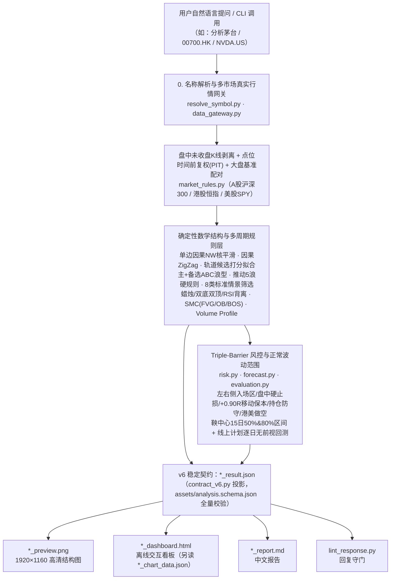

# kline-structure-chart：A股 / 港股 / 美股 K 线数学结构、三重屏障风控与正常波动范围技能包

`kline-structure-chart` 是一个符合 [Agent Skills 开放规范](https://agentskills.io/specification) 的金融量化与 K 线数学结构分析技能包。装进 Claude Code、Codex、Hermes Agent、Cursor、Gemini CLI、OpenCode 等 AI 助手之后，你只需用自然语言提问（例如："帮我看看贵州茅台的 K 线结构和支撑压力，账户 50 万，带回测"），助手就会自动完成从**真实行情拉取 → 确定性数学结构识别 → 三重屏障风控与正常波动范围 → 离线交互看板与高清图生成 → 回复契约校验**的完整投研闭环。

---

## 0. 我们究竟解决什么问题？（为什么不能让大模型直接看图猜 K 线）

在传统的大模型看图或直接对话问股中，普遍存在四大致命痛点：

1. **视觉幻觉与价格编造**：让多模态模型（VLM）直接看 K 线截图识别形态或支撑阻力位，极易读错坐标轴、编造不存在的价格或画错趋势线。
2. **前视偏差（Lookahead Bias）与事后诸葛亮**：传统 ZigZag 拐点、双底/双顶、ABC 浪型往往在事后用未来 K 线重绘历史极值，回测看似完美，实盘完全无法复现。
3. **把主观打分伪装成"上涨概率"**：许多工具将几个指标的简单加权分直接宣称为"上涨概率 75%"，既无历史样本支撑，也未经样本外校准检验。
4. **忽视大盘环境与微观交易制度**：在大盘空头崩跌时仍激进推荐个股突破追高；或忽略 A 股 T+1、科创/创业板及双创 ETF ±20% 涨跌幅、港股动态价位表与双边印花税、美股盘前盘后与 VIX 波动放大等真实交易约束。

为此，`kline-structure-chart` 建立了**六大工程铁律（Hard Invariants）**与**确定性结构 + 风控两层架构**：



### 核心架构与六大不可变铁律

1. **数据真实性（Data Authenticity）优先于一切**：只使用新浪、Yahoo、腾讯实时/录制真实行情或用户提供的本地真实行情文件。取不到行情时立即以 `[DATA_UNAVAILABLE]` 非零退出（退出码 3），**严禁回退、估算、补数或生成任何合成行情**。当日未收盘 K 线（按交易所时区与半日市/提前收市规则判定）严格拆出，绝不混入已收盘序列。
2. **100% 算图分离（Compute-Render Separation）**：所有均线、指标、拐点、轨道、ABC 浪型、SMC、Volume Profile、三重屏障点位、15 日正常波动范围全部由 Python 从 OHLCV 序列计算一次并写入 JSON；PNG 与 HTML 渲染器只读取同一份计算结果，**严禁调用视觉模型看图猜数或调用图像生成模型画 K 线**。
3. **先大盘、后个股（Market-First Hierarchy）**：分析任何个股或 ETF 前必须同步加载对应市场大盘基准（A 股 `000300.SH`、港股 `HSI.HK`、美股 `SPY.US`），计算大盘状态分与 20 日相对强弱（RS Line）。大盘极弱（状态分 `< 35`）或缺失基准时，独立风控官自动触发一票否决（`verdict.risk_veto = true`）。
4. **严格单边因果与零前视泄漏（Zero Lookahead Bias）**：核平滑采用单边因果 Nadaraya-Watson；每个波段拐点同时记录极值发生日 `day` 与反向达标确认日 `confirmed_at_day`；点位复权（PIT）只消费截至当时已生效的分红送转；回测与历史回放截面按当时截止日重算大盘状态与复权，并经追加 5 倍极端未来价格冲击的因果回放审计验证零泄漏。
5. **跨展示窗口不变性（Cross-Window Invariance）**：`--days N`（60~500）只改变主图展示根数，底层取数固定 760 根、指标在固定 420 根历史上预热、结构在固定 120 根窗口上识别，切换展示天数绝不改变任何指标数值、结构分类或交易点位。
6. **概率与术语边界铁律**：规则分（`rule_score`）是确定性条件加权分，绝不称为"胜率"或"上涨概率"；**不输出任何概率、胜率或频率数字**，唯一例外是回测成交胜率（附 Wilson 95% 区间与样本量），它只是已发生成交的统计，不是未来上涨概率。

> 本技能只做规则化技术分析与量化研究验证，不构成任何投资建议，也不会替你下单。

---

## 1. 能分析什么（三市场全品种覆盖与真实图例展示）

| 市场 | 代码格式 | 示例 | 行情来源 | 默认大盘基准 |
| --- | --- | --- | --- | --- |
| A股 | 6 位代码 + `.SH` / `.SZ` / `.BJ` | `600519.SH`、`000002.SZ`、`830799.BJ`、`510300.SH`（ETF）、`000001.SH`（上证指数） | 新浪日线（不复权）+ Yahoo 除权除息事件 | 沪深300 `000300.SH` |
| 港股 | 5 位代码 + `.HK` | `00700.HK`、`01810.HK`、`02800.HK`（ETF）、`HSI.HK`、`HSTECH.HK` | Yahoo 日线；恒生科技指数用腾讯指数日线 | 恒生指数 `HSI.HK` |
| 美股 | 代码 + `.US` | `NVDA.US`、`SPY.US`、`QQQ.US`、`BRK.B.US` | Yahoo 日线 + `^VIX` 恐慌指数 | `SPY.US` |

证券简称、A 股 ST/\*ST 风险警示标识和港股每手股数（Board Lot）会自动从腾讯行情快照获取；常见科创/创业板 20% 涨跌幅 ETF、A 股跨境/债券/黄金/货币 T+0 ETF 以及港交所豁免印花税的 ETF/ETP 代码段均支持自动识别。

### 三市场真实行情生成的高清结构推演图展示

以下三张 `1920×1160` 结构图全部由本技能脚本基于真实行情自动生成（数据截至 2026-10-15，完整报告、JSON 与离线交互看板见 [examples/](examples/README.md)）：

#### (1) A 股示例：贵州茅台（`600519.SH` · 红涨绿跌 · 扩散喇叭形 + 三情景推演 + 15 日正常波动范围）


#### (2) 港股示例：腾讯控股（`00700.HK` · 红涨绿跌 · 破位下行与 C 浪末端反转推演）


#### (3) 美股示例：英伟达（`NVDA.US` · 绿涨红跌 · 超跌反弹与破位下行推演）


---

## 2. 环境要求

- macOS、Linux 或 Windows（Windows 安装脚本尚未实测，见第 10 节）。
- `git`，以及 **Python ≥ 3.12 + Pillow**（Pillow 只用来画 PNG；全部指标、形态、风控与回测计算只用 Python 标准库）。
- [uv](https://docs.astral.sh/uv/)：**推荐，但不是必需**。一键安装脚本依赖它；不想装 uv 时按 3.4「不用 uv 的手动安装」用 venv + pip。
- 网络：安装时需要访问 GitHub 与 PyPI；每次分析需要访问新浪、Yahoo、腾讯的行情接口。没有网络的沙箱环境无法使用（会直接报 `[DATA_UNAVAILABLE]`）。
- 中文字体（画 PNG 用）：macOS 与 Windows 自带；Linux 需要文泉驿或 Noto CJK，安装脚本发现缺字体时会打印对应发行版的安装命令（不会自动 sudo）。

### 为什么推荐 uv（但不是必需）

技能本身只是一份说明（`SKILL.md`）加一组 Python 脚本，agent 按 `SKILL.md` 里的命令运行脚本，所以电脑上必须有能运行这些脚本的 Python 和 Pillow。uv 解决的是"让这件事在任何机器上都一次成功"：

- **自动拿到对的 Python**：脚本要求 Python ≥ 3.12，而 macOS 自带的是 3.9、不少 Linux 发行版是 3.10/3.11。uv 会在用户目录下载 Python 3.12，不需要 sudo，也不碰系统 Python。
- **版本锁定、结果可复现**：`uv sync --frozen` 严格按 `uv.lock` 安装，每台机器得到同一个 Pillow 版本，PNG 渲染一致。
- **不污染系统环境**：依赖装在技能目录的 `.venv` 里；直接 `pip install` 到系统 Python 在新版 macOS（Homebrew）和 Debian/Ubuntu 上会被 PEP 668（externally-managed-environment）拒绝。

"agent 遇到错误会自己安装"大多数时候成立，但不可靠：agent 可能把依赖装进系统 Python（被拒绝或污染环境）、用了过低的 Python 版本、在禁止联网或禁止写系统目录的沙箱里反复失败，轻量模型尤其容易卡住。所以 `SKILL.md` 现在写明了确定的兜底路径：**有 uv 用 `uv run python`；没有 uv 就在技能目录建 `.venv` 并 `pip install -r requirements.txt`，然后用 `.venv/bin/python`**。`scripts/doctor.py` 也不再把"没装 uv"判为失败。

---

## 3. 安装

### 3.0 让 AI 助手在对话里帮你安装（最省事）

不想自己敲命令时，把下面这句话直接发给你正在用的 AI 助手（Claude Code、Codex、Gemini CLI、Cursor、OpenCode、Hermes Agent 等能执行命令的助手）：

```text
请按 https://raw.githubusercontent.com/xiongcp/stock-skill/main/INSTALL_FOR_AGENTS.md 的步骤，把 kline-structure-chart 技能安装到你自己的技能目录；需要安装 uv 或其他软件前先问我，完成后把 doctor 自检结果告诉我。
```

助手会读取 [INSTALL_FOR_AGENTS.md](INSTALL_FOR_AGENTS.md)：判断自己该装到哪个技能目录 → 检查 git / Python / uv → 有 uv 就运行一键脚本，没有 uv 且你不同意安装时改用 venv + pip → 运行 `doctor` → 告诉你结果和下一步。指引里写明了安全边界：不用 sudo、不覆盖已有目录、安装任何软件前先征求你的同意、不索要任何账号密码。

助手无法访问网址时，把 [INSTALL_FOR_AGENTS.md](INSTALL_FOR_AGENTS.md) 的全文复制给它即可。装完后**新开一个会话**，技能才会被加载。

### 3.1 一行命令安装

macOS / Linux：

```bash
curl -fsSL https://raw.githubusercontent.com/xiongcp/stock-skill/main/install.sh | bash
```

Windows（PowerShell）：

```powershell
irm https://raw.githubusercontent.com/xiongcp/stock-skill/main/install.ps1 | iex
```

脚本依次完成：

1. 检查 `git` 和 `uv`。缺 uv 时询问是否用官方安装器安装（加 `--install-uv` 则不询问直接安装）；不安装 uv 时（回答 N，或非交互环境未加 `--install-uv`）改用本机 Python 3.12+，依次查找 `python3.13`、`python3.12`、`python3`（Windows：`py -3.13`、`py -3.12`、`python`），都低于 3.12 才退出并提示安装 Python 3.12+ 或加 `--install-uv`。
2. 把代码克隆到 `~/.local/share/stock-skill`；已存在时执行 `git pull --ff-only`，所以**重复执行同一条命令就是更新**。
3. 执行 `uv sync --frozen --python 3.12`，按 `uv.lock` 安装依赖；不用 uv 时改为在技能目录 `python -m venv .venv` 并 `.venv/bin/pip install -r requirements.txt`（版本与 `uv.lock` 一致）。
4. Linux 下检查中文字体。
5. 自动探测已安装的 `claude`、`codex`、`gemini`、`cursor-agent`、`opencode`，把技能目录**软链**到对应的技能目录（见下表）。目标位置已有同名的普通目录时先备份为 `*.bak.<时间>`。
6. 运行离线快速自检（文档契约与工具测试；不用 uv 时跳过，因为 pytest 不在 `requirements.txt` 里）和环境自检 `doctor`（不用 uv 时用 `.venv/bin/python` 运行），最后打印下一步。

| Agent | 探测命令 | 全局技能目录 | `--project` 时的目录 |
| --- | --- | --- | --- |
| Claude Code | `claude` | `~/.claude/skills/` | `<项目>/.claude/skills/` |
| Codex（以及读取 `~/.agents/skills` 的其他工具） | `codex` | `~/.agents/skills/` | `<项目>/.agents/skills/` |
| Hermes Agent | `hermes` | `~/.hermes/skills/` | `<项目>/.hermes/skills/` |
| Gemini CLI | `gemini` | `~/.gemini/skills/` | `<项目>/.agents/skills/` |
| Cursor | `cursor-agent` | `~/.cursor/skills/` | `<项目>/.agents/skills/` |
| OpenCode | `opencode` | `~/.config/opencode/skills/` | `<项目>/.agents/skills/` |

目录约定与 [vercel-labs/skills](https://github.com/vercel-labs/skills) 一致。一个都没探测到时，默认注册到 Claude Code 和 `~/.agents/skills/`。

安装完成后**新开一个会话**，试问"帮我分析 600519.SH"或"看看茅台的 K 线"。

### 3.2 安装选项

通过管道运行时用 `bash -s --` 传参，例如：

```bash
curl -fsSL https://raw.githubusercontent.com/xiongcp/stock-skill/main/install.sh | bash -s -- --agents claude,codex --dry-run
```

| 选项（`install.sh`） | Windows（`install.ps1`） | 说明 |
| --- | --- | --- |
| `--dir <目录>` | `-Dir` | 代码目录，默认 `~/.local/share/stock-skill`（也可用环境变量 `STOCK_SKILL_DIR`） |
| `--agents claude,codex` | `-Agents claude,codex` | 只注册到指定 agent；`all` 表示全部五个 |
| `--project <目录>` | `-Project` | 只注册到某个项目（项目级技能目录），不动全局目录 |
| `--copy` | `-Copy` | 复制而不是软链（更新代码后需重新执行脚本） |
| `--install-uv` | `-InstallUv` | 缺 uv 时直接安装，不询问；不加且不安装 uv 时改用本机 Python 3.12+ 建 `.venv`（见 3.1 第 1 步） |
| `--no-test` | `-NoTest` | 跳过安装后的自检 |
| `--dry-run` | `-DryRun` | 只打印将要执行的操作，不做任何修改 |
| `--source <地址或路径>` | `-Source` | 从其他 Git 地址或本地检出安装（开发测试用） |
| `--update` | `-Update` | 更新，等同重新执行安装 |
| `--uninstall` | `-Uninstall` | 卸载 |

### 3.3 更新与卸载

更新：重新执行 3.1 的安装命令即可（软链安装会随 `git pull` 自动生效；`--copy` 安装会重新复制）。

卸载：

```bash
bash ~/.local/share/stock-skill/install.sh --uninstall
```

卸载只删除**本脚本创建的**软链、带安装标记的复制目录和代码目录；其他技能、你自己放在同名位置的目录（会提示"跳过"）以及安装时生成的 `*.bak.*` 备份都不会被删除。安装时用过 `--dir` 或 `--project` 的，卸载时请带上同样的参数。

### 3.4 其他安装方式

**Claude Code 插件市场**：在 Claude Code 里执行

```text
/plugin marketplace add xiongcp/stock-skill
/plugin install kline-structure-chart@stock-skill
```

插件市场清单在 [.claude-plugin/marketplace.json](.claude-plugin/marketplace.json)，直接指向 `kline-structure-chart/` 目录。插件方式不会运行 `uv sync`，首次分析时 `uv run` 会自动安装依赖。

**npx skills（vercel-labs/skills）**：会自动识别已安装的 agent。

```bash
npx skills add xiongcp/stock-skill
```

常用参数：`-g` 安装到用户目录、`-a claude-code` 指定 agent、`--copy` 复制而不软链。

**手动安装**：

```bash
git clone https://github.com/xiongcp/stock-skill.git ~/.local/share/stock-skill
```

```bash
cd ~/.local/share/stock-skill && uv sync --frozen --python 3.12 --directory kline-structure-chart
```

```bash
mkdir -p ~/.claude/skills && ln -sfn ~/.local/share/stock-skill/kline-structure-chart ~/.claude/skills/kline-structure-chart
```

其他 agent 把最后一步的 `~/.claude/skills` 换成 3.1 表格里的目录。

**不用 uv 的手动安装**：需要 Python ≥ 3.12（`python3 --version` 查看；把下面的 `python3.12` 换成你机器上 3.12 及以上的解释器名）。克隆与软链两步同上，把第二步换成：

```bash
cd ~/.local/share/stock-skill/kline-structure-chart && python3.12 -m venv .venv && .venv/bin/pip install -r requirements.txt
```

`requirements.txt` 只有 Pillow，版本与 `uv.lock` 一致（由测试校验）。此后 `SKILL.md` 与本文中的 `uv run python` 一律换成 `.venv/bin/python`（Windows：`.venv\Scripts\python`），助手会按 `SKILL.md`「运行环境」一节自动替换。

### 3.5 验证安装

以下命令在代码目录（默认 `~/.local/share/stock-skill`）执行。先跑环境自检，逐项显示 ✅/❌ 和修复建议（断网时数据源几项为 ❌，其余可离线通过）：

```bash
uv run --directory kline-structure-chart python scripts/doctor.py
```

再跑离线测试（不访问网络，全部使用录制下来的真实行情回放）：

```bash
uv run --directory kline-structure-chart pytest -q
```

最后联网跑一次真实分析：

```bash
uv run --directory kline-structure-chart python scripts/analyze_and_forecast.py --market CN --symbol 600519.SH --output-dir artifacts/smoke
```

失败时脚本以非零码退出：`[DATA_UNAVAILABLE]` 表示取不到真实行情，`[INVALID_ARGUMENT]` 表示代码或参数有误（见第 8 节）。成功时退出码为 0，`kline-structure-chart/artifacts/smoke/` 下会出现 `600519.SH_report.md`、`600519.SH_result.json`、`600519.SH_preview.png`、`600519.SH_dashboard.html` 四个文件。

---

## 4. 在 AI 助手里使用

直接用自然语言提问即可，名称、拼音、代码都可以：

- "帮我分析一下茅台的 K 线结构和支撑压力。"
- "腾讯 00700.HK 未来两周大概的波动区间是多少？带上历史回测。"
- "NVDA 现在的风控计划是什么？我的账户 10 万美元，单笔最多亏 1%。"
- "看看上证指数和创业板指现在的结构。"

助手按技能里的规则工作：

1. 只说了名称时，先用 `scripts/resolve_symbol.py` 通过腾讯证券搜索查代码；匹配到多个证券（比如"腾讯"）时会请你选择，不会凭记忆猜。
2. 按问题类型选择参数并运行脚本（比如给了账户净值才计算股数，问回测才加 `--backtest`）。
3. 先检查数据质量：`UNAVAILABLE` 不给任何价位；`PARTIAL` 把告警放在回答最前面。
4. 以生成的 `*_report.md` 为骨架回答，顺序为：大盘 → 结构与条件推演 → 风控计划 → 未来正常波动范围 → 回测 → 文件路径 → 免责声明。报告中的数字不得改动。
5. 风控否决了做多时，否决原因放在最前面。不会给出"上涨概率"之类的数字。

完整示例（真实行情生成的报告、图和标准回复）见 [examples/](examples/README.md)。

小提示：

- 想看回测就说"带回测"。
- 想要建议股数，就告诉它账户净值和单笔风险比例。
- 基本面、新闻、财报不在本技能范围内。

---

## 5. 直接用命令行

所有命令都在仓库根目录执行。

```bash
uv run --directory kline-structure-chart python scripts/analyze_and_forecast.py --market HK --symbol 01810.HK --account-equity 300000 --output-dir artifacts/hk --backtest
```

命令执行完会在终端打印一段 JSON 摘要，产物写入 `kline-structure-chart/<--output-dir>/`。

### 5.1 参数

| 参数 | 说明 |
| --- | --- |
| `--symbol`（必填） | 标的代码，格式见第 1 节 |
| `--output-dir`（必填） | 产物目录，相对于 `kline-structure-chart/` |
| `--market` | `CN` / `HK` / `US`；代码带后缀时可以省略 |
| `--asset-type` | `index` / `equity` / `etf`。默认按代码段推断：A 股 51/56/58（沪）、15（深）开头及港交所 ETF/ETP 代码段（02800~02849、03000~03199 等）自动识别为 ETF |
| `--days` | 主图显示多少根 K 线，取值 60~500，默认 120。只影响显示，不影响任何计算结果 |
| `--horizon-bars` | 预测天数，1~60，默认 15 |
| `--as-of` | 只用截至某日（`YYYY-MM-DD`）的数据，用于复盘历史 |
| `--adjustment` | `raw` / `split` / `total_return`。默认个股和 ETF 用前复权（含分红送转），指数不复权 |
| `--account-equity`、`--max-risk-pct` | 账户净值与单笔风险**比例**（默认 0.01，即 1%；取值 0~0.05，写成 `1` 会以 `[INVALID_ARGUMENT]` 拒绝）。不传账户净值时不计算股数；股数按入场区上沿到止损的距离（含交易成本）计算，风控否决或评级不是做多时不给股数 |
| `--name`、`--st` | 手动指定证券简称、手动标记 ST。正常情况下会自动获取，无需填写 |
| `--ipo-no-limit` | 标记上市前 5 个交易日、不设涨跌幅的新股 |
| `--color-scheme` | `auto` / `cn_red_up` / `us_green_up`。默认 A 股和港股红涨绿跌，美股绿涨红跌 |
| `--benchmark` | 替换默认大盘基准 |
| `--backtest`、`--backtest-step` | 生成历史计划回放回测；`--backtest-step` 设为大于 1 可以加快速度 |
| `--input`、`--offline` | 使用本地真实行情文件，并且不联网（见 5.2） |

### 5.2 使用本地行情文件

本地文件是一个 JSON 数组，每个元素是一根日 K 线：

```json
[{"day": "2026-10-14", "open": 1270.1, "high": 1286.75, "low": 1266.0, "close": 1286.0, "volume": 2377273}]
```

```bash
uv run --directory kline-structure-chart python scripts/analyze_and_forecast.py --market CN --symbol 600519.SH --name 贵州茅台 --input /path/to/bars.json --offline --output-dir artifacts/local
```

对文件的要求和行为：

- 至少需要 130 根 K 线。
- 本地文件没有大盘数据，所以数据质量为 `PARTIAL`，风控会否决做多确认。
- 本地文件也没有除权除息事件，价格按原样使用。

### 5.3 名称转代码与环境自检

只知道名称或拼音时，先查代码（数据源为腾讯证券搜索接口）：

```bash
uv run --directory kline-structure-chart python scripts/resolve_symbol.py 茅台
```

- 唯一匹配时 `status` 为 `RESOLVED`，并给出可直接运行的分析命令；匹配到多个（如"腾讯"、"000001"）时为 `AMBIGUOUS`，列出候选；找不到时以 `[INVALID_ARGUMENT]` 退出。
- 可用 `--market HK`、`--asset-type index` 缩小范围。北交所股票目前搜不到，请直接用 `.BJ` 代码。

环境有问题时运行 `scripts/doctor.py`（见 3.5 节），加 `--offline` 可跳过数据源连通检查。

---

## 6. 输出文件

| 文件 | 内容 |
| --- | --- |
| `*_report.md` | 中文分析报告，依次为：数据说明、风控否决、结论、大盘、结构与条件推演、风控计划、形态证据、未来正常波动范围、回测、文件路径、免责声明。数字全部取自 `*_result.json` |
| `*_result.json` | v6 稳定契约（通过 `assets/analysis.schema.json` 全量校验） |
| `*_chart_data.json` | K 线序列、回放快照等渲染数据；不是稳定接口 |
| `*_preview.png` | 1920×1160 结构推演图；数据有问题时带红色告警和水印 |
| `*_dashboard.html` | 离线交互看板：8 个图层开关、悬停查看数值、相对强弱视图、历史回放滑块、导出 PNG |
| `*_backtest.json` | 历史计划回放回测与无前视审计（传 `--backtest` 时生成） |

命令行的标准输出是一个 JSON 信封，失败时退出码区分错误类型：

| 退出码 | 标准输出 | 含义 |
| --- | --- | --- |
| 0 | `{"status": "ok", "schema_version", "verdict", "quality", "files"}` | 成功；`files` 是相对 `--output-dir` 的产物文件名 |
| 2 | `{"status": "error", "error": {"code": "INVALID_ARGUMENT", "message"}}` | 代码或参数有误（argparse 自身的参数错误也是 2，但不输出 JSON） |
| 3 | 同上，`code = DATA_UNAVAILABLE` | 真实行情取不到 |
| 4 | 同上，`code = INSUFFICIENT_HISTORY` | 上市太短或 `--as-of` 太早，已收盘K线不足 |

stderr 同时打印 `[CODE] message`。

每个字段的含义、单位、能否为空和稳定级别见 [references/output-fields.md](kline-structure-chart/references/output-fields.md)（6.x 内只新增字段，不删除、不改名、不改语义）。完整产物示例见 [examples/](examples/README.md)。

---

## 7. 怎么读结果

### 7.1 两层输出（结构 → 风控计划）

| 层级 | 核心产出 | 统计口径与对外表述规范 |
| --- | --- | --- |
| **确定性数学结构层** | 轨道拟合形态、主+备选 ABC 浪型、推动 5 浪、8 类标准情景（选 2~5 个活跃情景）、蜡烛/双底双顶/RSI 背离、SMC（FVG/订单块/BOS）、24 桶成交分布（POC/VAH/VAL）、多周期规则分（0~100） | 规则分是确定性条件加权分（均值回归体制下按反转规则调整），**严禁称为胜率或上涨概率**；Volume Profile 是 OHLCV 成交分布近似，不等于真实持仓筹码；情景只写"触发条件 → 目标位 → 失效条件"，不附概率 |
| **风控与正常波动范围层** | 入场区、止损、TP1/TP2、移动保本、仓位、持仓防守、港美股做空计划，以及以最新收盘为中心的 15 日正常波动范围（50%、80%） | 区间只描述波动幅度、不含方向；必须同时给出样本外覆盖率与独立样本数；风控否决时入场区称"观察区" |

### 7.2 8 类标准情景库速查（见 [references/scenario-playbook.md](kline-structure-chart/references/scenario-playbook.md)）

每次分析会根据当前截面的轨道位置、量能、RSI 与波段结构，从以下 8 类标准情景中动态筛选出 2~5 个适用情景（当触发位距最新收盘价不足 `0.5×ATR` 时自动归入**「已在进行中」**）：

1. `TREND_CONTINUATION`（趋势延续）：沿上升通道或推动第 3/5 浪顺势推进；
2. `BREAKOUT_RETEST`（突破回踩）：放量站上上轨/颈线/前高后回踩确认；
3. `FALSE_BREAKOUT_REVERSAL`（假突破回落）：冲高刺破上轨或前高后缺量跌回轨道内；
4. `RANGE_OSCILLATION`（区间震荡）：位于轨道内部且距上下边界均超过 `1.0×ATR`；
5. `BREAKDOWN_DECLINE`（破位下行）：收盘跌破下轨、颈线或前低支撑；
6. `C_WAVE_REVERSAL`（C 浪末端反转）：ABC 调整浪中 `C/A` 接近 `1.0` 倍且出现背离或企稳；
7. `OVERSOLD_BOUNCE`（超跌反弹）：`RSI14 < 30` 或收盘偏离 `MA20` 超过 `2.0×ATR`；
8. `APEX_BREAKOUT`（收敛末端变盘）：收敛三角形/楔形距顶点剩余 `0~10` 根 K 线以内且未过期。

### 7.3 回复校验命令

```bash
# 对 Agent 最终输出的自然语言回复执行契约守门校验（拦截捏造价格、违规概率术语、漏报否决/免责声明）
uv run --directory kline-structure-chart python scripts/lint_response.py --result examples/600519.SH/600519.SH_result.json --response examples/600519.SH/reply.md
```

### 7.4 阅读报告与图表的核心要点

- **先看数据质量**（`quality.status`）：
  - `OK`：可以正常解读。
  - `PARTIAL`：有告警，比如缺少大盘基准，请先读告警。
  - `UNAVAILABLE`：结果不可用。
  - 盘中运行时，当天未收盘的 K 线会被排除，报告里会注明。
  - 收盘后不久运行时，数据源可能还没入库当天日线（实测北京时间 15:19 新浪仍只到前一交易日）。报告会注明"数据只到某日"，稍后重跑即可；脚本不会用其他来源补数。
- **风控否决优先**：出现"风控否决"时，所有点位只用于观察，不构成做多建议。
- **规则分（0~100）不是胜率**：它是多个技术条件的加权打分，不代表上涨概率。
- **未来正常波动范围只描述波动幅度，不判断方向**：
  - 中枢（q50）就是最新收盘价。
  - 50%、80% 范围宽度来自历史波动的分期限校准。
  - 报告同时给出历史样本外覆盖率和约等于多少个独立样本。独立样本很少时，覆盖率本身也不稳定。
  - 只有约 20 个以上独立样本且覆盖率接近名义值时，状态才是"已达标"，否则是"校准观察期"。审计覆盖全部已取到的历史，默认 15 日范围约有 24～42 个独立样本（视历史长度而定），能否达标取决于覆盖率是否接近名义值。
- **回测看样本量**：成交少于 30 笔时，胜率和收益统计参考价值很低，报告会明确提示。胜率后面括号里是 Wilson 95% 区间，样本越少区间越宽（例如 3 笔全亏时为 0%~56%）。
- 形态、浪型、市场状态的解读要点与常见误读见 [references/interpretation-guide.md](kline-structure-chart/references/interpretation-guide.md)。

---

## 8. 故障排查

| 现象 | 原因与处理 |
| --- | --- |
| `[DATA_UNAVAILABLE] ... 网络已禁用(--offline)` | 去掉 `--offline`，或者配合 `--input` 使用本地文件 |
| `[DATA_UNAVAILABLE] ... HTTPError 429` / `timed out` | 行情接口限流或网络不通，稍后重试 |
| `[DATA_UNAVAILABLE] ... Cannot derive ... symbol` | 代码格式不对，按第 1 节的格式补全后缀 |
| `[INVALID_ARGUMENT] Cannot resolve market` | 代码没有后缀，加上 `.SH` / `.SZ` / `.HK` / `.US` 或传 `--market` |
| `[INVALID_ARGUMENT] Ambiguous symbol '000001'` | 需要明确是 `000001.SH`（上证指数）还是 `000001.SZ`（平安银行） |
| `[INVALID_ARGUMENT] --days must be between 60 and 500` | `--days` 超出范围；`--horizon-bars` 同理（1~60） |
| `[INSUFFICIENT_HISTORY] ...`（退出码 4） | 上市时间太短，或 `--as-of` 太早，已收盘K线不足 |
| `no CJK font found` | 没有中文字体，运行 `scripts/doctor.py` 查看对应发行版的安装命令 |
| `uv: command not found` | 安装 uv：<https://docs.astral.sh/uv/>，或重新执行安装脚本并加 `--install-uv`；不想装 uv 时按 3.4「不用 uv 的手动安装」建 `.venv`，再把命令里的 `uv run python` 换成 `.venv/bin/python` |
| 新会话里看不到 `kline-structure-chart` | 运行 `scripts/doctor.py` 检查技能软链；确认注册到了正在使用的 agent 的目录（第 3.1 节表格），然后新开会话 |
| 安装时提示"已存在且不是 Git 仓库" | `--dir` 指向的目录里已有别的文件，换一个目录或先手动清理 |
| `resolve_symbol.py` 以 `[DATA_UNAVAILABLE]` 退出 | 腾讯证券搜索接口不可用，直接提供带后缀的完整代码 |
| 报告提示"数据只到某日：最近已收盘的交易日……尚未提供" | 数据源收盘后入库有延迟，或该标的停牌；稍后重跑 |
| 报告提示"港股每手股数未能获取" | 腾讯快照暂时不可用，股数按 100 股/手假设计算，下单前请向券商核对 |

---

## 9. 常见问题

**Q：能告诉我上涨概率吗？**
不能。规则分（0~100）是技术条件的加权打分，不是概率；未来正常波动范围只描述波动幅度，不含方向。本技能**不输出任何概率、胜率或频率数字**，唯一例外是回测成交胜率（附 Wilson 95% 区间与样本量），它只是这套规则在该标的上已发生成交的统计，不是未来上涨概率。

**Q：数据从哪里来，会不会用假数据？**
新浪、Yahoo、腾讯的公开行情接口。取不到就以 `[DATA_UNAVAILABLE]` 退出，绝不估算或生成数据；离线测试使用录制下来的真实行情。

**Q：会把我的数据或问题发给第三方吗？**
脚本只向行情接口请求标的代码对应的公开行情，不上传账户净值等任何个人信息。

**Q：怎么更新？会不会覆盖我的修改？**
重新执行安装命令即可，代码目录用 `git pull --ff-only` 更新；如果你在代码目录里改过文件导致无法快进合并，脚本会报错停止，不会覆盖。

**Q：可以只给某个项目安装吗？**
可以，加 `--project <项目目录>`，技能会注册到该项目的 `.claude/skills` 或 `.agents/skills`。

**Q：能分析北交所股票、港股 ETF 吗？**
可以。北交所需要直接给 `.BJ` 代码（名称搜索不到）；常见港交所 ETF/ETP 代码段（如 `02800.HK`、`03033.HK`）会自动识别为 `etf` 并免除印花税。

**Q：能做空吗？**
本技能不替你交易。港股、美股可以融券卖空但有严格限制，A 股融券受限更多，规则见 `references/` 下的三个市场手册。

---

## 10. 已知限制

- 行情接口是新浪、Yahoo、腾讯的公开网页接口，不是官方付费数据。它们可能限流或调整格式，届时会以 `[DATA_UNAVAILABLE]` 报错，不会给出错误数据。
- 交易日历：A 股覆盖到 2026-12-31（2027 年放假安排尚未公布），港股和美股覆盖到 2027-12-31。超出范围的未来日期按工作日估算，报告会注明。
- 北交所没有除权除息事件数据，按不复权价格计算并在报告中注明。
- ST 状态按当前简称识别，回测和历史区间审计会把它沿用到全部历史日期。
- 财报日数据暂无来源，财报窗口不会放大预测区间。
- Windows：`install.ps1` 与整体流程都还没有在 Windows 上实测。创建软链需要开发者模式或管理员权限，失败时脚本会自动改为复制；已加入微软雅黑字体路径。
- 名称转代码依赖腾讯证券搜索接口，搜不到北交所股票。

---

## 11. 开发者

- 工程规范、铁律和门禁命令见 [AGENTS.md](AGENTS.md)；审查记录见 [SKILL_REVIEW_CHECKLIST.md](SKILL_REVIEW_CHECKLIST.md)。
- 修改代码后必须跑通以下两项门禁：

```bash
uv run --directory kline-structure-chart pytest -v
```

```bash
uv run --directory kline-structure-chart python tests/check_days_invariance.py --data tests/fixtures/recorded/sina_daily --step 40
```

- 推送和 PR 时 [CI](.github/workflows/ci.yml) 会在 Ubuntu 上自动运行这两项门禁（只用录制数据，不联网）。
- 版本变化记录在 [CHANGELOG.md](CHANGELOG.md)。
- 从本地检出演练安装脚本时，务必使用临时 HOME，避免改动自己的技能目录：

```bash
HOME="$(mktemp -d)" bash install.sh --source "$(pwd)" --agents claude,codex
```

- 测试数据需要更新时，联网重新录制。可以用 `--only quotes`、`--only search` 这类参数只录某一类：

```bash
uv run --directory kline-structure-chart python tests/record_fixtures.py
```

---

## 免责声明

本技能输出的所有内容都是基于历史行情的规则化技术分析，仅供研究与学习参考，不构成任何投资建议。市场有风险，决策需独立判断。
