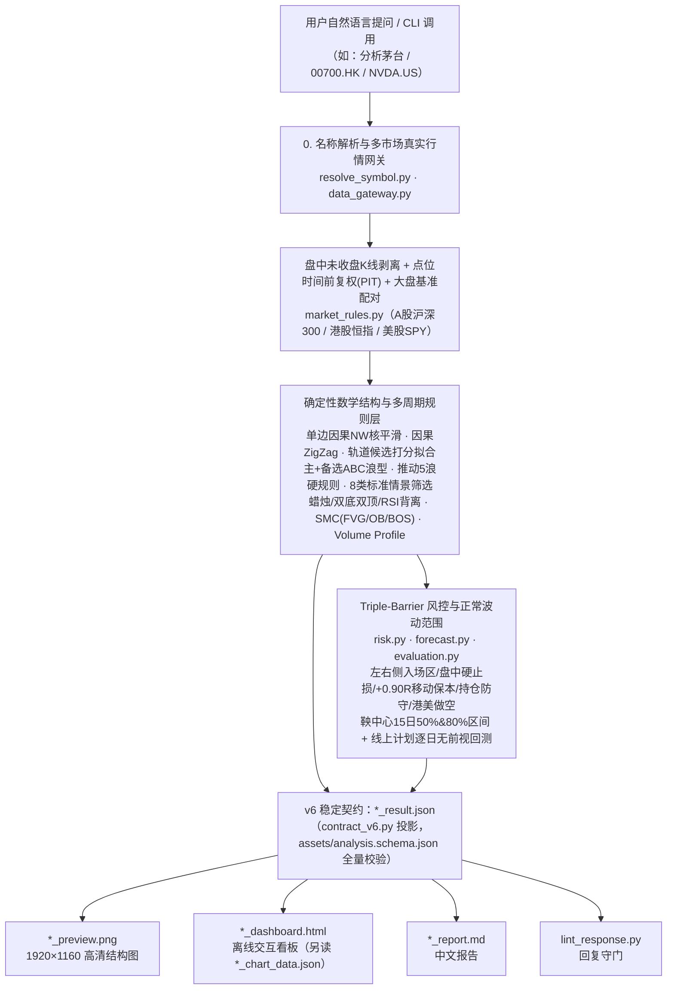

# v6 输出契约与去预测化 实施计划

> **For agentic workers:** REQUIRED SUB-SKILL: Use superpowers:subagent-driven-development (recommended) or superpowers:executing-plans to implement this plan task-by-task. Steps use checkbox (`- [ ]`) syntax for tracking.

**Goal:** 删除反转层、L2/L3 概率与情景扇形，把技能输出升级为 6.0.0 稳定契约（精简的 `result.json` + 非稳定的 `chart_data.json` + JSON 命令行信封），同时把 `research/` 移出 main、测试门禁分层。

**Architecture:** 流水线内部报告（`analysis.analyze_bundle` 的返回值）保留 v5 字段名，供回测、历史回放和现有单元测试继续使用；新增 `scripts/contract_v6.py` 在边界上把内部报告**投影**成对外的 `result.json` 与 `chart_data.json`，schema 校验只针对投影结果。`report.md`、HTML 看板与回复校验器改读 v6；PNG 仍按 AGENTS.md 铁律 1 直接接收同一份结构层计算结果（不经 JSON），只删掉频率相关的绘制。

**Tech Stack:** Python ≥ 3.12（运行期只依赖 Pillow），pytest + pytest-xdist，uv。

**Spec:** `docs/superpowers/specs/2026-10-22-v6-contract-design.md`

## Global Constraints

- 运行期依赖只有 Pillow；schema 校验用标准库实现，不得引入 jsonschema。
- 测试一律断网，只用 `tests/fixtures/recorded/` 的真实录制行情；严禁生成或使用合成行情。
- 版本号统一为 `6.0.0`：`SKILL.md` 的 `metadata.version`、`pyproject.toml`、`assets/analysis.schema.json` 的 `schema_version.enum`、`scripts/contract_v6.py` 的 `SCHEMA_VERSION`、`.claude-plugin/marketplace.json`。
- 对外不输出任何概率、胜率、频率数字；唯一例外是"回测胜率 + 95% 区间"。
- 稳定性规则：6.x 内只新增字段，不删除、不改名、不改语义；枚举可能新增取值；字段在 schema 中标注 `x-stability: stable | experimental`。
- `result.json` 落盘（`indent=2`）不超过 80 KB。
- 退出码：`0` 成功；`2` `INVALID_ARGUMENT`；`3` `DATA_UNAVAILABLE`；`4` `INSUFFICIENT_HISTORY`；stderr 上的 `[CODE]` 前缀保留。
- 算图分离：渲染层不得重算任何点位；JSON 写入 `<script>` 必须经 `_safe_json_for_script`；新字段不得含 NaN/Infinity。
- 技能脚本的改动在主做多计划 H1 验收跑完之前不得合入 main（2026-10-21 的决定）。
- 推送分支、标签或开 PR 之前先向用户确认。

## Review Focus

1. **数据不可用（`quality.status = UNAVAILABLE`）**：`report.md` 与 HTML 不得出现任何价位；HTML 只嵌入 `meta`/`quality`/`reproducibility`。→ Task B8 迁移 `test_report_md_hides_all_prices_when_data_unavailable`。
2. **指数与 ETF 标的**：`plan.long.position_sizing.tradable = false`、没有做空计划时，投影与 schema 校验不能报错。→ Task B5 的全市场 schema 测试含 `000001.SH`（指数）与 `SPY.US`（ETF）。
3. **缺少大盘基准（本地文件输入）**：`market_context` 字段为空值、`benchmark_missing = true` 时仍能通过 schema。→ Task B5 新增 `test_v6_result_validates_without_benchmark`。
4. **证券名称含 HTML 特殊字符**：嵌入看板的 JSON 不得提前闭合 `<script>`（`_safe_json_for_script` 把 `<`、`>`、`&` 转成 `<` 等）。→ Task B8 Step 6 把现有 `test_html_xss_escaping` 迁移到 v6 签名，断言不变。
5. **已按 stderr 前缀判断错误的旧 agent**：退出码与标准输出改了，stderr 前缀和不打印 Traceback 必须保持。→ Task B6 保留并扩展 `test_cli_errors_are_labelled_without_traceback`。

---

## File Structure

| 文件 | 动作 | 职责 |
| --- | --- | --- |
| `kline-structure-chart/scripts/contract_v6.py` | 新建 | `SCHEMA_VERSION`；内部报告 → `result.json` / `chart_data.json` 的投影；产物文件名 |
| `kline-structure-chart/scripts/price_text.py` | 新建 | 价格文本识别正则与价格白名单收集（从已删除的 `judgment.py`、`validate_judgment.py` 迁入） |
| `kline-structure-chart/scripts/contracts.py` | 修改 | 标准库 schema 校验；`validate_report` 改为校验 v6；`InsufficientHistoryError` |
| `kline-structure-chart/assets/analysis.schema.json` | 重写 | v6 全量 schema |
| `kline-structure-chart/scripts/analyze_and_forecast.py` | 修改 | 写出 v6 文件；JSON 信封与退出码 |
| `kline-structure-chart/scripts/analysis.py` | 修改 | 去掉研判证据包与内部 schema 校验；版本号取自 `contract_v6` |
| `kline-structure-chart/scripts/risk.py` | 修改 | 删除反转层与 L2 守门 |
| `kline-structure-chart/scripts/scenarios.py` | 修改 | 删除历史频率与用时分位；折点时间改用扩散尺度 |
| `kline-structure-chart/scripts/structure.py` | 修改 | 不再挂载频率；删除孤立参数 `benchmark_bars` |
| `kline-structure-chart/scripts/forecast.py` | 修改 | 删除情景混合扇形 |
| `kline-structure-chart/scripts/evaluation.py` | 修改 | 删除 L2 Brier 与对应审计项 |
| `kline-structure-chart/scripts/data_gateway.py` | 修改 | 历史不足改抛 `InsufficientHistoryError` |
| `kline-structure-chart/scripts/lint_response.py` | 修改 | 改读 v6；概率规则简化为一条 |
| `kline-structure-chart/scripts/render_report_md.py` | 修改 | 改读 v6；删除第 8 节研判、频率列与扇形 |
| `kline-structure-chart/scripts/render_html.py` | 修改 | 改读 v6（过渡适配层）；删除扇形、冲突信号与频率样式 |
| `kline-structure-chart/scripts/render_structure_chart.py` | 修改 | 删除按频率调整线宽与标签 |
| `kline-structure-chart/scripts/{base_rates,judgment,validate_judgment,score_judgments}.py` | 删除 | — |
| `kline-structure-chart/references/llm-judgment-protocol.md` | 删除 | — |
| `kline-structure-chart/references/output-fields.md` | 重写 | v6 字段字典与稳定性规则 |
| `kline-structure-chart/references/{scenario-playbook,interpretation-guide,failure-modes,math-patterns}.md` | 修改 | 删除频率、研判、反转层与扇形内容 |
| `kline-structure-chart/SKILL.md`、`AGENTS.md`、`README.md`、`CHANGELOG.md`、`examples/` | 修改 | 同步到 v6 |
| `kline-structure-chart/tests/conftest.py` | 修改 | 新增 `load_v6` 辅助函数 |
| `kline-structure-chart/tests/test_v6_contract.py` | 新建 | v6 契约、体积、去预测守护、命令行信封 |
| `research/` | 从 main 删除 | 保留在 `research/archive` 分支与标签上 |

---

# Part A：研究线移出 main + 门禁分层（PR-A）

前置条件：PR #8（pytest-xdist）已合入 main。

### Task A1：打标签、建归档分支、从 main 删除 research/

**Files:**
- Delete: `research/`（整个目录）
- Modify: `CHANGELOG.md`（`[Unreleased]` 顶部）

**Interfaces:**
- Consumes: 无
- Produces: 标签 `h2-frozen`、`main-plan-h1-v3-frozen`、`v5.3.0-final`；分支 `research/archive`；main 上不再有 `research/`

- [ ] **Step 1：确认前置条件**

```bash
gh pr view 8 --repo xiongcp/stock-skill --json state -q .state
git fetch origin
git log -1 --format=%H -- research/preregistration/preregistration_h2.json
git rev-parse be431f2
```

Expected：第一行输出 `MERGED`；第三行以 `da34cad` 开头；第四行以 `be431f2` 开头。任一不符就停下来问用户。

- [ ] **Step 2：在本地打标签、建归档分支**

```bash
git tag -a h2-frozen da34cad -m "H2 前向跟踪预注册冻结提交（服务器按此运行）"
git tag -a main-plan-h1-v3-frozen be431f2 -m "主做多计划留出集 H1 预注册 v3 冻结提交"
git tag -a v5.3.0-final origin/main -m "v5 在 main 上的最后一个提交（research/ 移出之前）"
git branch research/archive origin/main
git show --no-patch --format='%h %s' h2-frozen main-plan-h1-v3-frozen v5.3.0-final research/archive
```

Expected：四行输出，提交号分别为 `da34cad`、`be431f2`、`origin/main` 当前提交、`origin/main` 当前提交。

- [ ] **Step 3：向用户确认后推送标签与归档分支**

先把下面这条命令发给用户确认，得到同意后再执行：

```bash
git push origin h2-frozen main-plan-h1-v3-frozen v5.3.0-final research/archive
```

- [ ] **Step 4：在新分支上删除 research/**

```bash
git switch -c chore/research-split-and-test-tiers origin/main
git rm -r -q research
git grep -n "research/" -- kline-structure-chart .github AGENTS.md README.md
```

Expected：`git grep` 没有输出（技能、CI、AGENTS、README 都不引用 `research/`）。有输出就逐条处理：代码引用说明设计有误，停下来问用户；文档引用改为指向 `research/archive` 分支。

- [ ] **Step 5：在 CHANGELOG 记录**

在 `CHANGELOG.md` 的 `## [Unreleased]` 下第一行插入：

```markdown
### 变更（研究代码移出 main）

- `research/`（长周期回测、预注册、H1 验收与 H2 前向跟踪脚本）移到长期分支 `research/archive`，main 只保留技能。冻结提交打了标签：`h2-frozen`（H2 服务器运行的提交）、`main-plan-h1-v3-frozen`（主做多计划 H1 预注册 v3）、`v5.3.0-final`（移出之前 main 的最后一个提交）。H2 服务器按 `H2_RUNBOOK.md` 检出冻结提交运行，不受影响。研究设计文档仍在 `docs/superpowers/specs/`。
```

- [ ] **Step 6：跑合并前门禁**

```bash
uv run --directory kline-structure-chart pytest -q -n auto
uv run --directory kline-structure-chart python tests/check_days_invariance.py --data tests/fixtures/recorded/sina_daily --step 40
```

Expected：`212 passed`；`runs=420 failing=0`。

- [ ] **Step 7：提交**

```bash
git add -A research CHANGELOG.md
git commit -m "chore: research/ 移到 research/archive 分支，冻结提交打标签

Co-Authored-By: Claude Opus 5.5 <noreply@anthropic.com>"
```

### Task A2：测试门禁分层（slow 标记）

**Files:**
- Modify: `kline-structure-chart/pyproject.toml`
- Modify: `kline-structure-chart/tests/test_quant_skill.py`、`tests/test_data_sources.py`、`tests/test_report_and_metadata.py`（只加装饰器）
- Modify: `AGENTS.md` 3.3 节

**Interfaces:**
- Produces: pytest 标记 `slow`；日常门禁命令 `pytest -n auto -m "not slow"`

- [ ] **Step 1：注册标记**

在 `kline-structure-chart/pyproject.toml` 末尾追加：

```toml
[tool.pytest.ini_options]
markers = [
    "slow: 单个用例约 5 秒以上的端到端流水线与回测测试；日常用 -m \"not slow\" 跳过，提 PR 前与 CI 跑全量",
]
```

- [ ] **Step 2：给以下测试函数加 `@pytest.mark.slow`**（放在已有装饰器的最上面；参数化测试加在 `@pytest.mark.parametrize` 上方）

`tests/test_quant_skill.py`：
`test_o3_01_rail_fit_has_no_convergence_bias`、`test_multi_market_pipeline_and_backtest`、`test_c04_c05_c10_backtest_replays_live_plan_with_bootstrap_ci`、`test_o3_03_wave_counts_primary_plus_distinct_alternates`、`test_o3_02_projection_timeline_within_horizon_and_triggers_off_noise`、`test_regime_adaptive_scoring_and_breakeven_ratchet_boost_moutai_ic_and_winrate`、`test_c06_v5_pipeline_is_days_invariant`、`test_triple_barrier_entry_zone_anchored_and_rr_insufficient_veto`、`test_o3_05_backtest_reports_rule_score_ic_and_action_forward_returns`

`tests/test_data_sources.py`：`test_pipeline_on_recorded_real_data`

`tests/test_report_and_metadata.py`：`test_report_md_numbers_match_json`、`test_report_md_puts_veto_before_conclusions`、`test_report_md_hides_all_prices_when_data_unavailable`、`test_report_md_zero_trade_rows_show_dash`

- [ ] **Step 3：量日常门禁耗时**

```bash
time uv run --directory kline-structure-chart pytest -q -n auto -m "not slow" --durations=10
```

Expected：全部通过，墙钟时间 < 20 秒。超过 20 秒时，把 `--durations` 里单个 ≥ 3 秒的用例也加上 `@pytest.mark.slow`，再量一次，直到达标。记下最终耗时与跳过的用例数。

- [ ] **Step 4：确认全量不受影响**

```bash
uv run --directory kline-structure-chart pytest -q -n auto
```

Expected：`212 passed`（标记不改变默认选择）。

- [ ] **Step 5：更新 AGENTS.md 3.3 节**

把 `### 3.3 测试与回归门禁（修改任何代码后必跑）` 到下一个 `###` 之间的整段替换为：

````markdown
### 3.3 测试与回归门禁

| 层级 | 何时跑 | 目标耗时 |
| --- | --- | --- |
| 日常 | 每次改动后 | < 20 秒 |
| 合并前 | 提 PR 前与 CI | 约 1.5 分钟 |

```bash
# 日常：跳过约 5 秒以上的端到端流水线与回测用例（标记 slow），pytest-xdist 按 CPU 核数并行
uv run --directory kline-structure-chart pytest -n auto -m "not slow"

# 合并前 1：全量 pytest（单元、P0~P3 回归、TA-Lib 金标准、真实录制数据回放、网络异常、文档契约）
uv run --directory kline-structure-chart pytest -v -n auto

# 合并前 2：v4.1 结构层跨窗口不变性（真实录制行情）
uv run --directory kline-structure-chart python tests/check_days_invariance.py --data tests/fixtures/recorded/sina_daily --step 40
```
````

- [ ] **Step 6：文档契约与提交**

```bash
uv run --directory kline-structure-chart pytest -q tests/test_docs_contract.py
git add kline-structure-chart/pyproject.toml kline-structure-chart/tests AGENTS.md
git commit -m "test: 用 slow 标记分出日常门禁（-m \"not slow\"），AGENTS.md 3.3 改为分层

Co-Authored-By: Claude Opus 5.5 <noreply@anthropic.com>"
```

Expected：`24 passed`。

- [ ] **Step 7：合入**

主做多计划 H1 验收跑完后（问用户确认），推送分支并开 PR-A（向用户确认后执行）。合入后 Part B 才开始。

---

# Part B：v6 契约与去预测化（PR-B）

- [ ] **Step 0（Part B 开始前）：建分支并记基线**

```bash
git fetch origin
git switch -c feat/v6-contract origin/main
uv run --directory kline-structure-chart pytest -q -n auto
```

Expected：全部通过。以下命令都在 `kline-structure-chart/` 下以 `uv run pytest ...` 运行（等价于仓库根目录加 `--directory kline-structure-chart`）。

### Task B1：删除高置信反转层

**Files:**
- Modify: `scripts/risk.py`（常量第 55~67 行；`detect_high_conviction_rebound`、`high_conviction_plan_levels`；`compute_triple_barrier_plan` 里的反转层段落与 `"high_conviction_plan"` 键）
- Modify: `scripts/lint_response.py`（`_HC_TERM_RE`、`_HC_PRIOR_RE`、`_PCT_RE`、`_NUM_RE`、`_reversal_layer_hits` 及其调用）
- Modify: `references/math-patterns.md`（删除第 8 节"高置信反转层"整节）、`SKILL.md`（第五节"高置信反转层"一条）
- Test: `tests/test_v6_contract.py`（新建）、`tests/test_quant_skill.py`

**Interfaces:**
- Produces: `meta_labeling_decision` 不再有 `high_conviction_*` 与 `decision_probability`；`triple_barrier_plan` 不再有 `high_conviction_plan`

- [ ] **Step 1：写失败测试**

新建 `tests/test_v6_contract.py`：

```python
"""v6 输出契约：去预测化、schema、体积预算与命令行信封（只用录制的真实行情）。"""
from __future__ import annotations

import json
import sys
from pathlib import Path

import pytest

SCRIPTS = Path(__file__).resolve().parent.parent / "scripts"
if str(SCRIPTS) not in sys.path:
    sys.path.insert(0, str(SCRIPTS))

from analyze_and_forecast import run_pipeline  # noqa: E402

REQ_BASE = {"display_bars": 120, "structure_bars": 120, "horizon_bars": 15}


def _cn_moutai(tmp_path: Path, **kw) -> dict:
    return run_pipeline(
        {"symbol": "600519.SH", "market": "CN", "asset_type": "equity", **REQ_BASE},
        output_dir=tmp_path,
        **kw,
    )


def test_reversal_layer_removed(replay_recorded, tmp_path: Path) -> None:
    import risk

    rep = _cn_moutai(tmp_path)
    assert "high_conviction_plan" not in rep["triple_barrier_plan"]
    dec = rep["meta_labeling_decision"]
    assert not any(k.startswith("high_conviction") for k in dec)
    assert "decision_probability" not in dec
    for name in ("detect_high_conviction_rebound", "high_conviction_plan_levels", "HC_PAUSE_REASONS"):
        assert not hasattr(risk, name)
```

- [ ] **Step 2：确认失败**

Run: `uv run pytest -q tests/test_v6_contract.py::test_reversal_layer_removed`
Expected：FAIL，`assert "high_conviction_plan" not in ...`。

- [ ] **Step 3：删除 risk.py 的反转层**

1. 删除注释"高置信反转计划的几何"起到 `HC_PAUSED_MARKETS = frozenset(HC_PAUSE_REASONS)` 为止的常量块。
2. 删除函数 `detect_high_conviction_rebound` 与 `high_conviction_plan_levels` 的全部定义。
3. 在 `compute_triple_barrier_plan` 里删除从注释 `# 高置信超跌/大盘共振反转层` 开始，到 `meta_decision["decision_probability"] = {...}` 字典结束为止的整段。
4. 删除返回字典里的 `"high_conviction_plan": {...}` 整个键值。
5. 运行 `grep -n "hc_\|HC_\|high_conviction\|decision_probability" scripts/risk.py`，Expected：无输出。

- [ ] **Step 4：删除 lint 的反转层规则**

在 `scripts/lint_response.py` 删除：注释 `# 高置信反转层：…` 及其下的 `_HC_TERM_RE`、`_HC_PRIOR_RE`、`_PCT_RE`、`_NUM_RE` 四个常量；函数 `_reversal_layer_hits`；`lint_agent_response` 中的 `errors.extend(_reversal_layer_hits(text, report))` 一行。然后运行 `grep -n "_PCT_RE\|_NUM_RE" scripts/lint_response.py`，Expected：无输出。

- [ ] **Step 5：删除只测反转层的测试**

在 `tests/test_quant_skill.py` 删除这四个函数：`test_high_conviction_rebound_and_decision_probability_contract`、`test_high_conviction_paused_market_only_hints`、`test_high_conviction_trigger_uses_calibrated_rsi_turn_and_bench_ret1`、`test_lint_blocks_reversal_layer_numbers_and_plan_prices`。删除后若 `detect_high_conviction_rebound` 等名字在 import 行里，一并删掉。

- [ ] **Step 6：文档**

- `references/math-patterns.md`：删除"高置信反转层"整节（标题含"反转层"的那一节到下一个同级标题之前）。
- `SKILL.md` 第五节：删除以 `- **高置信反转层**` 开头的整条。
- `references/output-fields.md`：删除 `high_conviction_*`、`decision_probability`、`high_conviction_plan` 的行（该文件在 Task B9 整体重写，这里只保证不引用已删字段）。

- [ ] **Step 7：跑测试**

```bash
uv run pytest -q -n auto -m "not slow"
uv run pytest -q tests/test_v6_contract.py tests/test_docs_contract.py
```

Expected：全部通过。

- [ ] **Step 8：提交**

```bash
git add -A scripts/risk.py scripts/lint_response.py tests references/math-patterns.md references/output-fields.md SKILL.md
git commit -m "feat(v6): 删除高置信反转层（H1 未通过，已暂停）及其校验规则

Co-Authored-By: Claude Opus 5.5 <noreply@anthropic.com>"
```

### Task B2：删除 L3 研判层，价格白名单迁入 price_text.py

**Files:**
- Create: `scripts/price_text.py`
- Delete: `scripts/judgment.py`、`scripts/validate_judgment.py`、`scripts/score_judgments.py`、`references/llm-judgment-protocol.md`、`examples/600519.SH/600519.SH_judgment.json`、`examples/*/*_judgment_pack.json`
- Modify: `scripts/lint_response.py`、`scripts/analysis.py`、`scripts/analyze_and_forecast.py`、`scripts/render_report_md.py`、`scripts/render_html.py`、`assets/analysis.schema.json`、`SKILL.md`、`AGENTS.md`（目录树）、`README.md`
- Test: `tests/test_v6_contract.py`、`tests/test_quant_skill.py`

**Interfaces:**
- Produces（`price_text.py`）：
  - `NON_PRICE_PATTERNS: tuple[re.Pattern[str], ...]`
  - `CONTEXT_PRICE_RE: re.Pattern[str]`
  - `price_in_whitelist(value: float, prices: list[float], tolerance: float) -> bool`
  - `collect_price_whitelist(sections: dict[str, Any], price_decimals: int, recent_bars: list[dict[str, Any]]) -> dict[str, Any]`，返回 `{"price_decimals": int, "tolerance": float, "count": int, "prices": list[float]}`
- Produces：`render_report_markdown(report, backtest=None)`（去掉 `judgment`、`judgment_score_summary` 两个参数）

- [ ] **Step 1：写失败测试**

追加到 `tests/test_v6_contract.py`：

```python
def test_judgment_layer_removed(replay_recorded, tmp_path: Path) -> None:
    rep = _cn_moutai(tmp_path)
    assert "judgment_pack" not in rep
    assert not list(tmp_path.glob("*_judgment_pack.json"))
    for name in ("judgment.py", "validate_judgment.py", "score_judgments.py"):
        assert not (SCRIPTS / name).exists()
    md = Path(rep["rendered_paths"]["report_md"]).read_text(encoding="utf-8")
    assert "研判" not in md


def test_price_whitelist_moved_to_price_text() -> None:
    from price_text import collect_price_whitelist, price_in_whitelist

    wl = collect_price_whitelist(
        {"plan": {"stop_loss_barrier": 12.346, "risk_reward_ratio": 1.4, "entry_zone": [12.5, 12.8]}},
        price_decimals=2,
        recent_bars=[{"close": 13.0, "volume": 1000.0}],
    )
    assert wl["prices"] == [12.35, 12.5, 12.8, 13.0]  # 盈亏比（ratio）与成交量不是价格
    assert price_in_whitelist(12.34, wl["prices"], wl["tolerance"])
    assert not price_in_whitelist(1.4, wl["prices"], wl["tolerance"])
```

- [ ] **Step 2：确认失败**

Run: `uv run pytest -q tests/test_v6_contract.py -k "judgment_layer or price_text"`
Expected：FAIL（`judgment_pack` 仍在、`price_text` 不存在）。

- [ ] **Step 3：新建 price_text.py**

把 `scripts/validate_judgment.py` 中的 `_NON_PRICE_PATTERNS`、`_CONTEXT_PRICE_RE` 两个常量原样搬过来改名为公开名，把 `scripts/judgment.py` 的 `_NON_PRICE_KEY_TOKENS` 与 `collect_price_whitelist` 的遍历逻辑搬过来并改成按参数接收数据：

```python
"""价格文本识别与价格白名单：回复校验器用它判断回复里的数字是不是报告里出现过的价位。"""
from __future__ import annotations

import re
from typing import Any

# 剔除非价格数字的模式：日期、指标参数名、百分比、百分点、样本量、天数/根数/手数/股数/倍数/ATR/分数/基点
NON_PRICE_PATTERNS = (
    # <<粘贴区：见下方命令>>
)
CONTEXT_PRICE_RE = re.compile(
    r"(?:目标位|失效位|止损位|止损|触发位|破位价|支撑位?|压力位?|现价|收盘价?|POC|VAH|VAL|TP1|TP2|入场区)\s*[为=:：约至]?\s*(\d+(?:\.\d+)?)"
)

# 键名含这些片段的字段不是价格（百分比、样本数、根数、比值、乘数、相似度等），不进入白名单，也不深入其子字段
_NON_PRICE_KEY_TOKENS = (
    "freq", "pct", "ratio", "sample", "count", "bars", "hits", "_ci", "score", "size", "coverage",
    "multiplier", "sigma", "weight", "similarity", "idx", "distance", "atr", "return", "slope",
    "days", "horizon", "_r",
)
_PRICE_KEY_TOKENS = (
    "price", "open", "high", "low", "close", "ma20", "ma60", "ma120", "ma250", "sma", "ema", "vwap",
    "poc", "vah", "val", "upper", "lower", "mid", "barrier", "take_profit", "stop_loss", "entry_zone",
    "support", "resistance", "level", "target", "q10", "q25", "q50", "q75", "q90", "band", "cap",
    "retest", "rebound", "range", "zone",
)
_RECENT_BAR_KEYS = ("open", "high", "low", "close", "ma20", "ma60", "ma120", "ma250", "kernel_smooth")


def price_in_whitelist(value: float, prices: list[float], tolerance: float) -> bool:
    return any(abs(value - p) <= tolerance + 1e-6 for p in prices)


def collect_price_whitelist(
    sections: dict[str, Any], price_decimals: int, recent_bars: list[dict[str, Any]]
) -> dict[str, Any]:
    """从给定各段里键名像价格的字段与最近 20 根K线收集全部合法价格。"""
    prices: set[float] = set()

    def _add(v: Any) -> None:
        if isinstance(v, (int, float)) and not isinstance(v, bool) and float(v) > 0:
            prices.add(round(float(v), price_decimals))

    def _walk(obj: Any) -> None:
        if isinstance(obj, dict):
            for k, val in obj.items():
                kl = k.lower()
                if any(tok in kl for tok in _NON_PRICE_KEY_TOKENS):
                    continue
                if any(tok in kl for tok in _PRICE_KEY_TOKENS):
                    if isinstance(val, (int, float)):
                        _add(val)
                    elif isinstance(val, list):
                        for item in val:
                            if isinstance(item, list):
                                for sub in item:
                                    _add(sub)
                            elif isinstance(item, dict):
                                _walk(item)
                            else:
                                _add(item)
                    elif isinstance(val, dict):
                        _walk(val)
                else:
                    _walk(val)
        elif isinstance(obj, list):
            for item in obj:
                _walk(item)

    for subtree in sections.values():
        _walk(subtree)
    for bar in recent_bars[-20:]:
        for k in _RECENT_BAR_KEYS:
            _add(bar.get(k))
    sorted_prices = sorted(prices)
    return {
        "price_decimals": price_decimals,
        "tolerance": round(max(10.0 ** (-price_decimals), 1e-3), 6),
        "count": len(sorted_prices),
        "prices": sorted_prices,
    }
```

`NON_PRICE_PATTERNS` 的 17 条正则必须逐字复制（其中有汉字 Unicode 区间，手打容易出错），用命令取出原文：

```bash
sed -n '/^_NON_PRICE_PATTERNS = (/,/^)/p' scripts/validate_judgment.py
```

把输出中 `(` 与 `)` 之间的全部行（含两行注释）原样替换掉"粘贴区"注释，然后确认：

```bash
uv run python -c "import sys; sys.path.insert(0, 'scripts'); import price_text; assert len(price_text.NON_PRICE_PATTERNS) == 17"
```

（与旧实现相比去掉了 `round(fv, 4)` 的第二份副本和 `formatted_strings`：容差 `10^-p_dec` 已覆盖 4 位小数的写法，回复校验只用 `prices` 与 `tolerance`。）

- [ ] **Step 4：lint 改用 price_text**

`scripts/lint_response.py`：
1. import 改为 `from price_text import CONTEXT_PRICE_RE, NON_PRICE_PATTERNS, collect_price_whitelist, price_in_whitelist`，删除 `from judgment import …` 与 `from validate_judgment import …` 两行。
2. 全文把 `_CONTEXT_PRICE_RE` 换成 `CONTEXT_PRICE_RE`，`_NON_PRICE_PATTERNS` 换成 `NON_PRICE_PATTERNS`，`_price_in_whitelist` 换成 `price_in_whitelist`。
3. 把第 5 步开头的

```python
    pack = report.get("judgment_pack") or build_judgment_pack(report)
    whitelist = pack["price_whitelist"]
```

替换为：

```python
    meta = report.get("meta") or {}
    whitelist = collect_price_whitelist(
        {k: report[k] for k in ("mathematical_indicators", "smc_structures", "volume_profile",
                                "triple_barrier_plan", "rule_scenarios", "future_projection_15d") if k in report},
        int(meta.get("price_decimals") or 2),
        (report.get("series_export") or {}).get("bars") or [],
    )
```

- [ ] **Step 5：流水线去掉证据包**

- `scripts/analysis.py`：删除 `from judgment import build_judgment_pack`；末尾的

```python
    if include_forecast:
        report["judgment_pack"] = build_judgment_pack(report)
        validate_report(report)
    else:
        report["judgment_pack"] = {}
    return report
```

改为：

```python
    if include_forecast:
        validate_report(report)
    return report
```

- `scripts/analyze_and_forecast.py`：删除 `jpack_path` 变量、`rendered_paths` 里的 `"judgment_pack_json"` 键、`jpack_path.write_text(...)` 一行；模块文档字符串里的 `judgment_pack` 字样一并删除。
- `assets/analysis.schema.json`：从 `required` 删除 `"judgment_pack"`，从 `properties` 删除 `"judgment_pack"` 整项。
- `scripts/contracts.py`：`AnalysisReport` 删除 `judgment_pack` 一行。

- [ ] **Step 6：渲染器去掉研判**

- `scripts/render_report_md.py`：
  1. 函数签名改为 `def render_report_markdown(report: dict[str, Any], backtest: dict[str, Any] | None = None) -> str:`。
  2. 删除注释 `# 8. LLM 情景研判…` 起、到注释 `# 9. 文件` 之前的整段。
  3. 第 9 节里删除 `("judgment_pack_json", …)` 与 `("judgment_json", …)` 两项；把
     `sec_hdr = "## 9. 产物文件" if (active_judgment or jpack.get("evidence_items")) else "## 8. 产物文件"` 改为 `sec_hdr = "## 8. 产物文件"`；注释 `# 9. 文件` 改为 `# 8. 文件`。
- `scripts/render_html.py`：删除 `const conflictSignals = …` 起到对应 `forEach(...)` 结束的整块（7 行）。

- [ ] **Step 7：删除文件与测试**

```bash
git rm -q scripts/judgment.py scripts/validate_judgment.py scripts/score_judgments.py references/llm-judgment-protocol.md
git rm -q ../examples/600519.SH/600519.SH_judgment.json ../examples/*/*_judgment_pack.json
grep -rln "judgment\b\|validate_judgment\|score_judgments\|build_judgment_pack\|collect_price_whitelist" scripts tests
```

`tests/test_quant_skill.py` 删除这些函数：`test_o3_30_to_o3_34_judgment_layer_and_scoring`、`test_flash_model_digest_and_validate_judgment_auto_init_cli`、`test_p0_falsification_condition_follows_primary_direction`、`test_p0_auto_init_template_is_labeled_and_bearish_primary_falsification_is_consistent`、`test_score_judgments_offline_bars_payload_parsing`、`test_validate_judgment_ignores_wave_numbers_and_ratios`。

修改：
- `test_p0_mean_reversion_rule_score_adjustment_is_disclosed`：删除读取 `rep["judgment_pack"]["evidence_items"]` 的 `e5 = …` 一行及其后对 `e5` 的断言。
- `test_p0_lint_rejects_skill_md_counterexample_and_unvalidated_probabilities`：`from judgment import collect_price_whitelist` 改为 `from price_text import collect_price_whitelist`，并把 `collect_price_whitelist(rep)` 的调用改为 Step 4 中 lint 使用的同一组参数。

再跑一次上面的 `grep`，Expected：只剩 `price_text.py`、`lint_response.py` 与测试中对 `collect_price_whitelist` 的引用。

- [ ] **Step 8：文档**

- `SKILL.md`：
  - 第零节删除第 3 步（"需要 L3 情景研判时先预填模板再研判"整条），原第 4、5 步改为第 3、4 步，标题改为"4 步闭环"；第 2 步产物列表删除 `*_judgment_pack.json`。
  - 第二节"产物"删除 `*_judgment_pack.json` 一条。
  - 第四节删除第 7 项"L3 受约束情景研判"，第 8、9 项改为第 7、8 项。
  - 第五节删除"主观研判概率"一条（两类概率改为一类，Task B9 统一改写）。
  - 第八节删除 `references/llm-judgment-protocol.md` 一行。
- `AGENTS.md` 第 2 节目录树：删除 `judgment.py`、`validate_judgment.py`、`score_judgments.py`、`llm-judgment-protocol.md` 四行。
- `README.md`：删除第 6 节表格的 `*_judgment_pack.json` 行；删除 7.3 节中第 1~3 条命令及其注释（保留第 4 条 `lint_response.py`），7.3 标题改为"回复校验命令"；7.1 节表格删除"L3 受约束主观研判层"一行。

- [ ] **Step 9：跑测试并提交**

```bash
uv run pytest -q -n auto -m "not slow"
uv run pytest -q tests/test_v6_contract.py tests/test_docs_contract.py
git add -A scripts tests assets references SKILL.md ../AGENTS.md ../README.md ../examples
git commit -m "feat(v6): 删除 L3 研判层，价格白名单迁入 price_text.py

Co-Authored-By: Claude Opus 5.5 <noreply@anthropic.com>"
```

Expected：全部通过（`test_example_reply_passes_lint_and_counterexample_is_rejected` 用 v5 示例 JSON 通过新白名单逻辑；若因价格容差失败，检查是否是 4 位小数价格，必要时在 `_add` 中补回 `round(fv, 4)` 并在提交说明里写明）。

### Task B3：删除 L2 历史条件频率、用时分位与 L2 守门

**Files:**
- Delete: `scripts/base_rates.py`
- Modify: `scripts/scenarios.py`、`scripts/structure.py`、`scripts/risk.py`（第 451~459 行）、`scripts/evaluation.py`、`scripts/analysis.py` 与 `scripts/analyze_and_forecast.py`（`compute_structure_layer` 调用处）、`scripts/lint_response.py`、`scripts/render_report_md.py`、`scripts/render_structure_chart.py`、`scripts/render_html.py`、`references/scenario-playbook.md`
- Test: `tests/test_v6_contract.py`、`tests/test_quant_skill.py`

**Interfaces:**
- Produces：`scenarios.build_scenarios(...)`（原 `build_scenarios_with_base_rates`，去掉 `benchmark_bars` 参数），返回 `{"scenarios", "scenario_count", "precondition_met_count", "scenario_signature", "impulse_wave"}`；情景项不再含 `historical_frequency`、`time_window_bars`
- Produces：`structure.compute_structure_layer(...)` 去掉 `benchmark_bars` 参数

- [ ] **Step 1：写失败测试**

```python
def test_historical_frequency_removed(replay_recorded, tmp_path: Path) -> None:
    rep = _cn_moutai(tmp_path, run_backtest=True, backtest_step=20)
    text = json.dumps({k: v for k, v in rep.items() if k != "rendered_paths"}, ensure_ascii=False)
    for token in ("historical_frequency", "time_window_bars", "target_freq", "bars_to_target"):
        assert token not in text
    bt = json.loads(Path(rep["rendered_paths"]["backtest_json"]).read_text(encoding="utf-8"))
    assert "scenario_frequency_brier" not in bt["backtest"]
    assert "multi_scenarios_base_rates" not in bt["causal_replay_audit"]["modules_audited"]
    assert not (SCRIPTS / "base_rates.py").exists()
```

- [ ] **Step 2：确认失败**

Run: `uv run pytest -q tests/test_v6_contract.py::test_historical_frequency_removed`
Expected：FAIL。

- [ ] **Step 3：scenarios.py 去掉频率**

1. 删除 `from base_rates import _get_or_build_causal_features, compute_scenario_frequency`；模块文档字符串第 5 条（"结合 base_rates.py…"）删除。
2. 新增私有函数（放在 `_slot_triplet` 之前），口径与原 `base_rates._build_causal_features` 中对应序列完全一致，只取最后一根：

```python
def _last_causal_state(bars: list[dict[str, Any]]) -> dict[str, float]:
    """最后一根已收盘K线的 RSI14（Wilder）、RVOL20、MA20、MA60，口径与原历史事件研究模块一致。"""
    closes = [float(b["close"]) for b in bars]
    vols = [float(b.get("volume") or 0.0) for b in bars]
    n = len(closes)
    rsi14 = 50.0
    avg_gain = avg_loss = 0.0
    for i in range(1, n):
        chg = closes[i] - closes[i - 1]
        gain, loss = max(0.0, chg), max(0.0, -chg)
        if i <= 14:
            avg_gain += gain / 14.0
            avg_loss += loss / 14.0
            if i < 14:
                continue
        else:
            avg_gain = (avg_gain * 13.0 + gain) / 14.0
            avg_loss = (avg_loss * 13.0 + loss) / 14.0
        if avg_gain == 0.0 and avg_loss == 0.0:
            rsi14 = 50.0
        elif avg_loss == 0.0:
            rsi14 = 100.0
        else:
            rsi14 = 100.0 - 100.0 / (1.0 + avg_gain / avg_loss)
    win_v = vols[-20:]
    mean_v = sum(win_v) / len(win_v) if win_v else 0.0
    return {
        "rsi14": rsi14,
        "rvol20": vols[-1] / mean_v if mean_v > 0 else 1.0,
        "ma20": sum(closes[-20:]) / len(closes[-20:]) if closes else 0.0,
        "ma60": sum(closes[-60:]) / len(closes[-60:]) if closes else 0.0,
    }
```

3. 函数 `build_scenarios_with_base_rates` 改名为 `build_scenarios`，删除参数 `benchmark_bars`；文档字符串改为 `"""根据 L1 状态评估 8 类情景，选出 2~5 个适用情景。"""`。
4. 把

```python
    target_feat = _get_or_build_causal_features(hist)
    bench_feat: dict[str, list[float]] | None = None
    if benchmark_bars:
        …
            bench_feat = _get_or_build_causal_features(b_sub)

    rsi_now = target_feat["rsi14"][-1] if target_feat["rsi14"] else 50.0
    rvol_now = target_feat["rvol20"][-1] if target_feat["rvol20"] else 1.0
    ma20 = ma_last.get(20) or (target_feat["ma20"][-1] if target_feat["ma20"] else ref)
    ma60 = ma_last.get(60) or (target_feat["ma60"][-1] if target_feat["ma60"] else ref)
```

替换为：

```python
    state = _last_causal_state(hist)
    rsi_now = state["rsi14"]
    rvol_now = state["rvol20"]
    ma20 = ma_last.get(20) or (state["ma20"] or ref)
    ma60 = ma_last.get(60) or (state["ma60"] or ref)
```

5. 删除 `freq_cache` 与内部函数 `get_freq`。
6. `build_item` 内把

```python
        freq = get_freq(sc_id, direction)
        btt = freq["bars_to_target"]
        diff_eta = ((abs(target_price / ref - 1.0)) / max(sigma, 1e-6)) ** 2
        raw_med = btt["median"] if btt["median"] is not None else (btt["median_all_outcomes"] or round(diff_eta, 1))
        raw_q25 = btt["q25"] if btt["q25"] is not None else round(max(1.0, raw_med * 0.6), 1)
        raw_q75 = btt["q75"] if btt["q75"] is not None else round(raw_med * 1.35, 1)

        q25_c = min(float(horizon), max(1.0, round(float(raw_q25), 1)))
        med_c = min(float(horizon), max(q25_c, round(float(raw_med), 1)))
        q75_c = min(float(horizon), max(med_c, round(float(raw_q75), 1)))
```

替换为：

```python
        # 折点时间按扩散尺度 t≈(距离/日波动σ)² 估计，只用于画路径，截断在预测期内
        diff_eta = ((abs(target_price / ref - 1.0)) / max(sigma, 1e-6)) ** 2
        med_c = min(float(horizon), max(1.0, round(diff_eta, 1)))
```

7. 返回字典里删除 `"time_window_bars": {...}` 与 `"historical_frequency": freq` 两个键。
8. 函数末尾删除"为向后兼容的三路径…挂载对应的历史条件频率"注释、`bull_sc`/`neut_sc`/`bear_sc` 与三个 `*_freq` 变量，返回字典删除 `bull_frequency`、`neutral_frequency`、`bear_frequency`。
9. `grep -n "freq\|btt\|target_feat\|bench_feat\|base_rates" scripts/scenarios.py`，Expected：无输出。

- [ ] **Step 4：structure.py 与调用方**

- `scripts/structure.py`：import 改为 `from scenarios import build_scenarios`；调用处改为 `scen_bundle = build_scenarios(...)` 并删除 `benchmark_bars=benchmark_bars,` 一行；删除三行 `projections[...]["historical_frequency"] = …`；删除 `compute_structure_layer` 的参数 `benchmark_bars: list[dict] | None = None,`。
- 找出所有调用方并删掉该关键字参数：

```bash
grep -rn -A12 "compute_structure_layer(" scripts tests | grep "benchmark_bars="
```

  对输出中属于 `compute_structure_layer(...)` 调用的 `benchmark_bars=…` 逐个删除（`scripts/analyze_and_forecast.py`、`scripts/analysis.py`，以及测试里的调用）。`_build_replay_snapshots` 自己的 `benchmark_bars` 参数用于基准状态，保留不动。

- [ ] **Step 5：risk.py 删除 L2 守门**

删除 `compute_triple_barrier_plan` 中从注释 `# L2 历史条件频率守门（经验 Meta-Labeling）…` 到 `action_cn = "条件观察（待放量/收盘确认）"`（守门 if 块的最后一行）为止的整段（当前第 451~459 行）。`_num_or` 仍被其他行使用，保留。

- [ ] **Step 6：evaluation.py 删除 L2 检验**

1. 删除 `from base_rates import _build_causal_features, compute_scenario_frequency, label_scenario_event`。
2. `run_causal_replay_audit`：删除注释 `# 5. 多情景历史条件频率…` 起的整个检查块（`sc_sub = …` 到 `mismatches.append(f"Scenario base rate mutated …")`）；`modules_audited` 删除 `"multi_scenarios_base_rates"`。
3. `run_plan_backtest`：删除 `brier_records` 定义、`full_causal_feat = _build_causal_features(bars)`、`for sc_item in rep["rule_scenarios"].get("scenarios") or []:` 整个循环、返回字典的 `"scenario_frequency_brier": _evaluate_scenario_brier(brier_records),`。
4. 删除函数 `_evaluate_scenario_brier`。
5. `grep -n "brier\|base_rates\|causal_feat\|label_scenario_event" scripts/evaluation.py`，Expected：无输出。

- [ ] **Step 7：渲染器与 lint**

- `scripts/lint_response.py`：删除 `allowed_hf_pcts: list[float] = []` 起到"历史条件频率 … 与 result.json 不一致"检查结束的整块。
- `scripts/render_report_md.py` 第 3 节：
  1. 删除 `bull_hf`、`neut_hf`、`bear_hf` 三行，三条路径表格去掉"历史条件频率"列（表头与每行同时删一列）。
  2. 活跃情景循环里删除 `tw = …`、`hf_item = …` 及其输出的"预计用时""历史条件频率"字段。
  3. 删除以 `"它统计的是以触发日 ATR 为单位的**标准化屏障事件**` 开头的说明段落（整条 `lines` 项）。
  4. 第 7 节删除读取 `scenario_frequency_brier` 的整段展示。
- `scripts/render_structure_chart.py`：
  1. `_branch_freq_style` 整个函数删除，三条路径的样式改为常量：

```python
    bull_ftag, bull_w, bull_a, bull_dash = "", 2.8, 255, False
    neut_ftag, neut_w, neut_a, neut_dash = "", 2.8, 255, True
    bear_ftag, bear_w, bear_a, bear_dash = "", 2.8, 255, False
```

  2. 独立情景路径循环里删除 `sc_hf`、`sc_freq`、`sc_n`、`sc_low`、`sc_raw`、`sc_pct`、`sc_low_tag` 六个变量，绘制与标签改为：

```python
        sc_pending = sc_item.get("status") != "ACTIVE"
        draw_arrow_polyline(draw, sc_pts, fill=sc_col, width=2.2, dashed=sc_pending, alpha=200)
        right_gutter_tags.append((sc_pts[-1][1], f"{sc_item['name']} {fp(sc_tgt)}", sc_col))
```

- `scripts/render_html.py`：
  1. 情景列表：删除 `const hf = …`、`const tw = …` 两行；`detail.textContent` 改为 `'触发: ' + sc.trigger + ' | 失效: ' + sc.invalidation;`。
  2. 图层说明 `多情景路径(线宽/深浅按频率·虚线=n&lt;30)` 改为 `多情景路径(虚线=待触发)`。
  3. 路径绘制块（注释 `// Layer: Multi-Scenario Playbook Paths …`）里删除 `hf`、`freq`、`nSamp`、`lowSample`、`alpha`、`lw` 的计算，改为：

```javascript
        const pending = sc.status !== 'ACTIVE';
        const alpha = 0.85;
        const lw = 2.2;
```

  把 `if (lowSample) ctx.setLineDash([6, 4]);` 改为 `if (pending) ctx.setLineDash([6, 4]);`；末尾标签删除 `rawFreq`、`pctStr` 两行，`const tag = sc.name + ' ' + fmtPrice(lastWp[1]);`。注释改为 `// Layer: Multi-Scenario Playbook Paths (dashed = pending trigger)`。（注意 render_html 的 JS 写在 f-string 里，花括号要写成 `{{ }}`。）

- [ ] **Step 8：删除 base_rates.py 与测试**

```bash
git rm -q scripts/base_rates.py
grep -rn "base_rates\|historical_frequency\|time_window_bars\|scenario_frequency_brier\|build_scenarios_with_base_rates" scripts tests references
```

`tests/test_quant_skill.py`：
- 删除：`test_o3_21_base_rates_point_in_time_no_lookahead_and_beta_binomial_shrinkage`、`test_o3_22_backtest_scenario_frequency_brier_and_reliability_buckets`、`test_p0_l2_display_leads_with_observed_frequency_inside_its_wilson_interval`。
- `test_causal_replay_invariance_no_lookahead`：删除 `assert "multi_scenarios_base_rates" in audit["modules_audited"]`。
- `test_o3_20_multi_scenario_engine_diversity_active_trigger_and_impulse_rules`：删除 `tw = s["time_window_bars"]` 及其后对 `tw` 的断言。
- `test_p1_all_eight_audit_items_regression`：删除 `sfb = bt["scenario_frequency_brier"]` 及其后对 `sfb` 的断言块；删除构造 `fake_proj[...]["historical_frequency"]` 并断言 L2 守门降级的块（从该赋值行到对应断言结束）。
- `test_p0_lint_rejects_skill_md_counterexample_and_unvalidated_probabilities`：删除 `assert all(abs(p - sc0["historical_frequency"]["target_freq"]) …)` 一行。

`references/scenario-playbook.md`：保留 8 类情景定义表（`test_o3_20_scenario_playbook_doc_matches_code_verbatim` 逐字比对），删除历史条件频率、Wilson 区间、Beta-Binomial 收缩、到达用时分位与 Brier 检验的全部段落。

再跑一次上面的 `grep`，Expected：只剩 `tests/test_v6_contract.py` 中断言"不存在"的字符串。

- [ ] **Step 9：跑测试**

```bash
uv run pytest -q -n auto
uv run python tests/check_days_invariance.py --data tests/fixtures/recorded/sina_daily --step 40
```

Expected：全部通过；`failing=0`。若有测试断言了具体的折点位置或评级（因 L2 守门删除与折点改用扩散尺度而变化），确认变化只来自这两处后更新断言，并在提交说明里列出改了哪些断言。

- [ ] **Step 10：提交**

```bash
git add -A scripts tests references
git commit -m "feat(v6): 删除 L2 历史条件频率、用时分位与 L2 守门

情景折点时间改用扩散尺度估计；评级只由规则分、结构与风控否决决定。

Co-Authored-By: Claude Opus 5.5 <noreply@anthropic.com>"
```

### Task B4：删除情景混合扇形

**Files:**
- Modify: `scripts/forecast.py`（`_build_scenario_conditional_fan` 与调用、返回键）、`scripts/analysis.py`（调用 `compute_conformal_forecast` 处）、`scripts/render_report_md.py`、`scripts/render_html.py`
- Test: `tests/test_v6_contract.py`、`tests/test_quant_skill.py`

**Interfaces:**
- Produces：`future_projection_15d` 不含 `scenario_conditional_fan`；看板没有 `data-layer="scenario_fan"`

- [ ] **Step 1：写失败测试**

```python
def test_scenario_fan_removed(replay_recorded, tmp_path: Path) -> None:
    rep = _cn_moutai(tmp_path)
    assert "scenario_conditional_fan" not in rep["future_projection_15d"]
    html_text = Path(rep["rendered_paths"]["dashboard_html"]).read_text(encoding="utf-8")
    assert 'data-layer="scenario_fan"' not in html_text and "情景混合" not in html_text
    md = Path(rep["rendered_paths"]["report_md"]).read_text(encoding="utf-8")
    assert "情景混合" not in md
```

- [ ] **Step 2：确认失败**

Run: `uv run pytest -q tests/test_v6_contract.py::test_scenario_fan_removed`，Expected：FAIL。

- [ ] **Step 3：实现**

- `scripts/forecast.py`：删除函数 `_build_scenario_conditional_fan`、调用它的 `scenario_fan = …` 语句和返回字典的 `"scenario_conditional_fan": scenario_fan,`。然后 `grep -n "scenarios" scripts/forecast.py`：若参数 `scenarios` 已不再被使用，从 `compute_conformal_forecast` 签名删除，并删除 `scripts/analysis.py`（及其他调用方）传入的 `scenarios=…` 关键字参数。
- `scripts/render_report_md.py` 第 6 节：删除 `scf = fp.get("scenario_conditional_fan") or {}` 起的整段展示。
- `scripts/render_html.py`：删除第 282 行左右的 `<label …data-layer="scenario_fan"…>情景混合（非校准区间）</label>`；`layers` 默认值里删除 `scenario_fan: false,`；`liveOnly` 判断里删除 `|| lk === 'scenario_fan'`；删除两处 `if (layers.scenario_fan && fp.scenario_conditional_fan …) {{ … }}` 整块（价格范围收集一处、绘制一处）。
- `tests/test_quant_skill.py` 的 `test_o3_23_and_o3_24_renderers_and_scenario_conditional_fan`：删除所有涉及 `scenario_conditional_fan`、`scenario_fan`、"情景混合"的断言，函数改名为 `test_o3_23_renderers_draw_scenarios`。

- [ ] **Step 4：跑测试并提交**

```bash
uv run pytest -q -n auto -m "not slow"
uv run pytest -q tests/test_v6_contract.py
git add -A scripts tests
git commit -m "feat(v6): 删除情景混合扇形（按频率混合的展示区间）

Co-Authored-By: Claude Opus 5.5 <noreply@anthropic.com>"
```

### Task B5：v6 契约投影、全量 schema 与版本号

**Files:**
- Create: `scripts/contract_v6.py`
- Rewrite: `assets/analysis.schema.json`
- Modify: `scripts/contracts.py`、`scripts/analysis.py`、`scripts/analyze_and_forecast.py`、`scripts/render_html.py`（只删开头的 `validate_report(report)`）、`pyproject.toml`、`uv.lock`、`SKILL.md`（frontmatter 版本）、`../.claude-plugin/marketplace.json`、`tests/conftest.py`、`tests/test_docs_contract.py`（`test_versions_are_in_sync`）
- Test: `tests/test_v6_contract.py`、`tests/test_quant_skill.py`（`test_c06_v5_pipeline_is_days_invariant`、`test_multi_market_pipeline_and_backtest` 中 `schema_version` 断言）

**Interfaces:**
- Produces（`contract_v6.py`）：
  - `SCHEMA_VERSION: str = "6.0.0"`
  - `artifact_files(safe_sym: str, has_backtest: bool) -> dict[str, str]`
  - `build_result(report: dict[str, Any], files: dict[str, str]) -> dict[str, Any]`
  - `build_chart_data(report: dict[str, Any]) -> dict[str, Any]`
- Produces（`contracts.py`）：`schema_errors(value, schema, path="$") -> list[str]`；`validate_report(result) -> None`（校验 v6）；`validate_chart_data(chart) -> None`
- Produces（`run_pipeline`）：返回内部报告；`report["rendered_paths"]` 为各产物绝对路径（键：`result_json`、`chart_data_json`、`preview_png`、`dashboard_html`、`report_md`、可选 `backtest_json`），只在进程内使用、不写入任何 JSON
- Produces（`tests/conftest.py`）：`load_v6(report: dict) -> tuple[dict, dict]`

- [ ] **Step 1：写失败测试**

`tests/conftest.py` 末尾追加：

```python
def load_v6(report: dict) -> tuple[dict, dict]:
    """读取 run_pipeline 写出的 v6 result.json 与 chart_data.json。"""
    paths = report["rendered_paths"]
    return (
        json.loads(Path(paths["result_json"]).read_text(encoding="utf-8")),
        json.loads(Path(paths["chart_data_json"]).read_text(encoding="utf-8")),
    )
```

（若 conftest 尚未 `import json`，在顶部补上。）

`tests/test_v6_contract.py` 追加：

```python
from conftest import load_v6  # noqa: E402

V6_TOP = {
    "schema_version", "meta", "quality", "verdict", "market_context", "structure", "indicators",
    "scenarios", "plan", "volatility_range", "quotable_prices", "files", "reproducibility",
}
FORBIDDEN_KEY_PARTS = ("probability", "frequency", "freq", "high_conviction", "judgment", "brier", "analogue")


def _walk_keys(obj, path="$"):
    if isinstance(obj, dict):
        for k, v in obj.items():
            yield f"{path}.{k}", k
            yield from _walk_keys(v, f"{path}.{k}")
    elif isinstance(obj, list):
        for i, v in enumerate(obj):
            yield from _walk_keys(v, f"{path}[{i}]")


@pytest.mark.slow
@pytest.mark.parametrize(
    ("market", "symbol", "asset_type"),
    [
        ("CN", "600519.SH", "equity"),
        ("CN", "000001.SH", "index"),
        ("HK", "00700.HK", "equity"),
        ("US", "NVDA.US", "equity"),
        ("US", "SPY.US", "etf"),
    ],
)
def test_v6_result_validates_and_fits_budget(replay_recorded, tmp_path: Path, market, symbol, asset_type) -> None:
    from contracts import validate_report

    rep = run_pipeline({"symbol": symbol, "market": market, "asset_type": asset_type, **REQ_BASE}, output_dir=tmp_path)
    result, chart = load_v6(rep)
    validate_report(result)
    assert set(result) == V6_TOP
    assert result["schema_version"] == "6.0.0"
    assert result["meta"]["timezone"] in ("Asia/Shanghai", "Asia/Hong_Kong", "America/New_York")
    assert all(not Path(p).is_absolute() for p in result["files"].values())
    assert (tmp_path / result["files"]["chart_data_json"]).exists()
    assert len(chart["bars"]) == REQ_BASE["display_bars"]
    size = Path(rep["rendered_paths"]["result_json"]).stat().st_size
    assert size <= 80 * 1024, f"result.json {size} 字节超过 80 KB 预算"
    bad = [p for p, k in _walk_keys(result) if any(part in k.lower() for part in FORBIDDEN_KEY_PARTS)]
    assert not bad, f"result.json 含预测性字段: {bad[:5]}"


def test_v6_result_validates_without_benchmark(tmp_path: Path) -> None:
    from conftest import load_recorded
    from contracts import validate_report

    bars_file = tmp_path / "600519_bars.json"
    rows = load_recorded("sina_daily/sh600519.json")
    bars_file.write_text(json.dumps([{k: r[k] for k in ("day", "open", "high", "low", "close", "volume")} for r in rows]))
    rep = run_pipeline(
        {"symbol": "600519.SH", "market": "CN", "asset_type": "equity", "name": "贵州茅台", **REQ_BASE},
        output_dir=tmp_path / "out", input_path=bars_file, allow_network=False,
    )
    result, _ = load_v6(rep)
    validate_report(result)
    assert result["quality"]["status"] == "PARTIAL"
    assert result["market_context"]["benchmark_missing"] is True


def test_v6_schema_marks_stability_and_rejects_unknown_fields() -> None:
    from contracts import load_report_schema, schema_errors

    schema = load_report_schema()
    assert schema["additionalProperties"] is False
    for key, sub in schema["properties"].items():
        assert sub.get("x-stability") in ("stable", "experimental"), key
        for child, child_schema in (sub.get("properties") or {}).items():
            assert child_schema.get("x-stability") in ("stable", "experimental"), f"{key}.{child}"
    errs = schema_errors({"schema_version": "6.0.0", "surprise": 1}, schema)
    assert any("未声明的字段 surprise" in e for e in errs)
    assert any("缺少必填字段 verdict" in e for e in errs)
    assert schema_errors(1.5, {"type": "integer"}) and not schema_errors(2, {"type": "number"})
    assert schema_errors(True, {"type": "number"})
```

`tests/test_quant_skill.py` 的 `test_c06_v5_pipeline_is_days_invariant`：改名为 `test_c06_pipeline_is_days_invariant`，在循环里追加 v6 断言：

```python
        result, _ = load_v6(rep)
        result["meta"]["request"].pop("display_bars", None)
        result["quality"].pop("display_bars", None)
        v6_sigs[days] = result
```

循环前 `v6_sigs = {}`，循环后 `assert v6_sigs[60] == v6_sigs[120] == v6_sigs[300] == v6_sigs[500]`；文件顶部 `from conftest import load_v6`。`test_multi_market_pipeline_and_backtest` 中 `assert report["schema_version"] == "5.3.0"` 改为 `== "6.0.0"`。

- [ ] **Step 2：确认失败**

Run: `uv run pytest -q tests/test_v6_contract.py -k "v6_"`，Expected：FAIL（`load_v6` 找不到 `chart_data_json` 等）。

- [ ] **Step 3：新建 contract_v6.py**

```python
"""v6 输出契约：把流水线内部报告投影为稳定的 result.json 与非稳定的 chart_data.json。

内部报告（analysis.analyze_bundle 的返回值）沿用 v5 字段名，供回测、历史回放与单元测试使用；
对外只写本模块投影出的两个文件。字段定义与稳定性规则见 assets/analysis.schema.json 与 references/output-fields.md。
"""
from __future__ import annotations

from typing import Any

from market_rules import MARKET_SESSIONS
from price_text import collect_price_whitelist

SCHEMA_VERSION = "6.0.0"

_REQUEST_KEYS = (
    "symbol", "market", "asset_type", "display_bars", "structure_bars", "horizon_bars", "account_equity",
    "max_risk_pct", "color_scheme", "as_of", "adjustment", "benchmark_symbol",
)
# 只用于画路径的字段放进 chart_data，不进入稳定契约
_SCENARIO_DRAW_KEYS = ("waypoints_offset", "step_labels", "eta_bars")
_SCENARIO_DROP_KEYS = (*_SCENARIO_DRAW_KEYS, "target_within_horizon")
_QUOTABLE_SECTIONS = ("structure", "indicators", "scenarios", "plan", "volatility_range")


def artifact_files(safe_sym: str, has_backtest: bool) -> dict[str, str]:
    files = {
        "result_json": f"{safe_sym}_result.json",
        "chart_data_json": f"{safe_sym}_chart_data.json",
        "preview_png": f"{safe_sym}_preview.png",
        "dashboard_html": f"{safe_sym}_dashboard.html",
        "report_md": f"{safe_sym}_report.md",
    }
    if has_backtest:
        files["backtest_json"] = f"{safe_sym}_backtest.json"
    return files


def _strip_scenario(item: dict[str, Any]) -> dict[str, Any]:
    return {k: v for k, v in item.items() if k not in _SCENARIO_DROP_KEYS}


def _draw_only(item: dict[str, Any]) -> dict[str, Any]:
    return {k: item[k] for k in _SCENARIO_DRAW_KEYS if k in item}


def build_result(report: dict[str, Any], files: dict[str, str]) -> dict[str, Any]:
    meta = report["meta"]
    request = report.get("request") or {}
    dec = report["meta_labeling_decision"]
    mtf = report["multi_timeframe_score"]
    deb = report["debate_and_veto"]
    mb = report["market_benchmark"]
    mi = report["mathematical_indicators"]
    sl = mi["structure_levels"]
    rs = report["rule_scenarios"]
    tb = report["triple_barrier_plan"]
    fp = report["future_projection_15d"]
    result: dict[str, Any] = {
        "schema_version": SCHEMA_VERSION,
        "meta": {
            **meta,
            "timezone": MARKET_SESSIONS[meta["market"]][0],
            "engine_version": SCHEMA_VERSION,
            "request": {k: request[k] for k in _REQUEST_KEYS if k in request},
        },
        "quality": dict(report["quality"]),
        "verdict": {
            "action": dec["action"],
            "action_cn": dec["action_cn"],
            "setup_type": dec["setup_type"],
            "setup_label_cn": dec["setup_label_cn"],
            "risk_veto": bool(deb["risk_officer_veto"]),
            "veto_reasons": list(deb.get("veto_reasons") or []),
            "veto_codes": list(deb.get("veto_codes") or []),
            "rule_score": mtf["rule_score"],
            "rating": mtf["rating"],
            "rating_cn": mtf["rating_cn"],
            "headline_cn": deb["final_verdict_cn"],
            "overextended": bool(dec.get("overextended")),
            "rule_detail": {
                "components": mtf.get("components"),
                "components_total": mtf.get("components_total"),
                "regime_adjustment": mtf.get("regime_adjustment"),
                "timeframes_aligned": mtf.get("timeframes_aligned"),
                "scoring_method": dec.get("scoring_method"),
                "note": mtf.get("note"),
            },
            "strategy_signals": list(report.get("strategy_signals") or []),
            "anti_quant_traps": dec.get("anti_quant_traps"),
            "bull_case": list(deb.get("bull_case") or []),
            "bear_case": list(deb.get("bear_case") or []),
        },
        "market_context": {
            "index_symbol": mb.get("index_symbol"),
            "index_name": mb.get("index_name"),
            "regime": mb.get("regime"),
            "regime_label_cn": mb.get("regime_label_cn"),
            "regime_score": mb.get("regime_score"),
            "relative_strength_vs_index": mb.get("relative_strength_vs_index"),
            "benchmark_missing": bool(mb.get("benchmark_missing")),
            "source": mb.get("source"),
            "bench_ret1": mb.get("bench_ret1"),
            "bench_ret5": mb.get("bench_ret5"),
        },
        "structure": {
            "last_close": float(report["series_export"]["bars"][-1]["close"]),
            "regime": report["market_regime"],
            "key_levels": sl["key_levels"],
            "support_zone": sl["support_zone"],
            "resistance_zone": sl["resistance_zone"],
            "channel": sl["wedge_structure"],
            "fib_levels": sl["fib_levels"],
            "recent_gaps": sl["recent_gaps"],
            "abc_scenario": sl["abc_scenario"],
            "wave_counts": sl["wave_counts"],
            "patterns": report["algebraic_patterns_detected"],
            "smc": report["smc_structures"],
            "volume_profile": {k: v for k, v in report["volume_profile"].items() if k != "bins"},
        },
        "indicators": {k: mi[k] for k in ("trend", "momentum", "volatility", "qlib_factors")},
        "scenarios": {
            "horizon_bars": rs["horizon_bars"],
            "atr_pct": rs.get("atr_pct"),
            "sigma_1d_pct": rs.get("sigma_1d_pct"),
            "min_trigger_distance_atr": rs.get("min_trigger_distance_atr"),
            "breakout_level": rs["breakout_level"],
            "breakdown_level": rs["breakdown_level"],
            "contested_levels": list(rs.get("contested_levels") or []),
            "paths": {k: _strip_scenario(rs[k]) for k in ("bull", "neutral", "bear")},
            "active": [_strip_scenario(s) for s in rs.get("scenarios") or []],
            "precondition_met_count": rs.get("precondition_met_count"),
            "impulse_wave": rs.get("impulse_wave"),
        },
        "plan": {
            "long": {k: v for k, v in tb.items() if k not in ("holder_defense_plan", "short_plan")},
            "holder_defense": tb["holder_defense_plan"],
            "short": tb["short_plan"],
        },
        "volatility_range": {
            "method": fp.get("method"),
            "promotion_status": fp["promotion_status"],
            "horizon_bars": fp["horizon_bars"],
            "horizon_dates": fp["horizon_dates"],
            "calendar_coverage": fp.get("calendar_coverage"),
            "q10": fp["q10"],
            "q25": fp["q25"],
            "q50": fp["base_median_q50"],
            "q75": fp["optimistic_q75"],
            "q90": fp["q90"],
            "q50_method": fp.get("q50_method"),
            "q50_note": fp.get("q50_note"),
            "band_50": fp.get("conformal_50pct_band"),
            "band_80": fp["conformal_80pct_band"],
            "daily_price_limit_pct": fp.get("daily_price_limit_pct"),
            "volatility_scaling": fp.get("volatility_scaling"),
            "calibration_audit": fp.get("calibration_audit"),
        },
        "files": dict(files),
        "reproducibility": {**report["reproducibility"], "engine_version": SCHEMA_VERSION},
    }
    # 可引用价位只从本文件自己的价位字段与最近 20 根K线收集，保证回复里出现的每个价格都能在 result.json 里找到出处
    wl = collect_price_whitelist(
        {k: result[k] for k in _QUOTABLE_SECTIONS},
        int(meta.get("price_decimals") or 2),
        report["series_export"]["bars"],
    )
    result["quotable_prices"] = {k: wl[k] for k in ("price_decimals", "tolerance", "prices")}
    return result


def build_chart_data(report: dict[str, Any]) -> dict[str, Any]:
    se = report["series_export"]
    rs = report["rule_scenarios"]
    return {
        "schema_version": SCHEMA_VERSION,
        "stability": "unstable",
        "note": "非稳定接口：只供本技能的 PNG/HTML 渲染器读取，字段可能在任何版本变化；对外请读 result.json",
        "bars": se["bars"],
        "pivots": se["pivots"],
        "background": se.get("background"),
        "intraday": se.get("intraday"),
        "data_note": se.get("data_note"),
        "rs_series": list(report["market_benchmark"].get("rs_series") or []),
        "volume_profile_bins": list(report["volume_profile"].get("bins") or []),
        "scenario_paths": {
            "paths": {k: _draw_only(rs[k]) for k in ("bull", "neutral", "bear")},
            "active": [{"id": s["id"], **_draw_only(s)} for s in rs.get("scenarios") or []],
        },
        "replay_snapshots": list(report.get("replay_snapshots") or []),
    }
```

注意：`structure` 段键名 `support_zone` 等含 `support`，会被白名单收进去，这是预期行为。

- [ ] **Step 4：重写 schema**

`assets/analysis.schema.json` 整个替换为：

```json
{
  "$schema": "https://json-schema.org/draft/2020-12/schema",
  "title": "AnalysisResult",
  "description": "kline-structure-chart v6 result.json。6.x 内只新增字段、不删除不改名不改语义；枚举可能新增取值；x-stability=experimental 的字段可在次版本中变动并写入 CHANGELOG。",
  "type": "object",
  "additionalProperties": false,
  "required": ["schema_version", "meta", "quality", "verdict", "market_context", "structure", "indicators", "scenarios", "plan", "volatility_range", "quotable_prices", "files", "reproducibility"],
  "properties": {
    "schema_version": { "type": "string", "enum": ["6.0.0"], "x-stability": "stable" },
    "meta": {
      "type": "object", "x-stability": "stable",
      "required": ["symbol", "name", "market", "asset_type", "currency", "timeframe", "timezone", "as_of", "adjustment", "color_scheme", "price_decimals", "data_source", "engine_version", "request"],
      "properties": {
        "symbol": { "type": "string", "minLength": 1, "x-stability": "stable" },
        "name": { "type": "string", "minLength": 1, "x-stability": "stable" },
        "market": { "type": "string", "enum": ["CN", "HK", "US"], "x-stability": "stable" },
        "asset_type": { "type": "string", "enum": ["index", "equity", "etf"], "x-stability": "stable" },
        "currency": { "type": "string", "enum": ["CNY", "HKD", "USD"], "x-stability": "stable" },
        "timeframe": { "type": "string", "enum": ["1D", "1W", "60m", "15m"], "x-stability": "stable" },
        "timezone": { "type": "string", "enum": ["Asia/Shanghai", "Asia/Hong_Kong", "America/New_York"], "x-stability": "stable" },
        "as_of": { "type": "string", "x-stability": "stable" },
        "adjustment": { "type": "string", "enum": ["raw", "split", "total_return"], "x-stability": "stable" },
        "color_scheme": { "type": "string", "enum": ["cn_red_up", "us_green_up"], "x-stability": "stable" },
        "price_decimals": { "type": "integer", "x-stability": "stable" },
        "data_source": { "type": "string", "x-stability": "stable" },
        "engine_version": { "type": "string", "x-stability": "stable" },
        "is_st": { "type": "boolean", "x-stability": "stable" },
        "is_ipo_no_limit": { "type": "boolean", "x-stability": "stable" },
        "board_lot": { "type": ["integer", "null"], "x-stability": "stable" },
        "request": { "type": "object", "x-stability": "stable" }
      }
    },
    "quality": {
      "type": "object", "x-stability": "stable",
      "required": ["status", "data_source_class", "warnings", "notes"],
      "properties": {
        "status": { "type": "string", "enum": ["OK", "PARTIAL", "UNAVAILABLE"], "x-stability": "stable" },
        "data_source": { "type": "string", "x-stability": "stable" },
        "data_source_class": { "type": "string", "enum": ["LIVE", "LOCAL_FILE", "SYNTHETIC", "UNKNOWN"], "x-stability": "stable" },
        "benchmark_source": { "type": ["string", "null"], "x-stability": "stable" },
        "benchmark_source_class": { "type": ["string", "null"], "x-stability": "stable" },
        "warnings": { "type": "array", "items": { "type": "string" }, "x-stability": "stable" },
        "notes": { "type": "array", "items": { "type": "string" }, "x-stability": "stable" },
        "provenance_errors": { "type": "array", "x-stability": "experimental" },
        "completed_bars_total": { "type": "integer", "x-stability": "stable" },
        "display_bars": { "type": "integer", "x-stability": "stable" },
        "structure_bars": { "type": "integer", "x-stability": "stable" },
        "forecast_promotion_status": { "type": "string", "x-stability": "stable" },
        "placeholder_bars_removed": { "type": "object", "x-stability": "stable" }
      }
    },
    "verdict": {
      "type": "object", "x-stability": "stable",
      "required": ["action", "action_cn", "setup_type", "setup_label_cn", "risk_veto", "veto_reasons", "veto_codes", "rule_score", "rating", "rating_cn", "headline_cn"],
      "properties": {
        "action": { "type": "string", "x-stability": "stable" },
        "action_cn": { "type": "string", "x-stability": "stable" },
        "setup_type": { "type": "string", "x-stability": "stable" },
        "setup_label_cn": { "type": "string", "x-stability": "stable" },
        "risk_veto": { "type": "boolean", "x-stability": "stable" },
        "veto_reasons": { "type": "array", "items": { "type": "string" }, "x-stability": "stable" },
        "veto_codes": { "type": "array", "items": { "type": "string" }, "x-stability": "stable" },
        "rule_score": { "type": "number", "x-stability": "stable" },
        "rating": { "type": "string", "x-stability": "stable" },
        "rating_cn": { "type": "string", "x-stability": "stable" },
        "headline_cn": { "type": "string", "x-stability": "stable" },
        "overextended": { "type": "boolean", "x-stability": "experimental" },
        "rule_detail": { "type": "object", "x-stability": "experimental" },
        "strategy_signals": { "type": "array", "x-stability": "experimental" },
        "anti_quant_traps": { "type": ["object", "null"], "x-stability": "experimental" },
        "bull_case": { "type": "array", "items": { "type": "string" }, "x-stability": "experimental" },
        "bear_case": { "type": "array", "items": { "type": "string" }, "x-stability": "experimental" }
      }
    },
    "market_context": {
      "type": "object", "x-stability": "stable",
      "required": ["index_symbol", "regime", "regime_score", "relative_strength_vs_index", "benchmark_missing"],
      "properties": {
        "index_symbol": { "type": ["string", "null"], "x-stability": "stable" },
        "index_name": { "type": ["string", "null"], "x-stability": "stable" },
        "regime": { "type": ["string", "null"], "x-stability": "stable" },
        "regime_label_cn": { "type": ["string", "null"], "x-stability": "stable" },
        "regime_score": { "type": ["number", "null"], "x-stability": "stable" },
        "relative_strength_vs_index": { "type": ["number", "null"], "x-stability": "stable" },
        "benchmark_missing": { "type": "boolean", "x-stability": "stable" },
        "source": { "type": ["string", "null"], "x-stability": "stable" },
        "bench_ret1": { "type": ["number", "null"], "x-stability": "experimental" },
        "bench_ret5": { "type": ["number", "null"], "x-stability": "experimental" }
      }
    },
    "structure": {
      "type": "object", "x-stability": "stable",
      "required": ["last_close", "regime", "key_levels", "support_zone", "resistance_zone", "channel", "fib_levels", "recent_gaps", "abc_scenario", "wave_counts", "patterns", "smc", "volume_profile"],
      "properties": {
        "last_close": { "type": "number", "x-stability": "stable" },
        "regime": { "type": "object", "x-stability": "stable" },
        "key_levels": { "type": "object", "x-stability": "stable" },
        "support_zone": { "type": "array", "items": { "type": "number" }, "x-stability": "stable" },
        "resistance_zone": { "type": "array", "items": { "type": "number" }, "x-stability": "stable" },
        "channel": { "type": "object", "x-stability": "experimental" },
        "fib_levels": { "type": "object", "x-stability": "experimental" },
        "recent_gaps": { "type": "array", "x-stability": "stable" },
        "abc_scenario": { "type": ["object", "null"], "x-stability": "experimental" },
        "wave_counts": { "type": "array", "x-stability": "experimental" },
        "patterns": { "type": "array", "x-stability": "stable" },
        "smc": { "type": "object", "x-stability": "experimental" },
        "volume_profile": {
          "type": "object", "x-stability": "stable",
          "required": ["poc_price", "vah_price", "val_price"],
          "properties": {
            "poc_price": { "type": ["number", "null"], "x-stability": "stable" },
            "vah_price": { "type": ["number", "null"], "x-stability": "stable" },
            "val_price": { "type": ["number", "null"], "x-stability": "stable" }
          }
        }
      }
    },
    "indicators": {
      "type": "object", "x-stability": "stable",
      "required": ["trend", "momentum", "volatility"],
      "properties": {
        "trend": { "type": "object", "x-stability": "stable" },
        "momentum": { "type": "object", "x-stability": "stable" },
        "volatility": { "type": "object", "x-stability": "stable" },
        "qlib_factors": { "type": "object", "x-stability": "experimental" }
      }
    },
    "scenarios": {
      "type": "object", "x-stability": "stable",
      "required": ["horizon_bars", "breakout_level", "breakdown_level", "paths", "active"],
      "properties": {
        "horizon_bars": { "type": "integer", "x-stability": "stable" },
        "atr_pct": { "type": ["number", "null"], "x-stability": "experimental" },
        "sigma_1d_pct": { "type": ["number", "null"], "x-stability": "experimental" },
        "min_trigger_distance_atr": { "type": ["number", "null"], "x-stability": "experimental" },
        "breakout_level": { "type": "object", "x-stability": "stable" },
        "breakdown_level": { "type": "object", "x-stability": "stable" },
        "contested_levels": { "type": "array", "x-stability": "experimental" },
        "paths": {
          "type": "object", "x-stability": "stable",
          "required": ["bull", "neutral", "bear"],
          "properties": {
            "bull": { "type": "object", "x-stability": "stable" },
            "neutral": { "type": "object", "x-stability": "stable" },
            "bear": { "type": "object", "x-stability": "stable" }
          }
        },
        "active": {
          "type": "array", "x-stability": "stable",
          "items": {
            "type": "object",
            "required": ["id", "name", "direction", "status", "status_cn", "precondition_met", "trigger", "target_price", "invalidation"]
          }
        },
        "precondition_met_count": { "type": ["integer", "null"], "x-stability": "experimental" },
        "impulse_wave": { "type": ["object", "null"], "x-stability": "experimental" }
      }
    },
    "plan": {
      "type": "object", "x-stability": "stable",
      "required": ["long", "holder_defense", "short"],
      "properties": {
        "long": {
          "type": "object", "x-stability": "stable",
          "required": ["entry_zone", "stop_loss_barrier", "take_profit_1", "take_profit_2", "time_barrier_bars", "risk_reward_ratio", "breakeven_ratchet", "market_microstructure", "position_sizing"]
        },
        "holder_defense": { "type": "object", "x-stability": "stable" },
        "short": { "type": "object", "x-stability": "stable" }
      }
    },
    "volatility_range": {
      "type": "object", "x-stability": "stable",
      "required": ["promotion_status", "horizon_bars", "horizon_dates", "q10", "q25", "q50", "q75", "q90", "band_80"],
      "properties": {
        "method": { "type": ["string", "null"], "x-stability": "stable" },
        "promotion_status": { "type": "string", "x-stability": "stable" },
        "horizon_bars": { "type": "integer", "x-stability": "stable" },
        "horizon_dates": { "type": "array", "items": { "type": "string" }, "x-stability": "stable" },
        "calendar_coverage": { "type": ["object", "null"], "x-stability": "stable" },
        "q10": { "type": "array", "items": { "type": "number" }, "x-stability": "stable" },
        "q25": { "type": "array", "items": { "type": "number" }, "x-stability": "stable" },
        "q50": { "type": "array", "items": { "type": "number" }, "x-stability": "stable" },
        "q75": { "type": "array", "items": { "type": "number" }, "x-stability": "stable" },
        "q90": { "type": "array", "items": { "type": "number" }, "x-stability": "stable" },
        "q50_method": { "type": ["string", "null"], "x-stability": "stable" },
        "q50_note": { "type": ["string", "null"], "x-stability": "experimental" },
        "band_50": { "type": ["array", "null"], "x-stability": "stable" },
        "band_80": { "type": "array", "x-stability": "stable" },
        "daily_price_limit_pct": { "type": ["number", "null"], "x-stability": "stable" },
        "volatility_scaling": { "type": ["object", "null"], "x-stability": "experimental" },
        "calibration_audit": { "type": ["object", "null"], "x-stability": "stable" }
      }
    },
    "quotable_prices": {
      "type": "object", "x-stability": "stable",
      "required": ["price_decimals", "tolerance", "prices"],
      "properties": {
        "price_decimals": { "type": "integer", "x-stability": "stable" },
        "tolerance": { "type": "number", "x-stability": "stable" },
        "prices": { "type": "array", "items": { "type": "number" }, "x-stability": "stable" }
      }
    },
    "files": {
      "type": "object", "x-stability": "stable",
      "required": ["result_json", "chart_data_json", "preview_png", "dashboard_html", "report_md"],
      "properties": {
        "result_json": { "type": "string", "x-stability": "stable" },
        "chart_data_json": { "type": "string", "x-stability": "stable" },
        "preview_png": { "type": "string", "x-stability": "stable" },
        "dashboard_html": { "type": "string", "x-stability": "stable" },
        "report_md": { "type": "string", "x-stability": "stable" },
        "backtest_json": { "type": "string", "x-stability": "stable" }
      }
    },
    "reproducibility": {
      "type": "object", "x-stability": "stable",
      "required": ["engine_version", "bars_hash", "report_hash"],
      "properties": {
        "engine_version": { "type": "string", "x-stability": "stable" },
        "bars_hash": { "type": "string", "x-stability": "stable" },
        "report_hash": { "type": "string", "x-stability": "stable" }
      }
    }
  }
}
```

- [ ] **Step 5：contracts.py 校验 v6**

1. 新增（放在 `load_report_schema` 之后），并删除旧的 `_check_schema_contract`：

```python
class InsufficientHistoryError(RuntimeError):
    """已收盘K线不足以计算（上市太短或 --as-of 太早）；属于数据不可用的一种，命令行单独以退出码 4 报告。"""


_JSON_TYPES: dict[str, type | tuple[type, ...]] = {
    "object": dict, "array": list, "string": str, "boolean": bool, "null": type(None),
}


def _type_ok(value: Any, json_type: str) -> bool:
    if json_type == "integer":
        return isinstance(value, int) and not isinstance(value, bool)
    if json_type == "number":
        return isinstance(value, (int, float)) and not isinstance(value, bool)
    return isinstance(value, _JSON_TYPES[json_type])


def schema_errors(value: Any, schema: dict[str, Any], path: str = "$") -> list[str]:
    """按 schema 的 type / enum / minLength / required / properties / additionalProperties:false / items 校验，返回错误列表。"""
    types = schema.get("type")
    if types is not None:
        tlist = types if isinstance(types, list) else [types]
        if not any(_type_ok(value, t) for t in tlist):
            return [f"{path}: 期望 {'/'.join(tlist)}，实际 {type(value).__name__}"]
    errs: list[str] = []
    if "enum" in schema and value not in schema["enum"]:
        errs.append(f"{path}: {value!r} 不在 {schema['enum']} 中")
    if isinstance(value, str) and len(value) < int(schema.get("minLength", 0)):
        errs.append(f"{path}: 长度小于 {schema['minLength']}")
    if isinstance(value, dict):
        errs += [f"{path}: 缺少必填字段 {k}" for k in schema.get("required", []) if k not in value]
        props = schema.get("properties", {})
        if schema.get("additionalProperties") is False:
            errs += [f"{path}: 未声明的字段 {k}" for k in value if k not in props]
        for k, sub in props.items():
            if k in value:
                errs += schema_errors(value[k], sub, f"{path}.{k}")
    if isinstance(value, list) and "items" in schema:
        for i, item in enumerate(value):
            errs += schema_errors(item, schema["items"], f"{path}[{i}]")
    return errs
```

2. `validate_report` 整个替换为：

```python
def validate_report(result: dict[str, Any]) -> None:
    """校验 v6 result.json：无 NaN/Infinity、符合 assets/analysis.schema.json、正常波动范围分位单调且为正。"""
    _check_finite_numbers(result)
    errors = schema_errors(result, load_report_schema())
    if errors:
        raise ValueError("result.json 不符合 v6 契约：" + "；".join(errors[:10]))
    vr = result["volatility_range"]
    h_len = len(vr["horizon_dates"])
    if h_len <= 0:
        raise ValueError("volatility_range.horizon_dates must not be empty")
    keys = ("q10", "q25", "q50", "q75", "q90")
    for key in keys:
        if len(vr[key]) != h_len:
            raise ValueError(f"volatility_range.{key} length {len(vr[key])} != {h_len}")
        if any(float(v) <= 0 for v in vr[key]):
            raise ValueError(f"volatility_range.{key} contains non-positive price")
    for step in range(h_len):
        q = [float(vr[k][step]) for k in keys]
        if any(q[i] > q[i + 1] + 1e-6 for i in range(4)):
            raise ValueError(f"Quantile crossing at step {step}: {dict(zip(keys, q))}")


def validate_chart_data(chart: dict[str, Any]) -> None:
    _check_finite_numbers(chart)
    if chart.get("bars"):
        validate_bars(chart["bars"], "chart_data.bars")
```

（原 `validate_report` 末尾对 `series_export.bars` 的 `validate_bars` 由 `validate_chart_data` 接管；原函数中若还有对其他字段的检查，逐条确认是否仍适用于 v6，适用的改成 v6 路径保留。）

3. `scripts/analysis.py`：删除末尾 `if include_forecast: validate_report(report)`（v6 校验移到 `run_pipeline`），并删掉因此不再使用的 `validate_report` import；`"schema_version": "5.3.0"` 与 `"engine_version": "5.3.0"` 改为 `SCHEMA_VERSION`，顶部 `from contract_v6 import SCHEMA_VERSION`。
4. `scripts/render_html.py`：删除 `render_html` 第一行 `validate_report(report)` 及对应 import（`run_pipeline` 在渲染前已校验；Task B8 改签名）。

- [ ] **Step 6：run_pipeline 写出 v6 文件**

`scripts/analyze_and_forecast.py`：
1. import 增加 `from contract_v6 import SCHEMA_VERSION, artifact_files, build_chart_data, build_result`，`from contracts import AnalysisRequest, sanitize_filename, validate_chart_data, validate_report`。
2. 把 `png_path` / `html_path` / `json_path` 三个变量的定义替换为：

```python
    files = artifact_files(safe_sym, has_backtest=run_backtest)
    paths = {key: output_dir / name for key, name in files.items()}
```

   后文 `png_path` → `paths["preview_png"]`，`html_path` → `paths["dashboard_html"]`，`bt_path` → `paths["backtest_json"]`，`md_path` → `paths["report_md"]`。
3. `report["rendered_paths"] = {...}` 改为 `report["rendered_paths"] = {key: str(p.resolve()) for key, p in paths.items()}`，并删除后文对 `rendered_paths` 的逐项赋值。
4. `bt_payload` 字典的第一个键加 `"schema_version": SCHEMA_VERSION,`。
5. 末尾写文件部分替换为：

```python
    result = build_result(report, files)
    chart = build_chart_data(report)
    validate_report(result)
    validate_chart_data(chart)
    render_html(report, paths["dashboard_html"])  # Task B8 改为读 v6
    paths["result_json"].write_text(json.dumps(result, ensure_ascii=False, indent=2), encoding="utf-8")
    paths["chart_data_json"].write_text(json.dumps(chart, ensure_ascii=False, separators=(",", ":")), encoding="utf-8")
    # 面向回答的中文 Markdown 报告：数字全部取自 result.json，供 agent 直接转述
    paths["report_md"].write_text(render_report_markdown(report, bt_payload), encoding="utf-8")  # Task B8 改为读 v6
    return report
```

6. 模块文档字符串的产物列表改为：`result.json`（v6 稳定契约）、`chart_data.json`（渲染数据，非稳定）、`preview.png`、`dashboard.html`、`backtest.json`、`report.md`。

- [ ] **Step 7：版本号**

```bash
sed -i '' 's/^version = "5.3.0"/version = "6.0.0"/' pyproject.toml
sed -i '' 's/  version: "5.3.0"/  version: "6.0.0"/' SKILL.md
sed -i '' 's/"version": "5.3.0"/"version": "6.0.0"/' ../.claude-plugin/marketplace.json
uv lock
git diff --stat
```

Expected：`pyproject.toml`、`SKILL.md`、`marketplace.json`、`uv.lock` 各有改动（`uv.lock` 只改本项目版本行）。

`tests/test_docs_contract.py` 的 `test_versions_are_in_sync`：把最后两条断言替换为：

```python
    contract_py = (SKILL_DIR / "scripts" / "contract_v6.py").read_text(encoding="utf-8")
    assert f'SCHEMA_VERSION = "{version}"' in contract_py
    marketplace = json.loads((REPO_DIR / ".claude-plugin" / "marketplace.json").read_text(encoding="utf-8"))
    assert all(p.get("version") == version for p in marketplace.get("plugins", []) if "version" in p)
```

（先 `cat ../.claude-plugin/marketplace.json` 确认 `version` 所在层级，按实际结构写断言。）

- [ ] **Step 8：跑测试**

```bash
uv run pytest -q -n auto
uv run pytest -q tests/test_v6_contract.py
uv run python tests/check_days_invariance.py --data tests/fixtures/recorded/sina_daily --step 40
```

Expected：全部通过。`test_v6_result_validates_and_fits_budget` 若因体积超标失败，打印 `{k: len(json.dumps(v)) for k, v in result.items()}` 找到最大的段，只把渲染专用的子字段移到 `chart_data`（并同步 schema），不得为了过预算删除稳定字段。

- [ ] **Step 9：提交**

```bash
git add -A scripts assets tests pyproject.toml uv.lock SKILL.md ../.claude-plugin/marketplace.json
git commit -m "feat(v6): result.json 6.0.0 稳定契约与 chart_data.json，全量 schema 校验

Co-Authored-By: Claude Opus 5.5 <noreply@anthropic.com>"
```

### Task B6：命令行 JSON 信封与退出码

**Files:**
- Modify: `scripts/analyze_and_forecast.py`（`main`）、`scripts/data_gateway.py`（4 处"历史长度不足"）、`scripts/analysis.py:262`
- Test: `tests/test_report_and_metadata.py`（`test_cli_errors_are_labelled_without_traceback`）、`tests/test_v6_contract.py`

**Interfaces:**
- Consumes：`contracts.InsufficientHistoryError`（Task B5）
- Produces：`analyze_and_forecast.main(argv: list[str] | None = None) -> int`；常量 `EXIT_INVALID_ARGUMENT = 2`、`EXIT_DATA_UNAVAILABLE = 3`、`EXIT_INSUFFICIENT_HISTORY = 4`

- [ ] **Step 1：写失败测试**

`tests/test_report_and_metadata.py` 的参数化改为（增加退出码与错误码两列）：

```python
@pytest.mark.parametrize(
    ("args", "code", "exit_code", "message"),
    [
        (["--symbol", "600519"], "INVALID_ARGUMENT", 2, "Cannot resolve market"),
        (["--symbol", "000001"], "INVALID_ARGUMENT", 2, "Ambiguous symbol"),
        (["--symbol", "600519.SH", "--days", "30"], "INVALID_ARGUMENT", 2, "--days must be between 60 and 500"),
        (["--symbol", "600519.SH", "--offline"], "DATA_UNAVAILABLE", 3, "网络已禁用"),
    ],
)
def test_cli_errors_are_labelled_without_traceback(tmp_path: Path, args: list[str], code: str, exit_code: int, message: str) -> None:
    import subprocess
    import sys

    script = Path(__file__).resolve().parent.parent / "scripts" / "analyze_and_forecast.py"
    proc = subprocess.run(
        [sys.executable, str(script), *args, "--output-dir", str(tmp_path / "out")],
        capture_output=True, text=True, timeout=120,
    )
    assert proc.returncode == exit_code
    assert f"[{code}]" in proc.stderr and message in proc.stderr
    assert "Traceback" not in proc.stderr
    envelope = json.loads(proc.stdout)
    assert envelope["status"] == "error" and envelope["error"]["code"] == code
    assert message in envelope["error"]["message"]
```

`tests/test_v6_contract.py` 追加：

```python
def test_cli_success_envelope(replay_recorded, tmp_path: Path, capsys) -> None:
    from analyze_and_forecast import main

    rc = main(["--market", "CN", "--symbol", "600519.SH", "--asset-type", "equity", "--output-dir", str(tmp_path)])
    assert rc == 0
    env = json.loads(capsys.readouterr().out)
    assert env["status"] == "ok" and env["schema_version"] == "6.0.0"
    assert set(env["verdict"]) == {"action", "action_cn", "risk_veto", "veto_reasons", "rule_score", "rating_cn", "headline_cn"}
    assert env["files"]["result_json"] == "600519.SH_result.json"
    assert (tmp_path / env["files"]["result_json"]).exists()


def test_cli_insufficient_history_exit_code(replay_recorded, tmp_path: Path, capsys) -> None:
    from analyze_and_forecast import main

    rc = main(["--market", "CN", "--symbol", "600519.SH", "--asset-type", "equity", "--as-of", "2022-12-01", "--output-dir", str(tmp_path)])
    assert rc == 4
    captured = capsys.readouterr()
    env = json.loads(captured.out)
    assert env == {"status": "error", "error": {"code": "INSUFFICIENT_HISTORY", "message": env["error"]["message"]}}
    assert "历史长度不足" in env["error"]["message"]
    assert captured.err.startswith("[INSUFFICIENT_HISTORY]")
```

（录制的 `sh600519.json` 从 2022-07-25 开始，截至 2022-12-01 约 90 根，少于 `MIN_LIVE_BARS = 130`。）

- [ ] **Step 2：确认失败**

Run: `uv run pytest -q tests/test_report_and_metadata.py -k cli_errors tests/test_v6_contract.py -k cli`，Expected：FAIL（退出码为 1、stdout 不是 JSON）。

- [ ] **Step 3：历史不足改用专门异常**

- `scripts/data_gateway.py`：`from contracts import InsufficientHistoryError`（加到已有的 contracts import 里）；四处 `raise RuntimeError(f"历史长度不足 (…)")` 改为 `raise InsufficientHistoryError(f"历史长度不足 (…)")`，消息文本不变。
- `scripts/analysis.py:262`：`raise ValueError(f"Insufficient completed bars …")` 改为 `raise InsufficientHistoryError(f"历史长度不足：已收盘K线 {len(completed)} < 60（{inst['symbol']}）")`，并 import。
- `grep -rn "Insufficient completed bars" tests`：若有测试按 `ValueError` 断言，改为 `pytest.raises(InsufficientHistoryError, match="历史长度不足")`。

- [ ] **Step 4：实现 main**

`scripts/analyze_and_forecast.py`：
1. import 增加 `import sys`、`from contracts import InsufficientHistoryError`。
2. 模块级常量：

```python
EXIT_INVALID_ARGUMENT = 2
EXIT_DATA_UNAVAILABLE = 3
EXIT_INSUFFICIENT_HISTORY = 4
_ENVELOPE_VERDICT_KEYS = ("action", "action_cn", "risk_veto", "veto_reasons", "rule_score", "rating_cn", "headline_cn")


def _fail(code: str, message: str, exit_code: int) -> int:
    # 标准输出给 agent 解析的 JSON；stderr 保留 [CODE] 前缀，兼容按文字前缀判断的旧调用方
    print(json.dumps({"status": "error", "error": {"code": code, "message": message}}, ensure_ascii=False))
    print(f"[{code}] {message}", file=sys.stderr)
    return exit_code
```

3. `def main() -> None:` 改为 `def main(argv: list[str] | None = None) -> int:`，`args = parser.parse_args()` 改为 `args = parser.parse_args(argv)`。
4. 把 `try: report = run_pipeline(...) except RuntimeError … except ValueError …` 与其后的 `summary_out = {...}`、`print(...)` 整段替换为：

```python
    try:
        report = run_pipeline(
            req,
            output_dir=Path(args.output_dir),
            input_path=Path(args.input) if args.input else None,
            allow_network=not args.offline,
            run_backtest=args.backtest,
            backtest_step=max(1, args.backtest_step),
        )
    except InsufficientHistoryError as exc:
        return _fail("INSUFFICIENT_HISTORY", str(exc), EXIT_INSUFFICIENT_HISTORY)
    except RuntimeError as exc:
        # 真实行情取不到：数据源失败、限流、数据损坏
        return _fail("DATA_UNAVAILABLE", str(exc), EXIT_DATA_UNAVAILABLE)
    except ValueError as exc:
        # 参数或输入不合法：代码无法识别、参数越界、本地文件格式错误
        return _fail("INVALID_ARGUMENT", str(exc), EXIT_INVALID_ARGUMENT)
    result = json.loads(Path(report["rendered_paths"]["result_json"]).read_text(encoding="utf-8"))
    envelope = {
        "status": "ok",
        "schema_version": result["schema_version"],
        "verdict": {k: result["verdict"][k] for k in _ENVELOPE_VERDICT_KEYS},
        "quality": {k: result["quality"][k] for k in ("status", "warnings", "notes")},
        "files": result["files"],
    }
    print(json.dumps(envelope, ensure_ascii=False, indent=2))
    return 0
```

5. 文件末尾改为：

```python
if __name__ == "__main__":
    sys.exit(main())
```

（`argparse` 自身的参数错误仍以退出码 2 结束、不输出 JSON 信封，这一点写进 SKILL.md。）

6. `grep -rn "analyze_and_forecast import main\|import analyze_and_forecast\|SystemExit" tests/*.py`：凡是在进程内调用 `main()` 并用 `pytest.raises(SystemExit)` 断言错误的，改为断言 `main([...])` 的返回值与 `capsys` 捕获的 JSON 信封；`test_tools.py` 中针对 `resolve_symbol.py` 的 `SystemExit` 断言与本任务无关，保持不变。

- [ ] **Step 5：跑测试并提交**

```bash
uv run pytest -q -n auto -m "not slow"
uv run pytest -q tests/test_v6_contract.py tests/test_report_and_metadata.py
git add -A scripts tests
git commit -m "feat(v6): 命令行标准输出改为 JSON 信封，退出码按错误类型区分（2/3/4）

Co-Authored-By: Claude Opus 5.5 <noreply@anthropic.com>"
```

### Task B7：回复校验器改读 v6，概率规则简化

**Files:**
- Modify: `scripts/lint_response.py`
- Test: `tests/test_quant_skill.py`（lint 相关测试）、`tests/test_v6_contract.py`

**Interfaces:**
- Consumes：v6 `result.json` 字段 `quality`、`verdict.risk_veto`、`plan.long.position_sizing`、`plan.long.take_profit_*`、`plan.short.take_profit_*`、`scenarios.{active,paths,impulse_wave}`、`structure.{wave_counts,abc_scenario}`、`quotable_prices`
- Produces：`lint_agent_response(response_text: str, result: dict, backtest: dict | None = None) -> list[str]`（签名不变，`result` 改为 v6）

- [ ] **Step 1：写失败测试**

```python
@pytest.mark.slow
def test_lint_reads_v6_and_blocks_any_probability(replay_recorded, tmp_path: Path) -> None:
    from lint_response import lint_agent_response

    rep = _cn_moutai(tmp_path, run_backtest=True, backtest_step=10)
    result, _ = load_v6(rep)
    bt = json.loads(Path(rep["rendered_paths"]["backtest_json"]).read_text(encoding="utf-8"))
    head = "风控否决：大盘偏弱。" if result["verdict"]["risk_veto"] else ""
    stop = result["plan"]["long"]["stop_loss_barrier"]
    ok = f"{head}止损 {stop:.2f}。以上为规则化技术分析，不构成投资建议。"
    assert lint_agent_response(ok, result, bt) == []
    for bad in ("上涨概率 62%", "历史条件频率 55%", "主观研判概率 40%", "命中率约 70%"):
        errs = lint_agent_response(f"{head}{bad}。不构成投资建议。", result, bt)
        assert errs, bad
    wr = bt["backtest"]["all_long_signals"].get("win_rate_pct")
    if wr is not None:
        n = bt["backtest"]["all_long_signals"]["trades"]
        good_bt = f"{head}回测胜率 {wr}%（n={n}，95% 区间见报告）。不构成投资建议。"
        assert lint_agent_response(good_bt, result, bt) == []
    fake = f"{head}止损 {stop * 1.37:.2f}。不构成投资建议。"
    assert any("白名单" in e for e in lint_agent_response(fake, result, bt))
```

- [ ] **Step 2：确认失败**

Run: `uv run pytest -q tests/test_v6_contract.py::test_lint_reads_v6_and_blocks_any_probability`，Expected：FAIL（lint 仍读 v5 字段，`历史条件频率 55%` 被放行）。

- [ ] **Step 3：实现**

`scripts/lint_response.py`：
1. 模块文档字符串第 4 条改为：`4. 严禁把规则分称为「胜率」「上涨概率」「置信度」；除「回测胜率 + 95% 区间」外，不得出现任何概率、胜率、频率数字或「大概率」「胜算」等措辞。`
2. 数字型概率正则加入"频率"：

```python
    re.compile(
        r"(?:概率|可能性|几率|胜率|成功率|命中率|命中概率|准确率|把握|频率)\s*"
        r"(?:约|大约|为|是|达|达到|高达|超|超过|高于|接近|有|在|>=?|:|：|=)?\s*\d+(?:\.\d+)?\s*%"
    ),
```

3. `_PROB_ALLOWED_CONTEXT_RE` 替换为只认回测：

```python
# 唯一允许的概率类数字：回测成交胜率，同一句必须出现「回测」并给出 95% 区间
_BACKTEST_SENTENCE_RE = re.compile(r"回测")
_CI_RE = re.compile(r"95%\s*区间|Wilson")
```

   `_unvalidated_probability_hits` 中的放行条件改为：

```python
            sent = _sentence_around(text, m.start(), m.end())
            if pat is numeric_pat and _BACKTEST_SENTENCE_RE.search(sent) and _CI_RE.search(sent):
                continue
```

4. `lint_agent_response` 中字段读取改为 v6：

```python
    quality = report.get("quality") or {}
    q_status = str(quality.get("status") or "OK")
    verdict = report.get("verdict") or {}
    veto = bool(verdict.get("risk_veto"))
    plan = report.get("plan") or {}
    long_plan = plan.get("long") or {}
    scen = report.get("scenarios") or {}
    struct = report.get("structure") or {}
```

   - `sizing = (report.get("triple_barrier_plan") or {}).get("position_sizing") or {}` → `sizing = long_plan.get("position_sizing") or {}`
   - 白名单：删除 Task B2 加的 `collect_price_whitelist(...)` 调用，改为

```python
    whitelist = report.get("quotable_prices") or {}
    wl_prices = [float(p) for p in whitelist.get("prices") or []]
    wl_tol = float(whitelist.get("tolerance") or 0.01)
```

     并删除 `collect_price_whitelist` import。
   - 浪型测算位：`levels_node = …` 两行改为遍历 `list(struct.get("wave_counts") or []) + ([struct["abc_scenario"]] if struct.get("abc_scenario") else [])`。
   - 合法目标位：`tb_node` → `long_plan`；`sp_node = plan.get("short") or {}`；情景目标改为遍历 `list(scen.get("active") or []) + [scen.get("paths", {}).get(k) for k in ("bull", "neutral", "bear")]`；`impulse_wave` 改为 `scen.get("impulse_wave")`。
   - 删除所有对 `rs_obj`、`debate` 的引用。
5. 回测胜率一致性检查保持不变（它读的是 `backtest.json`）。
6. 错误提示文案里"只允许引用历史条件频率、通过校验的主观研判、带 95% 区间的回测胜率与区间覆盖率"改为"只允许引用带 95% 区间的回测胜率"。
7. `grep -n "triple_barrier_plan\|rule_scenarios\|debate_and_veto\|judgment\|历史条件频率\|主观研判" scripts/lint_response.py`，Expected：无输出。

- [ ] **Step 4：迁移已有 lint 测试**

`grep -n "lint_agent_response" tests/*.py` 列出所有调用。凡是传入 `run_pipeline` 返回的内部报告的，改为传 `load_v6(rep)[0]`；凡是期望"历史条件频率 xx%""主观研判"被放行的断言，改为期望被拦截。`test_example_reply_passes_lint_and_counterexample_is_rejected` 用的是 `examples/` 下的 v5 JSON，在 Task B10 重新生成示例后才会通过——本任务内先在该测试上加 `@pytest.mark.skip(reason="examples 在 Task B10 按 v6 重新生成")`，Task B10 删除这个 skip。

- [ ] **Step 5：跑测试并提交**

```bash
uv run pytest -q -n auto
git add -A scripts tests
git commit -m "feat(v6): 回复校验改读 v6，概率类数字只放行带 95% 区间的回测胜率

Co-Authored-By: Claude Opus 5.5 <noreply@anthropic.com>"
```

### Task B8：report.md 与 HTML 看板改读 v6

**Files:**
- Modify: `scripts/render_report_md.py`、`scripts/render_html.py`、`scripts/analyze_and_forecast.py`（两处渲染调用）
- Test: `tests/test_report_and_metadata.py`、`tests/test_quant_skill.py`（直接调用两个渲染函数的测试）、`tests/test_v6_contract.py`

**Interfaces:**
- Consumes：v6 `result`、`chart`（Task B5）
- Produces：`render_report_markdown(result: dict, backtest: dict | None = None) -> str`；`render_html(result: dict, chart: dict, output_path: Path) -> Path`

- [ ] **Step 1：写失败测试**

```python
def test_v6_html_reads_result_and_chart(replay_recorded, tmp_path: Path) -> None:
    from render_html import render_html

    rep = _cn_moutai(tmp_path)
    result, chart = load_v6(rep)
    out = render_html(result, chart, tmp_path / "dash.html").read_text(encoding="utf-8")
    assert '"chart":{' in out.replace(" ", "") and '"result":{' in out.replace(" ", "")
    assert "正常波动范围" in out and "保形预测" not in out


def test_v6_report_md_reads_result(replay_recorded, tmp_path: Path) -> None:
    from render_report_md import render_report_markdown

    rep = _cn_moutai(tmp_path)
    result, _ = load_v6(rep)
    md = render_report_markdown(result)
    vr = result["volatility_range"]
    assert f"**{result['verdict']['rule_score']:.1f} / 100**" in md
    assert f"{vr['q10'][-1]:.2f}" in md and f"{vr['q90'][-1]:.2f}" in md
    assert "正常波动范围" in md
    assert md == Path(rep["rendered_paths"]["report_md"]).read_text(encoding="utf-8")
```

- [ ] **Step 2：确认失败**

Run: `uv run pytest -q tests/test_v6_contract.py -k "v6_html or v6_report_md"`，Expected：FAIL（两个渲染函数还不接受 v6 参数）。

- [ ] **Step 3：render_report_md 改读 v6**

函数改为：

```python
def render_report_markdown(result: dict[str, Any], backtest: dict[str, Any] | None = None) -> str:
    meta = result["meta"]
    quality = result["quality"]
    market = meta["market"]
    asset_type = meta["asset_type"]
    verdict = result.get("verdict") or {}
    ctx = result.get("market_context") or {}
    st = result.get("structure") or {}
    plan_all = result.get("plan") or {}
    plan = plan_all.get("long") or {}
    vr = result.get("volatility_range") or {}
    sc = result.get("scenarios") or {}
    last_close = float(st.get("last_close") or 0.0)
    decimals = price_decimals(last_close, market, asset_type, meta["as_of"])
```

（`UNAVAILABLE` 分支在用到 `verdict` 等之前就返回，所以这些段缺失时不会出错。）然后按下表逐处替换函数体内的读取（左列在函数里逐个 `grep` 定位）：

| v5 写法 | v6 写法 |
| --- | --- |
| `debate = report["debate_and_veto"]`、`decision = report["meta_labeling_decision"]`、`mtf = report["multi_timeframe_score"]` | 删除这三行 |
| `debate.get("risk_officer_veto")` / `debate["risk_officer_veto"]` | `verdict.get("risk_veto")` |
| `debate.get("veto_reasons", [])` | `verdict.get("veto_reasons", [])` |
| `debate['final_verdict_cn']` | `verdict['headline_cn']` |
| `debate.get("bull_case")` / `debate.get("bear_case")` | `verdict.get("bull_case")` / `verdict.get("bear_case")` |
| `decision['action_cn']` / `decision['setup_label_cn']` / `decision.get("anti_quant_traps")` | `verdict[...]` 同名键 |
| `mtf['rule_score']` / `mtf['rating_cn']` | `verdict['rule_score']` / `verdict['rating_cn']` |
| `mtf.get("regime_adjustment")`、`mtf.get("components")` 等 | `verdict["rule_detail"].get(...)` 同名键 |
| `bench = report["market_benchmark"]` | `bench = ctx`（键名不变：`index_name`、`index_symbol`、`regime_label_cn`、`regime_score`、`relative_strength_vs_index`） |
| `plan = report["triple_barrier_plan"]` | 删除（已在开头定义） |
| `plan.get("short_plan")` / `plan.get("holder_defense_plan")` | `plan_all.get("short")` / `plan_all.get("holder_defense")` |
| `fp = report["future_projection_15d"]` | 删除；函数体内 `fp` 全部改为 `vr` |
| `fp['base_median_q50']` / `fp['optimistic_q75']` | `vr['q50']` / `vr['q75']` |
| `fp.get("conformal_80pct_band")` / `fp.get("conformal_50pct_band")` | `vr.get("band_80")` / `vr.get("band_50")` |
| `sc = report["rule_scenarios"]` | 删除；`sc["bull"]` 等改为 `sc["paths"]["bull"]`，`sc.get("scenarios")` 改为 `sc.get("active")` |
| `report["mathematical_indicators"]["structure_levels"]` | `st`；其中 `wedge_structure` 改为 `channel` |
| `report.get("smc_structures")` / `report.get("algebraic_patterns_detected")` / `report.get("strategy_signals")` | `st.get("smc")` / `st.get("patterns")` / `verdict.get("strategy_signals")` |
| `report["market_regime"]` | `st["regime"]` |
| `report.get("series_export", {}).get("bars")` | 删除（`last_close` 已取自 `st`） |
| `report.get("rendered_paths")` | `result.get("files")`；产物文件表格新增 `("chart_data_json", "渲染数据 JSON（非稳定接口）")` 一行 |

文案修改：
- 第 6 节标题改为 `f"## 6. 未来 {horizon} 个交易日正常波动范围（只描述波动幅度，不含方向判断）"`。
- 直出摘要里 `未来 {fp['horizon_bars']} 日 80% 保形区间为` 改为 `未来 {vr['horizon_bars']} 日 80% 正常波动范围为`。
- 全文 `grep -n "保形区间\|保形预测" scripts/render_report_md.py`，用"正常波动范围"替换面向用户的文案（变量名不改）。

完成后 `grep -n 'report\[' scripts/render_report_md.py`，Expected：无输出。

- [ ] **Step 4：render_html 改读 v6（过渡适配层）**

1. 签名与开头改为：

```python
def render_html(result: dict[str, Any], chart: dict[str, Any], output_path: Path) -> Path:
    """把 v6 result.json 与 chart_data.json 渲染为零外部依赖、断网双击即开的单文件交互式 HTML。"""
    meta = result["meta"]
    horizon_n = int((result.get("volatility_range") or {}).get("horizon_bars") or 15)
    title_str = html.escape(f"{meta['name']} ({meta['symbol']}) · K线数学结构与{horizon_n}日正常波动范围终端")
    q_status = str((result.get("quality") or {}).get("status") or "OK")
    if q_status == "UNAVAILABLE":
        payload: dict[str, Any] = {
            "result": {k: result.get(k) or {} for k in ("meta", "quality", "reproducibility")},
            "chart": {"bars": [], "pivots": [], "replay_snapshots": []},
        }
    else:
        payload = {"result": result, "chart": chart}
    safe_json = _safe_json_for_script(payload)
    quality_banner = _render_quality_banner(result.get("quality") or {})
```

2. 图层说明 `未来{horizon_n}日保形预测扇形(50%/80%)` 改为 `未来{horizon_n}日正常波动范围(50%/80%)`。
3. 把 JS 中 `const REPORT = JSON.parse(document.getElementById('report-data').textContent);` 一行替换为（注意 f-string 中花括号写成双层）：

```javascript
  const DATA = JSON.parse(document.getElementById('report-data').textContent);
  const RES = DATA.result || {{}};
  const CH = DATA.chart || {{}};
  // 过渡层（子项目 2 重做看板时删除）：把 v6 result + chart_data 映射为下方脚本沿用的旧变量结构
  const V = RES.verdict || {{}};
  const ST = RES.structure || {{}};
  const VR = RES.volatility_range || {{}};
  const SC = RES.scenarios || {{}};
  const SCP = (CH.scenario_paths || {{}}).active || [];
  const REPORT = {{
    meta: RES.meta,
    quality: RES.quality,
    reproducibility: RES.reproducibility || {{}},
    market_benchmark: Object.assign({{}}, RES.market_context, {{ rs_series: CH.rs_series || [] }}),
    mathematical_indicators: Object.assign({{}}, RES.indicators, {{ structure_levels: {{ wedge_structure: ST.channel }} }}),
    triple_barrier_plan: (RES.plan || {{}}).long,
    multi_timeframe_score: {{ rule_score: V.rule_score }},
    meta_labeling_decision: {{ action_cn: V.action_cn, setup_label_cn: V.setup_label_cn, anti_quant_traps: V.anti_quant_traps }},
    future_projection_15d: Object.assign({{}}, VR, {{ base_median_q50: VR.q50, optimistic_q75: VR.q75 }}),
    debate_and_veto: {{ risk_officer_veto: V.risk_veto, veto_reasons: V.veto_reasons || [], final_verdict_cn: V.headline_cn, bull_case: V.bull_case || [], bear_case: V.bear_case || [] }},
    series_export: {{ bars: CH.bars || [], pivots: CH.pivots || [], background: CH.background, intraday: CH.intraday, data_note: CH.data_note }},
    replay_snapshots: CH.replay_snapshots || [],
    market_regime: ST.regime || {{}},
    volume_profile: Object.assign({{}}, ST.volume_profile, {{ bins: CH.volume_profile_bins || [] }}),
    smc_structures: ST.smc,
    algebraic_patterns_detected: ST.patterns || [],
    strategy_signals: V.strategy_signals || [],
    rule_scenarios: {{ scenarios: (SC.active || []).map(function(s, i) {{ return Object.assign({{}}, s, SCP[i] || {{}}); }}) }},
  }};
```

4. `grep -n "REPORT\.\|ind\.\|tb\.\|fp\." scripts/render_html.py` 逐个核对：每个被读取的字段在上面的 `REPORT` 里都有来源（`fp.calibration_audit`、`fp.promotion_status`、`fp.horizon_dates`、`fp.q10` 等由 `Object.assign({{}}, VR, …)` 提供；`tb.position_sizing`、`tb.market_microstructure` 来自 `plan.long`）。发现缺口就在适配层补映射，不改下游脚本。

- [ ] **Step 5：run_pipeline 两处调用**

```python
    render_html(result, chart, paths["dashboard_html"])
    …
    paths["report_md"].write_text(render_report_markdown(result, bt_payload), encoding="utf-8")
```

删掉两行上的 `# Task B8 …` 注释。

- [ ] **Step 6：迁移直接调用渲染函数的测试**

`grep -n "render_html(\|render_report_markdown(" tests/*.py`，逐个改为先 `result, chart = load_v6(rep)`，再 `render_html(result, chart, path)` / `render_report_markdown(result, bt)`。其中：
- `test_html_xss_escaping`（`tests/test_quant_skill.py`）：仍把证券名设为 `"</script><script>window.__XSS=1;</script>"` 走一遍 `run_pipeline`，改为 `result, chart = load_v6(report)` 后 `render_html(result, chart, …)`，原有断言不变。
- `test_report_md_numbers_match_json`：`report[...]` 读取改为 `result`：`meta = result["meta"]`、`fp = result["volatility_range"]`、`result["verdict"]["rule_score"]`、`plan = result["plan"]["long"]`；`fp["horizon_dates"]`、`fp["q10"]`、`fp["q90"]`、`fp["calibration_audit"]`、`fp["promotion_status"]` 键名不变。
- `test_report_md_hides_all_prices_when_data_unavailable`：`broken = copy.deepcopy(result)`，`render_report_markdown(broken)`、`render_html(broken, chart, …)`；价格取 `result["plan"]["long"]["stop_loss_barrier"]`。
- `test_report_md_puts_veto_before_conclusions`：读 `result["verdict"]["risk_veto"]` 与 `veto_reasons`。
- `test_report_md_zero_trade_rows_show_dash`：`render_report_markdown(result, bt)`。
- `cn_pipeline` 夹具返回 `(report, md, backtest)` 不变，测试内部用 `load_v6(report)` 取 `result`。

- [ ] **Step 7：跑测试**

```bash
uv run pytest -q -n auto
```

Expected：全部通过（除 Task B7 中暂时 skip 的示例测试）。

- [ ] **Step 8：浏览器检查（AGENTS.md 第 4 节第 5 条）**

用录制行情为三个市场生成看板到 scratch 目录（临时测试文件，不提交）：

```python
# kline-structure-chart/tests/_tmp_render_dash.py —— 临时文件，跑完删除
import os
from pathlib import Path

from analyze_and_forecast import run_pipeline


def test_render(replay_recorded):
    out = Path(os.environ["DASH_OUT"])
    for market, sym, at in (("CN", "600519.SH", "equity"), ("HK", "00700.HK", "equity"), ("US", "NVDA.US", "equity")):
        run_pipeline({"symbol": sym, "market": market, "asset_type": at, "display_bars": 120, "structure_bars": 120,
                      "horizon_bars": 15}, output_dir=out / sym)
```

```bash
DASH_OUT=<scratchpad>/dash uv run pytest -q tests/_tmp_render_dash.py && rm tests/_tmp_render_dash.py
```

在浏览器中逐个打开 `<scratchpad>/dash/<sym>/<sym>_dashboard.html`，确认：每个图层开关可切换且图形变化；相对强弱切换可用；时间回放滑块能拖动并显示历史快照；悬停显示 OHLC；控制台零报错。同时打开三张 `*_preview.png`，确认 A 股/港股红涨绿跌、美股绿涨红跌，情景路径不再有百分比标签。记录检查结果写进提交说明。

- [ ] **Step 9：提交**

```bash
git add -A scripts tests
git commit -m "feat(v6): report.md 与 HTML 看板改读 result.json + chart_data.json

看板脚本通过过渡适配层沿用旧变量结构，子项目 2 重做时删除。
浏览器实测：<填入 Step 8 的检查结果>

Co-Authored-By: Claude Opus 5.5 <noreply@anthropic.com>"
```

### Task B9：文档同步到 v6

**Files:**
- Modify: `SKILL.md`、`references/output-fields.md`（重写）、`references/interpretation-guide.md`、`references/failure-modes.md`、`references/math-patterns.md`、`references/scenario-playbook.md`、`../AGENTS.md`、`../README.md`、`../CHANGELOG.md`
- Test: `tests/test_docs_contract.py`

**Interfaces:**
- Consumes：v6 字段与命令行接口（Task B5、B6）

- [ ] **Step 1：写失败测试**

`tests/test_docs_contract.py` 追加：

```python
def test_docs_have_no_probability_channels_after_v6() -> None:
    banned = ("历史条件频率", "主观研判", "judgment_pack", "validate_judgment", "score_judgments",
              "情景混合", "高置信反转", "校准先验", "future_projection_15d", "triple_barrier_plan",
              "debate_and_veto", "rule_scenarios", "meta_labeling_decision")
    docs = [SKILL, *(SKILL_DIR / "references").glob("*.md")]
    hits = [f"{d.name}: {w}" for d in docs for w in banned if w in d.read_text(encoding="utf-8")]
    assert not hits, f"文档仍引用已删除的概率通道或 v5 字段: {hits}"


def test_skill_md_documents_cli_contract() -> None:
    text = SKILL.read_text(encoding="utf-8")
    for token in ('"status": "ok"', "INVALID_ARGUMENT", "DATA_UNAVAILABLE", "INSUFFICIENT_HISTORY", "退出码", "chart_data.json"):
        assert token in text, token
```

Run: `uv run pytest -q tests/test_docs_contract.py -k "v6 or cli_contract"`，Expected：FAIL。

- [ ] **Step 2：SKILL.md**

1. 第零节 SOP 第 2 步产物列表改为：`*_report.md`、`*_result.json`、`*_chart_data.json`、`*_preview.png`、`*_dashboard.html`（需要回测时加 `--backtest`）。
2. 第二节"产物"列表整段替换为：

```markdown
产物（文件名以标的代码开头）：
- `*_report.md`：按下文"回复契约"组织好的中文分析报告，数字全部取自 `*_result.json`，**回答用户时以它为骨架**。
- `*_result.json`：v6 稳定契约（`schema_version = 6.0.0`），已通过 `assets/analysis.schema.json` 全量校验。字段含义与稳定性规则见 `references/output-fields.md`。
- `*_chart_data.json`：K 线序列、回放快照等渲染数据，只供本技能的图表使用，**不是稳定接口，回答时不要引用**。
- `*_preview.png`：结构推演图，配色随市场（A股/港股红涨绿跌，美股绿涨红跌）。
- `*_dashboard.html`：离线交互看板。
- `*_backtest.json`（传 `--backtest` 时生成）：线上计划逐日回放的成交统计，以及区间样本外覆盖率。

命令行的标准输出是一个 JSON 信封，失败时退出码区分错误类型：

| 退出码 | 标准输出 | 含义 |
| --- | --- | --- |
| 0 | `{"status": "ok", "schema_version", "verdict", "quality", "files"}` | 成功；`files` 是相对 `--output-dir` 的产物文件名 |
| 2 | `{"status": "error", "error": {"code": "INVALID_ARGUMENT", "message"}}` | 代码或参数有误（argparse 自身的参数错误也是 2，但不输出 JSON） |
| 3 | 同上，`code = DATA_UNAVAILABLE` | 真实行情取不到 |
| 4 | 同上，`code = INSUFFICIENT_HISTORY` | 上市太短或 `--as-of` 太早，已收盘K线不足 |

stderr 同时打印 `[CODE] message`。本节列出的命令行参数都是稳定接口。
```

3. 第三节第 4 条 `future_projection_15d.volatility_scaling.vix` 改为 `volatility_range.volatility_scaling.vix`。
4. 第四节"回复契约"按 v6 字段路径改写（字段名替换表同 Task B8 Step 3），第 3 项删除历史条件频率与"到达目标用时中位数"的要求（情景只转述"触发条件 → 目标位 → 失效条件"与状态），第 5 项标题改为"未来 15 日正常波动范围"，删除 `scenario_conditional_fan` 一条。
5. 第五节整节替换为：

```markdown
## 五、对外表述与概率规则

- `verdict.rule_score`、`market_context.regime_score` 等都是确定性规则打分，**不是**胜率、概率或置信度；Volume Profile 是成交分布近似，不是真实持仓筹码。
- **不输出任何概率、胜率或频率数字。** 唯一例外是 `*_backtest.json` 的回测成交胜率：必须同时给出样本量 n 与 95% 区间，并说明它是这套规则在该标的上已发生成交的统计，不是未来上涨概率。
- 不得出现"大概率突破""胜算七成"等等价说法；15 个交易日的方向本身接近随机，推演路径只写"触发条件 → 目标位 → 失效条件"，不承诺涨跌。
```

6. 第七节示例中出现的 v5 字段名按替换表改为 v6。
7. 第八节 `references/scenario-playbook.md` 的说明改为"8 类标准情景库的前提、触发、目标与失效条件"。

- [ ] **Step 3：references/output-fields.md 重写**

整个文件替换为下面的结构（每张表逐字段填写"含义 / 单位或取值 / 可否为空 / 稳定级别 / 对外怎么说"，字段集合与 Task B5 的 schema 完全一致）：

```markdown
# 输出字段字典（v6）

`*_result.json` 是本技能唯一的稳定输出接口（`schema_version = 6.0.0`），由 `scripts/contract_v6.py` 生成、`assets/analysis.schema.json` 全量校验。

## 稳定性规则（从 6.0.0 起）

1. `schema_version` 遵循语义化版本：6.x 内只新增字段，不删除、不改名、不改语义；破坏性变更只出现在主版本号。
2. 枚举可能新增取值，读取方必须容忍未知取值。
3. 每个字段标注稳定级别：`stable` 按第 1 条承诺；`experimental` 可在次版本中变动，变动写进 CHANGELOG 的"契约变更"小节。
4. `*_chart_data.json` 不是稳定接口，只供本技能的图表使用。

## 顶层

| 字段 | 内容 | 稳定级别 |
| --- | --- | --- |
| `schema_version` | 契约版本，当前 `6.0.0` | stable |
| `meta` | 标的、市场、币种、时区、截止日、复权、价格精度、数据源、引擎版本、请求参数 | stable |
| `quality` | 数据质量 `status`（OK / PARTIAL / UNAVAILABLE）、告警与备注 | stable |
| `verdict` | 一眼结论：评级、风控否决与理由、规则分、一句话结论 | stable（明细为 experimental） |
| `market_context` | 大盘基准、环境评分、相对强弱 | stable |
| `structure` | 最新收盘、本标的体制、关键价位、通道、斐波那契、浪型、形态、SMC、成交分布 | stable（部分子字段 experimental） |
| `indicators` | 趋势、动量、波动率指标快照 | stable |
| `scenarios` | 2~5 个活跃情景与上攻/震荡/下探三条路径：触发条件、目标位、失效条件，不含任何概率 | stable |
| `plan` | `long` 做多计划（入场区、止损、TP1/TP2、时间屏障、移动保本、仓位）、`holder_defense` 持仓防守、`short` 做空计划（港股、美股） | stable |
| `volatility_range` | 以最新收盘为中心的正常波动范围（q10~q90）与样本外覆盖率审计，只描述幅度、不含方向 | stable |
| `quotable_prices` | 回复中允许引用的全部价位与容差 | stable |
| `files` | 各产物相对 `--output-dir` 的文件名 | stable |
| `reproducibility` | 引擎版本、K线哈希、报告哈希 | stable |

## meta
## quality
## verdict
## market_context
## structure
## indicators
## scenarios
## plan
## volatility_range
## quotable_prices
## files
## reproducibility
## backtest.json
```

上面每个二级标题下各写一张表，列固定为：`| 字段 | 含义 | 取值 / 单位 | 可否为空 | 稳定级别 | 对外怎么说 |`。行的写法：
- **行的集合**：等于 Task B5 schema 中该段 `properties` 的全部键（`plan.long` 再展开 `required` 里的 9 个键，`scenarios.active[*]` 展开 `items.required` 的 9 个键）；`稳定级别` 列照抄 schema 的 `x-stability`。
- **含义与对外说法**：v5 版 `output-fields.md` 里已有对应字段的，原文迁移，只把字段路径改为 v6；新字段写新说明：`meta.timezone`（交易所时区，判定收盘用）、`meta.engine_version`（生成本文件的技能版本）、`verdict.headline_cn`（一句话结论，原文转述）、`structure.last_close`（最近已收盘K线收盘价）、`quotable_prices`（回复中允许出现的价位与容差，`lint_response.py` 用它判断有没有编造价格）、`files.chart_data_json`（渲染数据，非稳定接口，不要引用）。
- **`verdict.action` 的取值**：先运行 `grep -on 'action = "[A-Z_]*"' scripts/risk.py | sort -u`，把得到的全部取值和对应的 `action_cn` 列进"取值"列。
- **`backtest.json` 一节**：从旧文件原样迁移，删除 `scenario_frequency_brier` 行，新增顶层 `schema_version` 行。

- [ ] **Step 4：其余 references**

```bash
grep -n "历史条件频率\|主观研判\|judgment\|情景混合\|高置信\|校准先验\|Brier\|future_projection_15d\|triple_barrier_plan\|debate_and_veto\|rule_scenarios\|meta_labeling_decision\|保形" references/*.md
```

对每处：属于已删除功能的整段删除；v5 字段路径按 Task B8 Step 3 的替换表改为 v6；"保形区间"在面向用户的表述中改为"正常波动范围"（公式名称"split-conformal"保留在 `math-patterns.md` 的公式说明里）。

- [ ] **Step 5：AGENTS.md**

1. 第 0 节文档分工表不变。
2. 铁律 1：`结构层只在 …`一段后补一句：`对外输出由 scripts/contract_v6.py 把内部报告投影为 result.json（稳定契约）与 chart_data.json（渲染数据），report.md、HTML 与 lint_response.py 只读这两份文件；PNG 直接接收同一份结构层结果。`
3. 铁律 5 整条替换为：

```markdown
5. **概念、术语与概率边界**
   - 对外表述规则以 `SKILL.md` 的"对外表述与概率规则"一节为准。代码中的字段名、注释与文案不得把规则分、过滤分称为"胜率 / 概率 / 置信度"，不得把 Volume Profile 称为真实持仓筹码。
   - **不输出任何概率、胜率或频率数字。** 唯一例外是回测成交胜率（`*_backtest.json` 的 `win_rate_pct`，附 Wilson 95% 区间与样本量），可按报告原文转述，但不得说成未来上涨概率。
   - 历史条件频率（L2）、受约束主观研判（L3）与高置信反转层已在 6.0.0 删除：长周期回测显示前者没有区分力，后者未通过留出集验收（`docs/superpowers/specs/2026-10-22-v6-contract-design.md`）。研究代码在 `research/archive` 分支；任何能力要重新加回对外输出，必须先在研究分支上按预注册通过验收。
```

4. 第 2 节目录树：新增 `contract_v6.py`（"内部报告 → v6 result.json / chart_data.json 投影、产物文件名、SCHEMA_VERSION"）与 `price_text.py`（"价格文本识别与可引用价位收集"）；删除 `base_rates.py` 一行；`scenarios.py` 说明去掉"历史用时分位时间窗"；`risk.py` 说明保持；`tests/` 下新增 `test_v6_contract.py`（"v6 契约、体积预算、去预测守护、命令行信封"）。
5. 第 4 节第 2 条"四处版本号"改为：`五处版本号（SKILL.md、pyproject.toml、assets/analysis.schema.json、scripts/contract_v6.py、.claude-plugin/marketplace.json）必须保持同步（当前 6.0.0）。`

- [ ] **Step 6：README.md**

1. 第 1 节 mermaid 图整块替换为：



   上方"三层渐进式量化架构（L1 → L2 → L3）"改为"确定性结构 + 风控两层架构"。
2. 铁律第 6 条替换为与 AGENTS.md 铁律 5 第二条同义的一句话。
3. 第 6 节输出文件表：新增 `*_chart_data.json` 行（"K 线序列、回放快照等渲染数据；不是稳定接口"）；`*_result.json` 行改为"v6 稳定契约（通过 `assets/analysis.schema.json` 全量校验）"；表后补一段命令行 JSON 信封与退出码说明（内容同 SKILL.md 第二节表格）。
4. 7.1 节整节改为"两层输出（结构 → 风控计划）"，表格只保留"确定性数学结构层"一行，并新增"风控与正常波动范围层"一行（入场区、止损、TP、移动保本、仓位、正常波动范围；表述规范：区间只描述幅度不含方向）。
5. 7.3 节只保留 `lint_response.py` 命令（Task B2 已处理），确认无残留。
6. `grep -n "L2\|L3\|历史条件频率\|研判\|judgment\|情景混合\|保形" README.md`，逐条处理到只剩无关用法。

- [ ] **Step 7：CHANGELOG.md**

在 `## [Unreleased]` 之后新增 `## [6.0.0] - <合入日期>`，把 Part B 的变更写进去，结构：

```markdown
## [6.0.0] - YYYY-MM-DD

### 契约变更（破坏性）

- `*_result.json` 升级为 v6 稳定契约，顶层改为 `schema_version`、`meta`、`quality`、`verdict`、`market_context`、`structure`、`indicators`、`scenarios`、`plan`、`volatility_range`、`quotable_prices`、`files`、`reproducibility`；v5 → v6 字段对照见 `references/output-fields.md`。
- 新增 `*_chart_data.json`（渲染数据，非稳定接口）；删除 `*_judgment_pack.json`。
- 命令行标准输出改为 JSON 信封；退出码 2 / 3 / 4 分别对应 `INVALID_ARGUMENT` / `DATA_UNAVAILABLE` / `INSUFFICIENT_HISTORY`（此前一律为 1），stderr 前缀不变。
- 从 6.0.0 起：6.x 内只新增字段，不删除、不改名、不改语义。

### 删除（去预测化）

- 高置信反转层、L3 受约束研判（`judgment.py`、`validate_judgment.py`、`score_judgments.py`、`llm-judgment-protocol.md`）、L2 历史条件频率与到达用时分位（`base_rates.py`）、情景混合扇形。
- 风控中的 L2 守门随之删除，评级只由规则分、结构与风控否决决定。录制数据回放上评级变化：<填入 Task B10 Step 3 的统计>。
- 情景折点时间改按扩散尺度估计（只影响画图位置）。

### 变更

- 15 日分位区间改称"正常波动范围"（`volatility_range`，q50/q75 去掉方向性命名）。
- 回复校验：概率类数字只放行带 95% 区间的回测胜率；可引用价位改读 `quotable_prices`。
- 单次分析耗时（本机，录制行情）：v5 <x> 秒 → v6 <y> 秒（Task B10 Step 4）。
```

- [ ] **Step 8：跑测试并提交**

```bash
uv run pytest -q tests/test_docs_contract.py
uv run pytest -q -n auto -m "not slow"
git add -A SKILL.md references ../AGENTS.md ../README.md ../CHANGELOG.md tests
git commit -m "docs(v6): SKILL.md、字段字典、AGENTS.md、README 与 CHANGELOG 同步到 6.0.0

Co-Authored-By: Claude Opus 5.5 <noreply@anthropic.com>"
```

Expected：全部通过。

### Task B10：示例重新生成、评级变化统计、耗时对比与最终门禁

**Files:**
- Modify: `../examples/`（三个市场的产物、`600519.SH/reply.md`、`README.md`）
- Modify: `../CHANGELOG.md`（填入统计与耗时）
- Modify: `tests/test_docs_contract.py`（删除 Task B7 加的 skip）

- [ ] **Step 1：记下 v5 示例的请求参数，删除旧产物**

```bash
python3 -c "import json;print(json.load(open('../examples/600519.SH/600519.SH_result.json'))['request'])"
git rm -q ../examples/*/*_result.json ../examples/*/*_dashboard.html ../examples/*/*_report.md ../examples/*/*_preview.png ../examples/600519.SH/600519.SH_backtest.json
```

记下 `account_equity`、`max_risk_pct`、`display_bars`，下一步沿用。

- [ ] **Step 2：用录制行情重新生成**

临时测试文件（不提交）：

```python
# kline-structure-chart/tests/_tmp_regen_examples.py —— 临时文件，跑完删除
from pathlib import Path

from analyze_and_forecast import run_pipeline

EX = Path(__file__).resolve().parents[2] / "examples"
BASE = {"display_bars": 120, "structure_bars": 120, "horizon_bars": 15, "as_of": "2026-10-15"}


def test_regen(replay_recorded):
    run_pipeline({"symbol": "600519.SH", "market": "CN", "asset_type": "equity", "account_equity": 500000.0,
                  "max_risk_pct": 0.01, **BASE}, output_dir=EX / "600519.SH", run_backtest=True)
    run_pipeline({"symbol": "00700.HK", "market": "HK", "asset_type": "equity", **BASE}, output_dir=EX / "00700.HK")
    run_pipeline({"symbol": "NVDA.US", "market": "US", "asset_type": "equity", **BASE}, output_dir=EX / "NVDA.US")
```

（`account_equity` 等以 Step 1 记下的值为准。）

```bash
uv run pytest -q tests/_tmp_regen_examples.py && rm tests/_tmp_regen_examples.py
grep -rln "/Users/\|/home/" ../examples || echo "无本机绝对路径"
```

Expected：最后一行输出"无本机绝对路径"（v6 的 `files` 是相对路径）。

- [ ] **Step 3：评级变化统计**

在 scratch 目录建 v5 工作树，并在两棵树里各放一个临时测试（不提交）：

```bash
git worktree add <scratchpad>/v5 v5.3.0-final
```

```python
# tests/_tmp_rating_dump.py —— 分别复制到 <scratchpad>/v5/kline-structure-chart/tests/ 与当前树的 tests/，跑完删除
import json
import os
import time
from pathlib import Path

from analysis import analyze_bundle
from analyze_and_forecast import run_pipeline
from data_gateway import load_bundle

CASES = [("CN", "600519.SH", "equity"), ("CN", "000001.SH", "index"), ("HK", "00700.HK", "equity"),
         ("US", "NVDA.US", "equity"), ("US", "SPY.US", "etf")]
REQ = {"display_bars": 120, "structure_bars": 120, "horizon_bars": 15}


def test_dump(replay_recorded, tmp_path):
    out = {"actions": {}, "seconds": {}}
    for market, sym, at in CASES:
        req = {"symbol": sym, "market": market, "asset_type": at, **REQ}
        bundle = load_bundle(req)
        bars = bundle["target"]["bars"]
        bench = bundle.get("benchmark")
        rows = {}
        for t in range(250, len(bars), 5):
            cut = bars[t]["day"]
            sub = {**bundle,
                   "target": {**bundle["target"], "bars": bars[: t + 1], "intraday": None},
                   "benchmark": {**bench, "bars": [b for b in bench["bars"] if b["day"] <= cut]} if bench else None}
            rep = analyze_bundle(sub, req, include_replay=False, include_forecast=False)
            rows[cut] = rep["meta_labeling_decision"]["action"]
        out["actions"][sym] = rows
        t0 = time.perf_counter()
        run_pipeline(req, output_dir=tmp_path / sym)
        out["seconds"][sym] = round(time.perf_counter() - t0, 2)
    Path(os.environ["RATING_DUMP"]).write_text(json.dumps(out, ensure_ascii=False), encoding="utf-8")
```

```bash
cp tests/_tmp_rating_dump.py <scratchpad>/v5/kline-structure-chart/tests/
(cd <scratchpad>/v5 && uv sync --directory kline-structure-chart -q && RATING_DUMP=<scratchpad>/v5.json uv run --directory kline-structure-chart pytest -q tests/_tmp_rating_dump.py)
RATING_DUMP=<scratchpad>/v6.json uv run pytest -q tests/_tmp_rating_dump.py
rm tests/_tmp_rating_dump.py
python3 - <<'EOF'
import json
from collections import Counter
a = json.load(open("<scratchpad>/v5.json")); b = json.load(open("<scratchpad>/v6.json"))
total = changed = 0
trans = Counter()
for sym, rows in a["actions"].items():
    for day, act in rows.items():
        total += 1
        new = b["actions"][sym].get(day)
        if new != act:
            changed += 1
            trans[(act, new)] += 1
print(f"决策日 {total}，评级变化 {changed}（{changed / total:.1%}）")
for (old, new), n in trans.most_common():
    print(f"  {old} -> {new}: {n}")
print("单次分析秒数 v5:", a["seconds"], "v6:", b["seconds"])
EOF
git worktree remove <scratchpad>/v5
```

把输出的"决策日 / 评级变化 / 主要转移"与两版耗时填进 CHANGELOG `[6.0.0]` 的占位处。若出现 `LONG_CONFIRMED`/`WATCH_LONG_SETUP` 以外方向的大量转移（例如变成 `DEFENSIVE_AVOID`），说明删除的不只是 L2 守门，停下来排查。

- [ ] **Step 4：标准回复与示例说明**

1. 重写 `../examples/600519.SH/reply.md` 的合格回复部分：以新 `600519.SH_report.md` 的直出摘要为第一段，按 SKILL.md 第四节顺序转述，不出现任何频率或研判内容；反例部分保留"上涨概率约 70%""1330 附近买入""目标 1440"那一段（这些价格是否仍在白名单之外，用 lint 验证）。
2. `../examples/README.md`：生成时间、技能版本改为 6.0.0；删除 L3 研判那一段与表格中"L3 研判证据包 JSON、L3 主观研判 JSON"；600519.SH 文件列表加"渲染数据 JSON"。
3. 删除 `tests/test_docs_contract.py` 中 Task B7 加的 `@pytest.mark.skip`。

```bash
uv run python scripts/lint_response.py --result ../examples/600519.SH/600519.SH_result.json --response ../examples/600519.SH/reply.md
```

Expected：lint 对整份 reply.md 报错（因为它包含反例）；`test_example_reply_passes_lint_and_counterexample_is_rejected` 通过（只校验合格部分，并确认反例被拦截）。

- [ ] **Step 5：浏览器复核示例看板**

按 Task B8 Step 8 的检查项，打开 `examples/600519.SH/600519.SH_dashboard.html`、`examples/00700.HK/…`、`examples/NVDA.US/…`，并目视三张 PNG。

- [ ] **Step 6：最终门禁**

```bash
uv run pytest -v -n auto 2>&1 | tail -3
uv run python tests/check_days_invariance.py --data tests/fixtures/recorded/sina_daily --step 40
time uv run pytest -q -n auto -m "not slow"
git grep -n "5\.3\.0" -- kline-structure-chart .claude-plugin ':!*.lock'
```

Expected：全部通过；`failing=0`；日常门禁 < 20 秒；最后一条只剩 CHANGELOG 等历史记录中的旧版本号（`kline-structure-chart/` 与 `.claude-plugin/` 下无输出）。

- [ ] **Step 7：提交**

```bash
git add -A ../examples ../CHANGELOG.md tests
git commit -m "docs(examples): 用录制行情 --as-of 2026-10-15 按 v6 重新生成三市场示例

评级变化与耗时对比见 CHANGELOG [6.0.0]。

Co-Authored-By: Claude Opus 5.5 <noreply@anthropic.com>"
```

- [ ] **Step 8：合入**

确认主做多计划 H1 验收已跑完，向用户确认后推送 `feat/v6-contract` 并开 PR-B（正文列出：契约变更、删除清单、评级变化统计、耗时对比、浏览器检查结果、spec 链接）。

---

## 自查记录

- Spec 覆盖：3.1 → B2/B5；3.2 → B5；3.3 → B5（schema）、B9（文档）；3.4 → B5；3.5 → B6；4.1 → B2/B3；4.2 各模块 → B1~B8；4.3 → B9；4.4 → B10；4.5 → 各任务测试步骤；5.1 → A1；5.2 → A2 Step 7、B10 Step 8；5.3 → A2；6.1 → Part A / Part B；6.2 第 1~7 项 → B5（1、2、4、6）、B6（3）、B10（5、6、7）；6.3 → B10。
- 与 spec 的两处实现取舍：(1) 内部报告保留 v5 字段名、只在边界投影为 v6，因此 spec 4.5 所说"其余测试迁移到 v6 字段路径"只针对读输出文件的测试，读内部报告的测试不改；(2) PNG 按 AGENTS.md 铁律 1 继续接收进程内的结构层结果，不改读 `chart_data.json`。`historical_analogues` 仍在 `forecast.py` 内部计算（有现成测试），但不进入 v6 输出。
