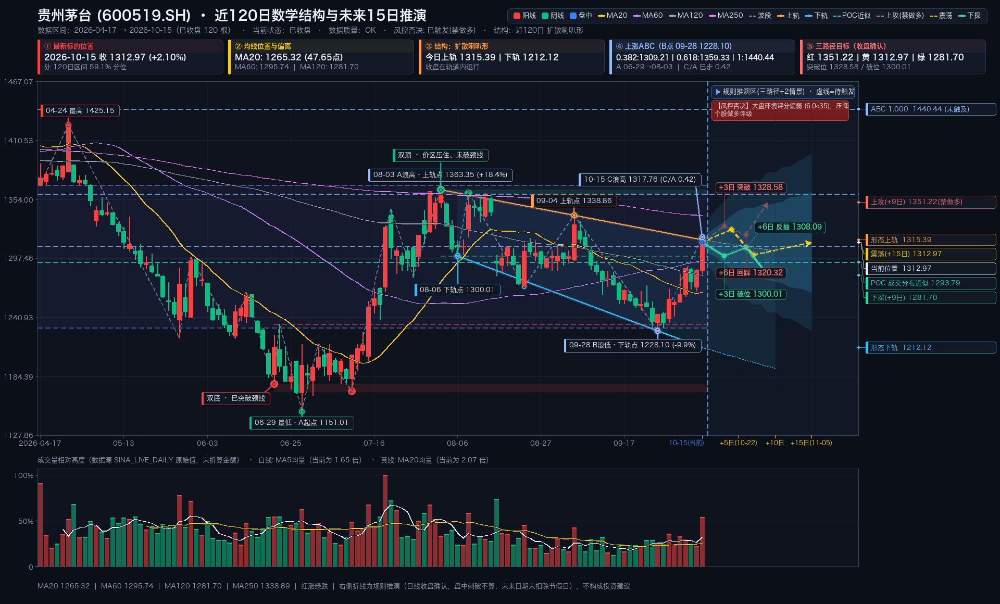
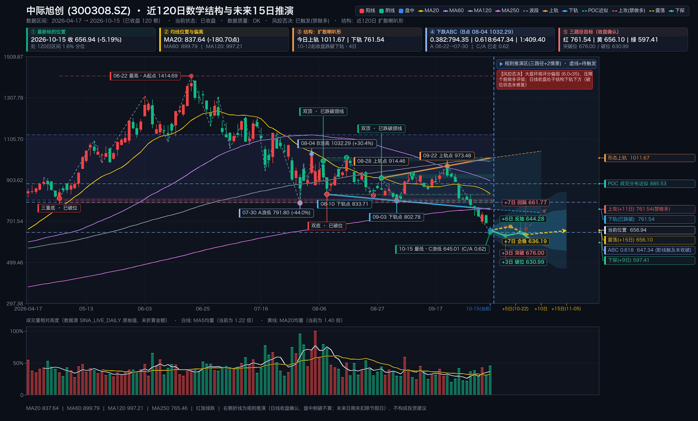
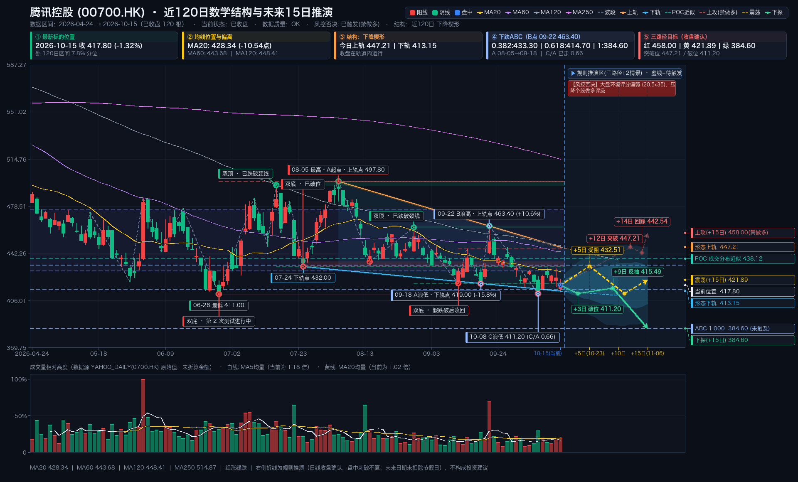
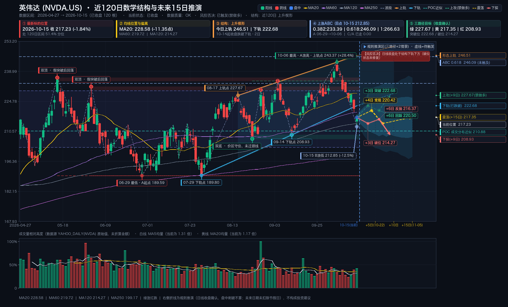

# 示例：真实行情生成的完整产物

本目录的全部文件都由技能脚本基于**真实行情**生成，没有任何手工修改或合成数据：`600519.SH`、`00700.HK`、`NVDA.US` 用仓库内录制的行情（`tests/fixtures/recorded/`）回放，`300308.SZ` 不在录制范围内，于 2026-10-26 联网取新浪日线生成；报告与 JSON 里的文件路径本身就是相对路径，未做改写。示例中的数字只用于说明输出格式，不代表当前行情，也不构成投资建议。

- 多次测试价区：`600519.SH`、`00700.HK`、`NVDA.US` 用录制行情、`300308.SZ` 联网，均按 `--as-of 2026-10-15` 重新生成。相对上一版只新增结果 JSON 的 `structure.tested_zones`（及其价位进入 `quotable_prices.prices`）、报告第 5 节"多次测试价区"小节、看板"多次测试价区"图层与结构图的价区横带；茅台 `*_backtest.json` 的因果审计新增 `tested_zones` 项。腾讯与中际旭创的 `result.json` 超出 80 KB，按裁剪顺序去掉了基准结构摘要的备选浪型计数与远端关键价位（见各自的 `quality.notes`）；中际旭创联网取到的历史长度变化，样本外覆盖率审计的数字随之略有不同。评级、否决与计划价位不变。
- 生成时间：2026-11-16（基于仓库真实录制行情 `--as-of 2026-10-15` 重新生成；相对 2026-10-25 版新增大盘层内容：结果 JSON 的 `market_context.structure` / `cycle` / `alignment` 与 `quotable_prices.benchmark`，报告第 2 节的大盘结构、周期阶段、个股与大盘三段，看板第 1 栏相应行，茅台 `*_backtest.json` 的因果审计新增 `market_layer` 与 `modules_skipped`；结构图 PNG 的内容不变，沿用原文件；港股剔除 Yahoo 占位K线并在报告"数据备注"中披露）
- `300308.SZ` 生成时间：2026-11-16（联网取新浪真实日线，`--as-of 2026-10-15`；回放模式不联网取简称，用 `--name 中际旭创` 指定；新浪当前返回的历史比 2026-10-26 少 16 根，样本外覆盖率审计的样本数与覆盖率随之略有不同，PNG 沿用原文件）
- 数据截止日（最后一根已收盘日 K 线）：**2026-10-15**
- 技能版本：6.0.0
- 数据源：A 股新浪日线 + Yahoo 除权除息事件；港股、美股 Yahoo 日线；证券简称与每手股数来自腾讯行情快照

- `reply.md` 是按报告骨架手写的标准回复（反例部分除外，已通过 `lint_response.py`）。
- 每个市场目录都有 `*_result.json`（稳定契约）与 `*_chart_data.json`（渲染数据，非稳定接口），`files` 字段均为相对路径。

| 目录 | 标的 | 文件 |
| --- | --- | --- |
| [600519.SH](600519.SH) | 贵州茅台（A 股，基准沪深300） | 报告、结果 JSON、渲染数据 JSON、回测 JSON、结构图 PNG、交互看板 HTML、[标准回复](600519.SH/reply.md) |
| [300308.SZ](300308.SZ) | 中际旭创（A 股创业板，基准创业板指） | 报告、结果 JSON、渲染数据 JSON、结构图 PNG、交互看板 HTML（未传 `--backtest`，没有回测 JSON） |
| [00700.HK](00700.HK) | 腾讯控股（港股，基准恒生指数） | 报告、结果 JSON、渲染数据 JSON、结构图 PNG、交互看板 HTML（未传 `--backtest`，没有回测 JSON） |
| [NVDA.US](NVDA.US) | 英伟达（美股，基准 SPY） | 报告、结果 JSON、渲染数据 JSON、结构图 PNG、交互看板 HTML（未传 `--backtest`，没有回测 JSON） |

## 三市场真实行情图例预览

### 1. 贵州茅台（`600519.SH` · A股红涨绿跌）

- 完整中文报告：[600519.SH_report.md](600519.SH/600519.SH_report.md)
- Agent 标准回复示范（含正例与反例）：[reply.md](600519.SH/reply.md)



### 2. 中际旭创（`300308.SZ` · A股创业板红涨绿跌）

- 完整中文报告：[300308.SZ_report.md](300308.SZ/300308.SZ_report.md)



### 3. 腾讯控股（`00700.HK` · 港股红涨绿跌）

- 完整中文报告：[00700.HK_report.md](00700.HK/00700.HK_report.md)



### 4. 英伟达（`NVDA.US` · 美股绿涨红跌）

- 完整中文报告：[NVDA.US_report.md](NVDA.US/NVDA.US_report.md)



## 生成命令

`600519.SH`、`00700.HK`、`NVDA.US` 是用 `tests/fixtures/recorded/` 的录制行情回放同一条流水线（`run_pipeline`，`as_of` 为 2026-10-15）生成的，`300308.SZ` 直接用下面第二条命令联网生成。下面的命令在仓库根目录执行，会联网取行情，产物写入 `kline-structure-chart/artifacts/examples/`；联网取到的行情可能比示例新，数字会不同：

```bash
uv run --directory kline-structure-chart python scripts/analyze_and_forecast.py --market CN --symbol 600519.SH --asset-type equity --account-equity 500000 --as-of 2026-10-15 --output-dir artifacts/examples --backtest
```

```bash
uv run --directory kline-structure-chart python scripts/analyze_and_forecast.py --market CN --symbol 300308.SZ --name 中际旭创 --asset-type equity --account-equity 500000 --as-of 2026-10-15 --output-dir artifacts/examples
```

```bash
uv run --directory kline-structure-chart python scripts/analyze_and_forecast.py --market HK --symbol 00700.HK --asset-type equity --account-equity 500000 --as-of 2026-10-15 --output-dir artifacts/examples
```

```bash
uv run --directory kline-structure-chart python scripts/analyze_and_forecast.py --market US --symbol NVDA.US --asset-type equity --account-equity 100000 --as-of 2026-10-15 --output-dir artifacts/examples
```

重新生成后数字会随行情变化。更新示例时请同时修改本文件的截止日，以及 `kline-structure-chart/SKILL.md` "回复示例"一节引用的数字。
